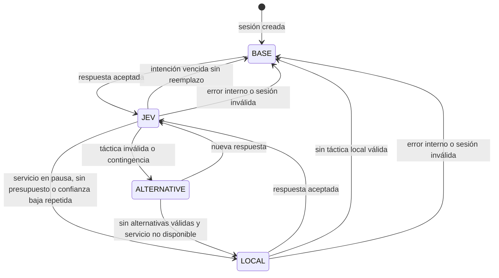

# 01. Modelo de dominio mínimo

> **Documento normativo de la 0.0.1.** Define los únicos tipos de `domain` y el estado mínimo de `engine`. Un módulo que necesite un tipo nuevo lo añade aquí primero, con su motivo. Reglas: [00-Arquitectura-y-reglas.md](00-Arquitectura-y-reglas.md). Índice: [README.md](README.md).
>
> **Revisión 2 (2026-09-29):** integra las propuestas de M02, M04, M05, M06, M07, M08, M09, M10, M11 y M12 (sección 10).
>
> **Revisión 3 (2026-09-29):** `CaptureContext` gana el mundo del encuentro, los objetivos inalcanzables conocidos y el receptor de `MobSighting`; `engine` gana `EncounterCapture` y `ContextEvents` (M07, sección 10).
>
> **Revisión 4 (2026-09-29):** `MobProbe` gana `worldId`; `engine` gana `InFlightRegistry`, `ResultIntake`, `SessionUpkeep` y `ExecutionSteps` (M09, sección 10).
>
> **Revisión 5 (2026-09-29):** `CoordinationPolicy.limitRetreats` con `Candidate` y `FallbackPolicy` con la racha configurada; `MobSession` gana `nextChoiceTick`, `progressReferenceBlocks` y `jevAnswered`; `engine` gana `TacticalExecution` y `ExecutionSettings` (M10, sección 10).
>
> **Revisión 6 (2026-09-29):** `FallbackReason` gana `RETREAT_LIMIT`; `MobSession` guarda la clave del último resultado de cast (M10, sección 10).
>
> **Revisión 7 (2026-09-29):** `ThreatPolicy` con su firma real (hecho, pérdida por objetivo inalcanzable y tope por ventana); las ventanas de amenaza de `Encounter` son por tabla de mob, participante y hecho; `engine` gana `ThreatEnrichment` y `ThreatMetrics` (M11, sección 10).
>
> **Revisión 8 (2026-09-29):** `ThreatTableState` para `inspect`; `MobSession` marca la intención de depuración; `Encounter` guarda los hechos de su última captura; `engine` gana `DebugIntents` y `Diagnostics` (con su auxiliar de paquete `StatusAssembler`), que construye `StatusReport` y `SessionReport`; `DecisionMetrics` guarda las tres últimas causas de fallo y de caída; `ResultIntake` espera comprobaciones y guarda el modelo de la última respuesta (M12, sección 10).
>
> **Revisión 9 (2026-09-29):** `MobSession` guarda el tick del último consumo de la choice y un contador de rearmes, para rearmar por reloj la skill de una intención de Jev renovada (DT-28, M13, sección 10).
>
> **Revisión 10 (2026-09-29):** `SkillPurpose` y sus enums, `SkillChoice.purpose`, `MobFacts.choicesOutOfReach`, `TargetRelation.grouped`, `PurposeRules`, `PurposeInference` y `ActiveUseConditions` (M15, sección 10).
>
> **Revisión 11 (2026-09-29):** `FitCheck`, respuestas de idoneidad, `contingencyEligible`, `QuestionDetail`, `QuestionSpec.keep`, `OptionSet`, `OptionContext`, `FitGate`, los tipos del puerto `DecisionClient` (`Preparation`, `PreparedRequest`), la reserva de presupuesto por tamaño preparado y las ventanas de resultado (M16, sección 10).
>
> **Revisión 12 (2026-09-29):** participantes como entidades (`ParticipantKind`, alias por tipo, especie), `ParticipantRules`, bandos en `assign` y `participantGone` (M17, sección 10). Con ella se aplican los defaults del re-banco de M16.10 (decisión del usuario, 2026-09-30): `QuestionDetail.DEFAULT` = `FULL`; `config.DecisionSettings.DEFAULT_MINIMUM_CONFIDENCE` = 0,45.
>
> **Revisión 13 (2026-09-29):** puertos `DuelRecording` y `DecisionTap` para `/thepredict duel` (M18, sección 10), con `SwitchableDecisionTap`; sin tipos nuevos en `domain`.
>
> **Revisión 14 (2026-09-30):** disponibilidad en tiempo real de M10 (decisión del usuario, 2026-09-30): `MobFacts.eligibleWhenReady`, `CombatActions.ready` y, en `MobSession`, el origen del último consumo de la choice y el tick en que empezó la táctica vigente (sección 10).
>
> **Revisión 15 (2026-10-06):** vocabulario `Intention`, `NativeSkillFacts`, `ReachMeasure` en `SkillPurpose`, `CastMode`, `ReadyCastOrder`, `OptionPruning`, `MobFacts.eligibleSoon` y el estado de disponibilidad de `MobSession` (M19, sección 10).
>
> **Revisión 16 (2026-10-06):** `TickSignals`, `TickLayerMode`, `Reaction`, `ReactionBand`, `ReactionScope`, `ReactionPolicy`, `CastPreference`, `MicroBehaviour`, `MicroSide`, `MicroPolicy`, `Steering`, `CandidateIntent`, `CandidateSet`, `CandidatePolicy`, `SituationSignature`, `Consideration`, `UtilityScore`, `StableRandom`, `DecisionCadence`, `IntentView.micro`, `DiscardReason.SITUATION_CHANGED`, la vigencia desde la captura de `IntentPolicy`, la enmienda de `ReadyCastOrder` y el estado por tick de `MobSession` (M20, sección 10).
>
> **Revisión 17 (2026-10-06):** `RecordLevel`, `AnswerSource`, `AnswerCacheMode`, `OutcomeStatKey`, `OutcomeStat`, `OutcomeStatMath`, `DecisionResult.Answered.source`, `OutcomeWindow.Summary.startBand` y `targetKind`, `EncounterClosed` (la causa reutiliza `SessionMetrics.EncounterEnd`; errata E21-2) y los tipos de `engine` `AggregateStore`, `AggregateCache`, `AnswerCache`, `StorageControl`, `StorageMetrics` y el carril de almacenamiento de `Inbox` (M21, sección 10). El patrón futuro de M28 (`v\d+[a-z]?:…`) no se aplica en esta revisión.
>
> **Revisión 17a (2026-10-06, P-AIConfig):** notas de ubicación a D11 y C13 (decisión del usuario del 2026-10-02). `config.ConfigLocations` nombra las rutas; no es un tipo de `domain`.
>
> **Revisión 18 (2026-10-06):** tipos de dificultad y entropía (M22, sección 10). `DifficultyMode.DEFAULT` es `AUTO`, no `BENCH`. `TargetSeconds` es opcional. La curva de reacción de entropía arranca en el suelo del preset (errata E22-4).
>
> **Revisión 19 (2026-10-07):** posturas, avisos y aguante (M23) y `FightClock.takenFrom` (M22.13). `TacticalProfile` gana `StanceSettings`, `TelegraphSettings` y `Optional<PoiseSettings>`. `Intention` v2 añade la familia `ANSWER` (`ANSWER_BLOCK`, `ANSWER_DODGE`, `ANSWER_BACK_OFF`, `ANSWER_BREAK_SIGHT`, `ANSWER_INTERRUPT`); `TellAnswer` no tiene `NONE` y la vista lleva `Optional` vacío (errata E23-6). `TelegraphEnd` termina en `FEINTED`. `Telegraph.Commitment` y `Telegraph.EntropyCommitment` son las dos claves de finta (errata E23-9). `OutcomeEvents.takenFrom` y `tracksMember` alimentan el aguante haya o no ventana.
>
> **Revisión 24 (2026-10-08):** `BehaviorPolicy`, `ContextKey` v2, `ZoneBand`, `GroupBand`, `HealthBand3`, `RewardSpec`, `CreditMath`, `ValueStatKey`, `ValueStatDelta`, `ValueEstimate`, `ShrinkageMath`, `CollapseCheck`, `CalibrationKey`, `CalibrationTarget`, `QuestionKind`, `OptionsBand`, `PlattMath`, `ExplorePolicy`, `ExploreScope`, `ExploreSettings`, `ExploreChoice`, `VoiPolicy`, `VoiDecision`, `LearnedValueConsideration` (errata E28-14 aplicada: no se llama `LearnedFactor`), `ArtifactFormat`, `ArtifactHeader`, `HeldIntent`, `LearnCause`; `Consideration.LEARNED_VALUE`; `StableRandom.SALT_EXPLORE`. `AggregateBatch.values`, `ValueStatsQuery`/`ValueStatsPage`, `ArtifactsQuery`/`ArtifactsLoaded`, `DecisionTap.credited`, `explored` y `learnEvent`. `LearnedArtifacts.State` es `NONE`, `PENDING_VERDICT`, `ACTIVE`, `UNVERIFIED_ARTIFACT`, `DEGRADED`. Errata E28-8 aplicada: `choose` no devuelve `EXPLORE_JEV_SAMPLE`. No hay `DISTILLED` ni tope 512 de artefactos. El escritor pagina `m28_value_stats` y lista `m28_artifacts`. `learn build`, `export`, `import`, `rollback` y `disable` corren en `ThePredict-Storage`.
>
> **Revisión 25 (2026-10-09):** `BehaviorPolicy.DISTILLED` al final del enum; `HeldIntent` se extiende a `DISTILLED` (la revisión 24 ya introdujo el tipo). `ChoiceStatKey`, `ChoiceStatDelta`, `AgreementStatDelta` (columnas `n`, `sum_delta`, `sum_delta_sq`; errata E29-1 aplicada). `DistilledPolicy`, `CellOrders`, `PreferenceTree`, `TacticOrder`, `DistilledChoice`, `DistillSource` (incluye `LOCAL_ORDER`; errata E29-3 aplicada), `LuceMath`, `PreferenceTreeBuilder`, `ValueOverrideRule`, `ProfileFingerprint`. `CoverageIndex`, `CoverageRule`, `OodCause` (9 valores, incluida `OOD_CELL_INFERIOR`). `FightRegime`, `EnemyBand`, `FightPhase`, `RegimeKey`, `RegimeManifest`, `RegimePartitioner`. `DistillArtifactFormat`, `RegimeManifestFormat`. `DistillMode`, `DemotionCause`. `ProfileOverlay`. `AggregateBatch.choices` y `agreements`. `DecisionTap.regimeChanged` y `distillEvent`. El muestreo de auditoría es `AuditSampler` (el plan lo llamaba `AuditCounter`; desviación anotada, no es errata). `m28_artifacts` ≤ 512. Erratas E29-1 a E29-13 aplicadas.
>
> **Revisión 23 (2026-10-07):** `PlayerMemory`, `StyleMemory`, `ProfileMemory`, `NarrativeMemory`, `PlayerMemoryCodec`, `PlayerMemoryMath`, `MemoryPolicy`, `MemoryMode`, `MemorySettings`, `LearningSettings`, `MemoryDigest` (`StyleDigest`, `FightDigest`), `CounterMemory`, `FightOutcome`, `ProfileHash`, `PatternSeed`, `MemoryFact`, `MemoryAdmissionCause`, `PartyBand`, `HintKind`, `MemoryEntryState`, `PressureCause.START_PRIOR_SUBJECT` y los tipos de `engine` `MemoryCache`, `MemoryEntry`, `MemoryPrefetchHints`, `PrefetchHint`, `MemoryDigests`, `SubjectEnemyModelSeed`, `SubjectDifficultyPriors`, `MemoryModeLoader` y `MemoryFactSelector` (M27). `TacticalProfile` gana `MemoryProfile`. `ParticipantFacts` gana `Optional<MemoryFact>`. `FightSummary` gana `targetDamageSharePermille` y `mobMaxHealth`. Errata E27-4 aplicada: se reutiliza `DifficultySection` y `PartyBand` traduce las cadenas `1`, `2_3` y `4P`. Errata G1 aplicada: `EnemyModels` no existe; el modelo por enemigo es `EnemyModel` y el registro de patrones es `PatternControl` / `PatternStep`. M27.10 no se implementa.
>
> **Revisión 22 (2026-10-07):** `EnemySignal`, `EnemyKinematics`, `EnemyAction`, `EnemyEpisode`, `EnemyTokenizer`, `StimulusWindow`, `StimulusKind`, `ActionPredictor`, `BetaEvidence`, `BetaMath`, `GammaRate`, `TimingHistogram`, `Cusum`, `EnemyPattern`, `PatternGroup`, `PatternState`, `PatternCause`, `PatternRules`, `CounterMap`, `CounterBias`, `ExploitPolicy`, `ExploitBudget`, `PatternMode`, `PatternSettings`, `EnemyPatternFact`, `EnemyProfileSummary`, `EnemyProfileMath`, `EnemyProfileCodec`, `SubjectKind`, `PatternChange`, `PatternExploit`, `Reaction.EXPLOIT_PATTERN`, `Consideration.ENEMY_PATTERN`, `TickSignals` v3, `CastPreference` (bits 27–31), `SituationSignature` v3, `PressureLevers.exploitShare` (escalera v5) y los tipos de `engine` `EnemyModel`, `EnemyModels`, `EnemyEvents`, `PatternStep`, `PatternFactFilter`, `EncounterPatternView` y `EnemyModelSeed` (M26, sección 10). `FightSummary` nace aquí con `reactionP50Ticks` y `answerFailPermille` (errata E26-2 aplicada: no existe como tipo previo y el nombre no es `answerFailRatio`). `TokenEnd.YIELDED` ya estaba (errata E25-3 aplicada).
>
> **Revisión 21 (2026-10-07):** coordinación de grupo (M25). `TacticalProfile` gana `GroupSettings`. `SkillChoice` gana `Optional<Boolean> targetsAlliesOverride`. `NativeSkillFacts` gana `targetsAllies`. `CombatFacts` gana `GroupRelations` y `GroupBrief`. `IntentView` gana `Optional<GroupRole>`, `Optional<GroupPlan>`, `tokenMask`, `squadSize` y `slotIndex` (no hay rol ni plan `NONE`; el vacío es `Optional`, precedente E23-6). `EngineSettings` y la configuración ganan `GroupCaps`. `PressureLevers` pasa a siete campos; el constructor de cinco argumentos conserva peso 2 y separación 6 (W5). `DifficultyKey` añade la sección. `MicroBehaviour.SLOT`, `Consideration.ROLE_FIT`, `DiscardReason.GROUP_EPOCH_CHANGED` y `EventType.GROUP_ASSIGNMENT` se añaden al final. `GroupFairnessReason` termina en `CAPACITY_LOWERED` (errata E25-6 aplicada). `TokenEnd` termina en `YIELDED` y no tiene `EPOCH` (errata E25-3 aplicada). El anillo de impactos es 16 por jugador (errata E25-2 aplicada). `EnemyPatternView` no gana métodos de M26 (errata E25-7 aplicada). Una sesión con ficha no es `TickTier.COLD`. No hay `MemoryDigests` ni `ladder-v5`.
>
> **Revisión 20 (2026-10-07):** contexto de zona (M24). `ZoneColumn`, `ZoneMaterialFlags`, `ZoneView`, `ZoneLayers`, `ZoneMode`, `ZoneSettings`, `HazardPush`, `ZoneQueryRunner`, `ZoneQueryKind`, `ZonePick`, `ZoneMiss`, `PushDanger`, `Feasibility`, `ZoneFact`, `ZoneFactPolicy`, `DisplacementKind`, `DisplacementOrigin`, `PushPolicy`, `PushDecision`, `ZoneGuardKind` (incluye `MICRO_NO_SAFE_DEST`, errata E24-2), `ZoneBuildReason`, `ZoneBuildSummary`, `HazardRecord`, `TickSignals` v2, `SituationSignature` v2 (bits 17–18), `MicroBehaviour.REPOSITION`, `Reaction.EDGE_DANGER` y `HAZARD_PUSH`, `PruneReason.CORNERED_RETREAT`, `Consideration.TERRAIN` y el bit 26 de `CastPreference`. En `engine`: `ZoneControl`, el paso `zone`, `PushLedger` y los contadores paralelos de zona. `TacticalProfile` gana `ZoneSettings`. `SkillChoice` gana `Optional<DisplacementKind>`. `NativeSkillFacts` gana el desplazamiento leído. `MobFacts` gana `Set<ZoneFact>`. `IntentView` gana `zoneFacts` y `pushDanger`.

## 1. Criterios

- Solo se modela lo que una regla pura necesita para decidir. Lo que solo necesita un adapter (objetos `Skill` de MythicMobs, entidades Bukkit, JSON) no entra en `domain`.
- Datos inmutables como records; conjuntos cerrados como enums; resultados con variantes como `sealed interface`.
- Los valores numéricos de Minecraft se convierten en bandas y señales antes de entrar en `domain`: las reglas y Jev trabajan con significado, no con coordenadas.
- Las condiciones nativas de MythicMobs se guardan como texto opaco; las evalúa el adapter y `domain` recibe solo qué contextos están activos.
- Cada resultado que puede fallar o descartarse lleva su causa enumerada (A7).

Las firmas siguientes son contratos; las validaciones indicadas van en el constructor canónico.

## 2. Identidad

```java
record MobKey(UUID entityId, int generation) {}          // generation >= 0
record EncounterId(long value) {}                         // value > 0
record TacticId(String value) {}                          // [a-z][a-z0-9_]{2,39}; llega al modelo
record ChoiceId(String value) {}                          // [a-z][a-z0-9_]{0,39}; local al perfil
record ContextId(String value) {}                         // [a-z][a-z0-9_]{0,39}; local al perfil
enum ParticipantKind { PLAYER, ENTITY }                   // M17
record ParticipantAlias(ParticipantKind kind, int index) {} // index >= 1; texto "player_" o "entity_" + index (M17);
                                                          // constructor de 1 argumento = PLAYER (W5)
record QuestionKey(String value) {}                       // q[0-9]{1,4}; opaca para el modelo
```

- `MobKey` distingue encarnaciones de una misma entidad: una respuesta para `generation = 3` nunca se aplica a `generation = 4`.
- `ParticipantAlias` (M17): un participante es cualquier entidad viva que admite la política de participantes; los jugadores son un tipo más. Los prefijos son `PLAYER_PREFIX = "player_"` y `ENTITY_PREFIX = "entity_"`, con un contador por tipo en cada encuentro (`player_1` y `entity_1` pueden coexistir).
- `TacticId` reserva `none` (sin táctica, usado por `IntentView.ABSENT` e `IntentView.base`) y el prefijo `debug_` (intenciones del comando de depuración de M01). El perfil no puede declararlos.

## 3. Perfil táctico

```java
record TacticalProfile(String id, String mythicMobId, String objective,
                       Map<TacticId, Tactic> tactics, Map<ChoiceId, SkillChoice> choices,
                       List<ContextRule> contexts, MovementSettings movement,
                       HealthThresholds health, ThreatWeights threat,
                       List<String> baseAi, DecisionTiming timing,
                       ParticipantRules participants) {}              // M17; constructor de 11 argumentos: ParticipantRules.DEFAULT (W5)

record PatternProfile(Optional<PatternMode> mode, BenchPolicy againstEntities, boolean facts) {} // M26; vacío = hereda el global

record ParticipantRules(Set<String> playerGameModes, List<String> entityAllow,
                        List<String> entityDeny, boolean perceiveNonTargets) {} // M17; texto opaco, domain no lo interpreta

record DifficultySettings(Optional<DifficultyMode> mode, OptionalInt targetSeconds, OptionalDouble tolerance,
                          int minRung, int maxRung, OptionalInt startRung, boolean inFight, boolean learn,
                          NativeLevelMode nativeLevel) {}                 // M22; minRung <= maxRung; targetSeconds opcional, 5–3600 si está (erratas E22-2 y E22-3 aplicadas). El preset y la entropía no viven aquí: el mundo y la variable los resuelven.

record Tactic(TacticId id, Movement movement, Optional<ChoiceId> choice,
              Optional<String> description, int priority) {}           // priority 0..100

enum Movement { APPROACH, KEEP_DISTANCE, RETREAT, HOLD, FLANK, NONE }

record SkillChoice(ChoiceId id, ChoiceKind kind, Optional<String> mythicSkillId,
                   Set<PredictValue> values, boolean requiresTarget,
                   int extraCooldownTicks,                               // extraCooldownTicks >= 0; compatibilidad
                   Optional<SkillPurpose> purpose,                       // vacío = sin tipo (M19); campo y retorno, nunca parámetro (C4)
                   NativeSkillFacts nativeFacts) {}                      // M19.3; NONE antes de vincular y en VANILLA_MELEE
                                                                         // fábricas typed, untyped y vanillaMelee; constructores de 7 y 6 argumentos (W5)

enum ChoiceKind { MYTHIC_SKILL, VANILLA_MELEE }

enum PredictValue { MELEE_ATTACK, RANGED_ATTACK, DEFENSE, SINGLE_TARGET, AREA_TARGET,
                    LOW_DAMAGE, MEDIUM_DAMAGE, HIGH_DAMAGE, APPLIES_POISON, APPLIES_BAD_OMEN,
                    HEALS_CASTER, SUMMONS_ALLY, IGNORES_SHIELD }

enum SkillRole { DAMAGE, CONTROL, GAP_CLOSE, ESCAPE, DEFENSE, SUSTAIN, BUFF, DEBUFF,
                 SUMMON, ZONE, INTERRUPT, FINISHER, OPENER }
enum Delivery { MELEE, PROJECTILE, HITSCAN, AREA_AROUND_SELF, AREA_AT_TARGET, CONE, SELF }
enum CooldownClass { UNKNOWN, NONE, SHORT, MEDIUM, LONG }
enum DamageTier { NONE, UNRATED, LOW, MEDIUM, HIGH }
enum UseCondition { TARGET_LOW_HEALTH, TARGET_SHIELDING, TARGET_FLEEING, SELF_LOW_HEALTH,
                    ENEMIES_GROUPED, TARGET_AT_RANGE, TARGET_IN_MELEE }
enum SkillRisk { LEAVES_CASTER_EXPOSED, ROOTS_CASTER, SELF_DAMAGE, NEEDS_LINE_OF_SIGHT,
                 SLOW_PROJECTILE, BLOCKED_BY_SHIELD, HITS_ALLIES }
enum PurposeOrigin { DECLARED, INFERRED, SKILL }                         // DECLARED: Purpose del perfil (anulación del admin).
                                                                         // INFERRED: solo VANILLA_MELEE y registros antiguos (decisión 5; W5).
                                                                         // SKILL: línea Intention de la skill (M19). Precedencia DECLARED > SKILL, por propósito entero.

record SkillPurpose(SkillRole primary, Set<SkillRole> roles, Delivery delivery,
                    OptionalDouble reachBlocks, OptionalDouble radiusBlocks, int windUpTicks,
                    CooldownClass cooldown, DamageTier damage, Set<UseCondition> bestWhen,
                    Set<SkillRisk> risks, boolean ignoresShield, PurposeOrigin origin,
                    ReachMeasure reachMeasure) {}                        // M19.3; constructor de 12 argumentos: defaultFor (W5)

enum ReachMeasure { BOX_GAP, CENTRES, POSITIONS_STRICT, POSITIONS }      // cuatro valores (errata E19-1 DP1); Jev no ve la medida

enum CastMode { ANY_READY, INTENT_ONLY }                                 // DEFAULT = ANY_READY, único lugar (C13)
enum CastThread { SAME_TICK, MYTHIC_DEFAULT }                            // DEFAULT = SAME_TICK; global, no es clave de perfil
enum UntypedCastMode { TACTIC_ONLY, ANY_READY }                          // DEFAULT = TACTIC_ONLY (decisión del usuario, 2026-10-01)

record ContextRule(ContextId id, List<String> nativeConditions, int priority,
                   Set<TacticId> allowedTactics, Optional<TacticId> directTactic) {}

record MovementSettings(double meleeReachBlocks, double bandInnerBlocks, double bandOuterBlocks,
                        double rangedReachBlocks, double retreatDistanceBlocks,
                        double retreatSpeed, double approachSpeed,
                        OptionalDouble arenaRadiusBlocks) {}

record HealthThresholds(double criticalRatio, double woundedRatio) {}

record ThreatWeights(double assistsOthers, double rangedHarass, double blockedHits,
                     double unreachableDecayPerSecond, double maxPerWindow) {}

record DecisionTiming(int heartbeatTicks, int minimumDecisionIntervalTicks,
                      int maximumIntentTicks, double minimumConfidence,
                      double switchMargin, int contingenciesPerMob,
                      QuestionDetail questionDetail, boolean fitChecks,
                      CastMode castMode, int readyHorizonTicks,            // 0..100; el planificador local no lo lee
                      UntypedCastMode untypedCast) {}                      // copia del global decision.untypedCast (C13)
                                                                         // constructor de 10 argumentos: UntypedCastMode.DEFAULT (W5)
                                                                         // constructor de 8 argumentos: INTENT_ONLY y horizonte 0; solo pruebas (W5)
                                                                         // no gana minRecastTicks (decisión 8)

enum QuestionDetail { COMPACT, STANDARD, FULL }                              // DEFAULT = FULL desde M16.10 (antes COMPACT), único lugar del default (C13)
```

Vocabulario `Intention` v1 (M19.1), en `domain` y solo `java.*`:

```java
enum IntentionToken { /* 38 constantes, orden de la tabla de la guía del autor */
    Family family();    // ROLE, DELIVERY, DAMAGE, BEST_WHEN, RISK, SHIELD
    int since();        // todas: 1
}
final class IntentionVocabulary {
    static final int VERSION = 1;
    static final int MAX_TOKENS = 16;          // en bruto; una línea válida tiene como mucho 14
    static final int MAX_CHARS = 400;
    static final Map<String, IntentionToken> ALIASES = Map.of();   // vacío en v1
    static IntentionParse parse(List<String> raw);                 // nunca lanza
    static IntentionDraft draftOf(SkillPurpose purpose);
    static List<IntentionToken> render(IntentionDraft draft);      // papeles (primario primero), entrega, daño,
                                                                    // WHEN_ y RISK_ en orden de enum, IGNORES_SHIELD
    static String text(List<IntentionToken> tokens);
}
sealed interface IntentionParse {
    record Parsed(IntentionDraft draft, List<IntentionIssue> warnings) implements IntentionParse {}
    record Invalid(List<IntentionIssue> errors, List<IntentionIssue> warnings) implements IntentionParse {}
    record Absent() implements IntentionParse {}
}
record IntentionDraft(SkillRole primary, Set<SkillRole> roles, Delivery delivery,
                      Optional<DamageTier> declaredDamage, Set<UseCondition> bestWhen,
                      Set<SkillRisk> risks, boolean ignoresShield) {}
record IntentionIssue(IntentionIssueKind kind, int index, String token) {}
enum IntentionIssueKind { UNKNOWN_TOKEN, REPEATED_TOKEN, NO_ROLE, TOO_MANY_ROLES, NO_DELIVERY,
                          MORE_THAN_ONE_DELIVERY, MORE_THAN_ONE_DAMAGE, TOO_MANY_BEST_WHEN,
                          TOO_MANY_RISKS, SHIELD_CONTRADICTION, TOO_LONG, FUTURE_TOKEN, ALIAS_USED }
record NativeSkillFacts(OptionalDouble cooldownSeconds, int charges, String cooldownMode,
                        OptionalInt windUpTicks, OptionalDouble targetWithinBlocks,
                        OptionalDouble radiusBlocks, OptionalDouble coneRangeBlocks,
                        boolean damageIgnoresShield, boolean damageIgnoresInvulnerability,
                        boolean requiresLineOfSight, boolean hasDamagingMechanic) {}
```

`NativeSkillFacts.NONE` es `charges = 1` y `SEQUENTIAL`. Distancias finitas en `(0, 64]`, radio en `(0, 16]`, preparación en `[0, 100]`, cooldown finito y `>= 0`, `charges >= 1`, `cooldownMode` no vacío. `ReachMeasure.defaultFor`: `MELEE` y `CONE` → `BOX_GAP`; `AREA_AROUND_SELF` → `POSITIONS_STRICT`; el resto → `CENTRES`. `POSITIONS` solo mide un `CONE` (el `range` de la skill). `POSITIONS` y `POSITIONS_STRICT` leen la distancia entre posiciones (`betweenPositions()`). `DECLARED` usa `defaultFor`. Solo `SKILL` puede usar `POSITIONS_STRICT` fuera de `AREA_AROUND_SELF`, o `POSITIONS` en un `CONE`. `semanticallyEqual` ignora la medida y el origen. `PurposeRules.UNTYPED_DEFAULTS` es sin papeles, daño `UNRATED`, `damaging = true` y alcance no comprobado (errata E19-1 DP8: dos niveles más el caso sin tipo; no se copia aquí la clase de peligro de módulos posteriores). `PurposeRules.DEFAULT_AREA_RADIUS_BLOCKS = 3.0` (movida desde `PurposeInference`, retirada). `DecisionTiming` no gana `minRecastTicks`. Consumidores de la línea, además de los que nombra el plan de M19: `QuestionBuilder` y `MythicProfileBinder` (errata E19-1 DP9). `IGNORES_SHIELD` de `PredictValues` no se copia a un propósito `DECLARED` (errata E19-1 DP5).

Patrones (M26). `TacticalProfile` gana `PatternProfile patterns`. El constructor anterior delega con `PatternProfile.DEFAULT` (W5).

Posturas, avisos y aguante (M23). `Tactic` gana `Optional<BaseStance> stance` (el constructor sin postura sigue, W5). `SkillChoice` gana `ChoiceTelegraph` (`Optional<DangerClass> danger`, `Optional<TellAnswer> answer`, `OptionalInt recoveryTicks`; sin declarar no hay aviso propio). `TacticalProfile` gana `StanceSettings stances` (`StanceNativeMode nativeMode`, default `HYBRID`; `minDwellTicks` 4–200; `hysteresisCycles` 1–7; `describe` default `false`), `TelegraphSettings telegraph` (dos claves de finta, errata E23-9 aplicada: `commitmentPercent` 50–100 default 100 y `entropyCommitmentPercent` 0–50 default 25; `ShortWindUp` default `LEAD`) y `Optional<PoiseSettings> poise` (solo si el autor declara la sección; no hay `poise.*` global). `ZoneSettings` de M24 sigue en el constructor canónico. `NativeSkillFacts` gana `OptionalInt recoveryTicks`, `int cueSignature`, `int cueChannels` y `HitShape hitShape`. Vocabulario `Intention` v2: `IntentionVocabulary.VERSION` es 2; familia `ANSWER` (`ANSWER_BLOCK`, `ANSWER_DODGE`, `ANSWER_BACK_OFF`, `ANSWER_BREAK_SIGHT`, `ANSWER_INTERRUPT`); `IntentionIssueKind` gana `MORE_THAN_ONE_ANSWER`. `TellAnswer` no tiene `NONE` (errata E23-6 aplicada). `TelegraphEnd` termina en `FEINTED`.

```java
enum BaseStance { NEUTRAL, PRESSING, GUARDED, EVASIVE }
enum ActionStance { NONE, WINDUP, RECOVERY, STAGGERED }
enum CombatStance { NEUTRAL, PRESSING, GUARDED, EVASIVE, WINDUP, RECOVERY, STAGGERED }
enum StanceNativeMode { HYBRID, READ, WRITE, OFF }          // DEFAULT = HYBRID
enum DangerClass { NONE, LIGHT, MEDIUM, HEAVY, SEVERE }
enum TellAnswer { BLOCK, DODGE, BACK_OFF, BREAK_SIGHT, INTERRUPT }
enum ShortWindUp { LEAD, IMMEDIATE }                        // DEFAULT = LEAD
enum TelegraphEnd { RELEASED, WHIFFED, INTERRUPTED, CASTER_GONE, TARGET_LOST, REJECTED, SESSION_INVALID, FEINTED }
enum HitShape { SINGLE_TARGET, AREA, CONE, PROJECTILE, UNKNOWN }
record ChoiceTelegraph(Optional<DangerClass> danger, Optional<TellAnswer> answer, OptionalInt recoveryTicks) {}
record StanceSettings(StanceNativeMode nativeMode, int minDwellTicks, int hysteresisCycles,
                      Map<BaseStance, List<SkillRole>> casts, Map<Movement, BaseStance> byMovement,
                      List<String> enragedContexts, List<String> enragedNative, boolean describe) {}
record PoiseSettings(double max, int regenDelayTicks, double regenPerSecond, double windUpMultiplier,
                     double blockedHitPoise, int staggerTicks, int immunityTicks) {}
```

Invariantes principales:

| Tipo | Invariante |
|---|---|
| `TacticalProfile` | Al menos una táctica; cada `Tactic.choice` existe en `choices`; cada `ContextRule` referencia tácticas existentes; `objective` no vacío. Desde M23, `stances`, `telegraph` y `poise` son las secciones que gobiernan modo, mínimos, fintas y aguante; los roles de `casts` existen en el vocabulario y `enragedContexts` nombra contextos del perfil. |
| `Tactic` | `FLANK` requiere una choice; `NONE` es la única opción de movimiento para especies con `Brain`. |
| `SkillChoice` | `MYTHIC_SKILL` exige `mythicSkillId`; `VANILLA_MELEE` exige que esté vacío y usa `LivingEntity#attack` (M10). `VANILLA_MELEE` exige además un propósito presente con `delivery == MELEE` y `DAMAGE` en `roles` (origen `INFERRED`, el de `PurposeRules.vanillaMelee`; errata E19-1 DP2). Una choice `MYTHIC_SKILL` puede ir sin propósito (sin tipo): solo entonces `purpose` está vacío. Nada se infiere de `PredictValues`. |
| `SkillPurpose` | `roles` contiene `primary`, de 1 a 3; `reachBlocks` finito en `(0, 64]`, presente en `MELEE` y `CONE` y ausente en `SELF` y `AREA_AROUND_SELF`; `radiusBlocks` finito en `(0, 16]`, presente exactamente en `AREA_AROUND_SELF` y `AREA_AT_TARGET`; `windUpTicks` en `[0, 100]`; `damage != NONE` si `roles` tiene `DAMAGE` o `FINISHER`; como mucho 4 `bestWhen` y 4 `risks`; `ignoresShield` excluye el riesgo `BLOCKED_BY_SHIELD`. `AREA_AROUND_SELF` exige `POSITIONS_STRICT`. Un origen distinto de `SKILL` usa `ReachMeasure.defaultFor` de su entrega. `POSITIONS` solo mide un `CONE`. `authored()` es verdadero para `DECLARED` y `SKILL`: solo entonces aplican el lint, la exclusión por alcance, la revalidación por entrega y el desempate local de M15. `semanticallyEqual` no compara la medida ni el origen. |
| `MovementSettings` | `0 < meleeReachBlocks < bandInnerBlocks < bandOuterBlocks <= rangedReachBlocks`; velocidades positivas y finitas; `arenaRadiusBlocks > bandOuterBlocks` si existe. Defaults: 2,5; 5; 9; 16; 10; 1,2; 1,15 (constante `MovementSettings.DEFAULTS`, de la que `config.ProfileDefaults.standard()` toma los suyos). |
| `HealthThresholds` | `0 < criticalRatio < woundedRatio < 1`. Defaults: 0,3 y 0,6. Valen para el mob y para los jugadores. |
| `DecisionTiming` | `heartbeatTicks >= minimumDecisionIntervalTicks`; `0 <= minimumConfidence < 1`; `0 <= switchMargin < 1`; `contingenciesPerMob` entre 0 y 2; `questionDetail`, `castMode` y `untypedCast` no nulos; `readyHorizonTicks` de 0 a 100 (`MAX_READY_HORIZON_TICKS`). Desde M20 también `tickLayer` (`TickLayerMode`, `DEFAULT = REACTIONS`), `reactions` (`ReactionScope`, default `ALL`), `reactionsAhead` (`ReactionBands.DEFAULT_AHEAD` = `SURVIVAL` y `OPPORTUNITY`; el constructor de compatibilidad de M19 lo deja vacío, errata E20-3), `reactionDelayTicks` de 0 a 20, `cadence` (`DecisionCadence.DEFAULT = REACTIVE`; `STANDARD` es el modo ahorro), `reactiveIntervalTicks` de 4 a 20 e `intentHorizonTicks` (el record admite 1 hasta `maximumIntentTicks`; la carga del perfil exige 4–200 y no mayor que la vigencia máxima, y con `STANDARD` avisa y lo ignora). `config` resuelve `decision.questionDetail`, `decision.fitChecks`, `decision.castMode`, `decision.readyHorizonTicks` y `decision.untypedCast` como default de cada perfil al cargar: el motor y el codificador solo leen estos valores (C13). `Timing.CastMode: intent_only` es una exclusión voluntaria del perfil y gana al global (errata G11); no es una regla de modo menor. `Timing.TickLayer` por encima del global avisa con archivo y ruta y usa el menor (errata E20-8). `sendsFitChecks()` es `fitChecks && questionDetail == FULL`: la idoneidad solo se envía con `FULL`. El constructor de 8 argumentos fija `INTENT_ONLY` y horizonte 0 y solo lo usan pruebas; producción pasa el constructor completo con `CastMode.DEFAULT` (`ANY_READY`). El constructor corto de M19 fija `CASTS`, `ALL`, retraso 0, `STANDARD`, intervalo 6, horizonte = `maximumIntentTicks` y `reactionsAhead` vacío, y solo lo usan pruebas, `ScenarioFacts` y `DuelMeasure` (W5). No hay `minRecastTicks`. |
| `ContextRule` | `nativeConditions` son líneas de MythicMobs; si hay `directTactic`, está en `allowedTactics`. |
| `ParticipantRules` | `playerGameModes` ⊆ {`SURVIVAL`, `ADVENTURE`, `CREATIVE`, `SPECTATOR`}; como mucho 16 selectores por lista, cada uno texto no vacío (la sintaxis la valida `config` y los valores los resuelve el adapter al vincular, como las condiciones nativas). `DEFAULT` = ({`SURVIVAL`, `ADVENTURE`}, [], [], `false`), único lugar de esos defaults (C13): reproduce la 0.0.1. `config` resuelve las reglas del perfil al cargar: sin sección `Participants`, los modos globales y `perceiveNonTargets` global; con ella, los modos del perfil (⊆ globales) y sus listas propias. `admitsEntities()` es verdadero con algún selector en `entityAllow`. |

`baseAi` son líneas con sintaxis de `AIGoalSelectors`; `domain` no las interpreta.

## 4. Hechos de combate

Nota de M29 (revisión 25): `AggregateBatch` gana `choices` (`List<ChoiceStatDelta>`) y `agreements` (`List<AgreementStatDelta>`). `ChoiceStatsQuery` y `AgreementStatsQuery` paginan a lo sumo 2 000 filas. `DecisionTap` gana `regimeChanged` y `distillEvent` con implementación `default`.

```java
record CombatFacts(EncounterId encounter, long captureTick, long captureNanos,
                   List<MobFacts> mobs, List<ParticipantFacts> participants,
                   List<EncounterEvent> recentEvents, int combatSeconds) {}

record MobFacts(MobKey mob, HealthBand health, Optional<TargetRelation> target,
                Set<ContextId> activeContexts, Set<TacticId> eligibleTactics, Set<MobCue> cues,
                Set<ChoiceId> choicesOutOfReach,         // vacío sin objetivo; solo propósitos del autor (M15)
                Map<Situation, Set<TacticId>> contingencyEligible,     // M16.6; constructor de 7 argumentos: mapa vacío (W5)
                Set<TacticId> eligibleWhenReady,     // M10, revisión 14; constructores de 7 y 8 argumentos: eligibleTactics (W5)
                Set<TacticId> eligibleSoon) {}       // M19; listas en ≤ readyHorizonTicks; constructores anteriores: eligibleTactics (W5)

record TargetRelation(ParticipantAlias target, DistanceBand distance, Trend trend,
                      boolean reachable, boolean visible, boolean outsideTargetReach,
                      boolean flankable, boolean grouped) {}  // grouped: otro participante percibido a <= 4 bloques

record ParticipantFacts(ParticipantAlias alias, HealthBand health, ArmorBand armor,
                        Set<TargetCue> cues, int threatRank,      // threatRank 1 = mayor amenaza
                        Optional<String> species) {}              // M17; solo con ENTITY, [a-z0-9_]{1,40}; constructor de 5 argumentos: vacía (W5)

record EncounterEvent(long tick, EventType type, Optional<ParticipantAlias> participant,
                      Optional<MobKey> mob) {}

record CaptureContext(BiFunction<UUID, ParticipantKind, ParticipantAlias> aliasFor, Set<MobKey> allowPathfinding,
                      Map<MobKey, Double> previousTargetDistanceBlocks,
                      List<EncounterEvent> recentEvents, UUID worldId, Set<MobKey> lastUnreachable,
                      Consumer<MobSighting> sightings) {}

record MobSighting(MobKey mob, UUID worldId, Optional<UUID> targetId,
                   OptionalDouble targetDistanceBlocks) {}     // distancia presente solo con objetivo

enum HealthBand { CRITICAL, WOUNDED, HEALTHY }
enum DistanceBand { MELEE, RANGED, BEYOND }
enum Trend { CLOSING, STEADY, BACKING_AWAY, STRAFING }
enum ArmorBand { LIGHT, MEDIUM, HEAVY }
enum MobCue { IN_WATER, IN_LAVA, CLIMBING, NO_LINE_OF_SIGHT }
enum TargetCue { RAISING_SHIELD, BLOCKING, SHIELD_DISABLED, ATTACK_RECHARGING, DRAWING_BOW,
                 BOW_FULLY_DRAWN, CROSSBOW_LOADED, CONSUMING, HOLDS_TOTEM,
                 PEARL_ON_COOLDOWN, GLIDING, LONG_REACH_WEAPON, MACE_DIVE, INVISIBLE }
enum EventType { MELEE_HIT, MELEE_BLOCKED, RANGED_HIT_ON_MOB, RANGED_MISS, TOTEM_USED,
                 PEARL_THROWN, POTION_CONSUMED, SHIELD_DISABLED, ALLY_ASSISTED }
```

- Solo `adapter.server.context` construye estos records, y solo con datos que el mob podría percibir ([plan §6](../Plan-Jev-y-combate-tactico.md#percepción-natural)). `recentEvents` tiene tamaño fijo por encuentro.
- `CaptureContext` lo arma `engine` para cada captura. `aliasFor` es `ParticipantAliases::aliasFor`: asigna alias nuevos en el hilo del servidor, así que el adapter no guarda estado (A3). `allowPathfinding` limita qué mobs pueden calcular una ruta en esa captura. `previousTargetDistanceBlocks` permite calcular `Trend`. `recentEvents` es una copia del historial del encuentro para `CombatFacts`. `worldId` es el mundo del encuentro: un miembro en otro mundo queda fuera de los hechos. `lastUnreachable` son los mobs cuyo último objetivo conocido era inalcanzable, el "último valor conocido por `engine`" de M07.4. `sightings` recibe un `MobSighting` por miembro leído: `engine` guarda con él el objetivo y su distancia (`MobSession.recordTarget`) y llama a `changedWorld` si el mundo no es el del encuentro. `MobSighting` nunca entra en `CombatFacts`, así que la UUID del objetivo no llega a Jev (I6).
- `DistanceBand` usa `meleeReachBlocks` y `rangedReachBlocks`; `HealthBand` usa `HealthThresholds` sobre salud más absorción.
- Participantes como entidades (M17): "participante" es cualquier entidad viva admitida por la política de participantes del perfil (por defecto, solo jugadores en `SURVIVAL` o `ADVENTURE`), y la percepción natural vale para todos los tipos. `ParticipantFacts.species` es la clave de `EntityType` sin espacio de nombres (`zombie`, `wither_skeleton`): presente exactamente cuando el alias es `entity_N` y vacía con `player_N` (invariante del constructor, que `CombatFacts` hereda). `CaptureContext.aliasFor` recibe el tipo del participante; si un UUID ya tiene alias, devuelve el suyo. Nunca viajan a Jev nombres, `Display`, ID de MythicMobs, facción ni UUID (I6); la facción y el equipo solo deciden bandos en el adapter (I13).
- `MobFacts.eligibleWhenReady` (M10, revisión 14): las tácticas que serían elegibles con todas sus skills fuera de cooldown nativo; el resto de la elegibilidad (contextos, objetivo, movimientos, alcance de M15 y M17) es la de la captura. Contiene `eligibleTactics` (el constructor lo exige: `IllegalArgumentException` si no, C2). Lo calcula la captura con el mismo `ReadyTactics.eligible`, sin rutas ni medidas nuevas. Nunca viaja a Jev (plan §6: Jev solo recibe `eligibleTactics`); `engine` lo cruza en el ciclo reactivo con `CombatActions.ready` para saber qué choice está lista ahora. Los constructores de 7 y 8 argumentos lo igualan a `eligibleTactics` (W5).
- `MobFacts.eligibleSoon` (M19): las tácticas elegibles con las choices listas en como mucho `readyHorizonTicks`. Invariante: `eligibleTactics ⊆ eligibleSoon ⊆ eligibleWhenReady`. Solo lo lee `EncounterQuestions`; ni `FallbackStep` ni `LocalPlanner`. Con horizonte 0 coincide con `eligibleTactics` y, con la poda apagada, el orden de la pregunta es el de hoy (errata E19-1 DP6). Los constructores anteriores lo igualan a `eligibleTactics` (W5). Nunca viaja a Jev.
- `ParticipantFacts` (M26) gana `Set<EnemyPattern> patterns`, vacío por defecto. El constructor anterior sigue (W5).
- `FightSummary` (M22.8) gana en M26 `int reactionP50Ticks` e `int answerFailPermille` (−1 sin datos; errata E26-2 aplicada: no existe `answerFailRatio`). El cierre que cuenta para el lazo lento. Campos de M22: `FightEventKind kind`, ticks transcurridos, `ln` del tiempo observado y peldaño. `TARGET_DIED` usa `ln(TTK)`. `MOB_DIED` usa `ln(min(t + H / r_last, tope·T))` con `r_last` congelado en el último golpe válido. Sin golpe válido no hay resumen y se cuenta `MOB_DIED_NO_EVIDENCE`. El lazo lo aplica `SessionDifficulty.closeAs`; no es un record público aparte.
- `MobFacts.contingencyEligible` (M16.6): tácticas que serían elegibles bajo cada hipótesis de contingencia; claves solo `IF_TARGET_IN_MELEE` e `IF_OWN_HEALTH_CRITICAL` (una clave `NOW` es un error); cada conjunto ⊆ tácticas del perfil. Lo calcula la captura (`ReadyTactics.contingencyEligible`): los contextos atajo se evalúan con la hipótesis y los nativos conservan su estado real. `eligibleIn(situation)` devuelve el conjunto de la hipótesis o, si falta la clave (dobles y capturas anteriores a M16), las elegibles de ahora.

## 5. Decisión remota

```java
record DecisionRequest(EncounterId encounter, long sequence, CombatFacts facts,
                       List<QuestionSpec> questions, Map<MobKey, TacticalProfile> profiles,
                       List<FitCheck> fitChecks) {}              // M16.5; constructor de 5 argumentos: sin fitChecks (W5)

record QuestionSpec(QuestionKey key, MobKey mob, Situation situation, List<TacticId> options,
                    Optional<TacticId> keep) {}                  // M16.1; constructor de 4 argumentos: keep vacío (W5)

record FitCheck(QuestionKey key, MobKey mob, TacticId tactic) {} // M16.5

enum Situation { NOW, IF_TARGET_IN_MELEE, IF_OWN_HEALTH_CRITICAL }

sealed interface DecisionResult permits DecisionResult.Answered, DecisionResult.Failed {
    record Answered(Map<QuestionKey, Answer> answers, String effectiveModel,
                    int inputTokens, Map<QuestionKey, Double> fits)  // M16.5; constructor de 3 argumentos: sin fits (W5)
                    implements DecisionResult {}
    record Failed(FailureKind kind, Optional<Duration> retryAfter,
                  String detail) implements DecisionResult {}
}

record Answer(Map<TacticId, Double> probabilities, double confidence) {}  // probabilidades finitas, suma ≈ 1

enum FailureKind { AUTHENTICATION, MODEL_UNAVAILABLE, INVALID_REQUEST, RATE_LIMITED,
                   OVERLOADED, SERVICE_ERROR, NETWORK, TIMEOUT, INVALID_RESPONSE }

record ServiceCheck(ServiceState state, String detail) {}

enum ServiceState { UNCONFIGURED, INVALID_CONFIGURATION, CHECKING, READY,
                    PAUSED, INVALID_CREDENTIALS, INVALID_MODEL }
```

- `QuestionSpec.options` contiene solo tácticas elegibles, entre 2 y 255. Una pregunta con una sola opción no se envía: se resuelve localmente. `QuestionSpec.keep` es la táctica vigente del mob; si está, pertenece a `options` (la deduplicación y el tope de M16.1 nunca la quitan). `withOptions(sent)` copia la pregunta con las opciones enviadas y conserva `keep` solo si sigue entre ellas.
- Las preguntas y opciones que llegan a `InFlightRequest` y a `ResponseParser` son las **enviadas** (`PreparedRequest.sent()`); `DecisionResult` no cambia por la deduplicación (no hay respuestas sintéticas). `RenderedCriterion`, `Discriminator` y la deduplicación por texto viven en `adapter.jev` (§9: los textos no entran en `domain`).
- `FitCheck` (M16.5): una pregunta `noul` de idoneidad por opción de la pregunta `NOW` de un mob. Sus claves comparten la secuencia `q0`, `q1`… de la solicitud (I3) y no repiten ninguna clave de pregunta. Invariante de `DecisionRequest`: cada `FitCheck` **enviado** nombra una de las opciones **enviadas** de la pregunta `NOW` de su mob; las de opciones fusionadas o preguntas quitadas se eliminan en `prepare`. `DecisionResult.Answered.fits` guarda la probabilidad de `true` de cada `FitCheck`, finita en `[0, 1]`.
- `profiles` contiene el perfil de cada mob preguntado: `adapter.jev` necesita el objetivo, el movimiento, el **propósito tipado** (`SkillPurpose` de origen `DECLARED` o `SKILL`) y la descripción de cada opción para escribir los criterios, y no puede leer `engine`. `PredictValues` ya no producen un propósito (decisión 5 del usuario) y no se envían como tal. Una choice sin tipo no aporta un propósito; las reglas que lo necesitan usan `PurposeRules.UNTYPED_DEFAULTS`.
- `Answer.ranked()` devuelve las tácticas por probabilidad descendente; `best()` la primera.
- Constructores de compatibilidad (W5) marcados arriba, y los de `DecisionTiming` (6 argumentos, y el de 8: `INTENT_ONLY` y horizonte 0, **solo pruebas**; producción, `ScenarioFacts` y `DuelMeasure` pasan el constructor completo con `CastMode.DEFAULT`), `SkillChoice` (7 argumentos con propósito y 6 que delega en `typed` o `vanillaMelee`), `SkillPurpose` (12 argumentos, medida `defaultFor`), `MobFacts` (7 y 8, y los que igualan `eligibleSoon` a `eligibleTactics`), `EngineSettings` (12) y `DecisionSettings` (20): el código de producción siempre pasa la forma completa y cada uno se conserva solo mientras lo usen pruebas y dobles (su Javadoc lo dice); `DecisionSettings` de 20 lo usan además `standard()` y la migración del esquema 1, y se retira con ella. `TacticalExecution` y `TacticalExecution.Parts` no tienen constructores de compatibilidad (auditoría de M16). `ArchitectureRulesTest` falla si `src/main/java`, `ScenarioFacts` o `DuelMeasure` llaman al constructor de 8 argumentos de `DecisionTiming`.
- `Preparation.Invalid` (la solicitud no se pudo preparar, por ejemplo por superar la guarda de tamaño) es un fallo **local del encuentro**, no del servicio: `PREPARE_FAILED`, contado como `INVALID_REQUEST`, sin reserva, sin solicitud en vuelo y sin efecto en `ServiceStatusTracker`; los mobs del encuentro siguen la cadena de fallback como con `NothingToAsk`. Los fallos reales del servicio (`Failed` de `decide`, incluido `INVALID_REQUEST` devuelto por Jev) conservan su efecto en el tracker.

## 6. Intención y control

Nota de M29 (revisión 25): los records y enums de destilación viven en `domain.distill`. `DistilledArtifacts.State` repite el ciclo `NONE`, `PENDING_VERDICT`, `ACTIVE`, `UNVERIFIED_ARTIFACT`, `DEGRADED`, y el modo efectivo es el mínimo de configurado, veredicto y suelo de degradación, por perfil y régimen. `HeldIntent` acepta `BehaviorPolicy.DISTILLED`.

```java
record TacticalIntent(MobKey mob, TacticId tactic, Movement movement,
                      Optional<ChoiceId> choice, double confidence,
                      List<TacticId> alternatives, Map<Situation, TacticId> contingencies,
                      ControlLevel level, long startTick, long expiresAtNanos,
                      boolean skillConsumed) {}

enum ControlLevel { JEV, ALTERNATIVE, LOCAL, BASE }       // niveles 1 a 4 del fallback

record IntentView(int generation, ControlLevel level, Movement movement,
                  TacticId tactic, float confidence, long expiresAtNanos) {}

enum SessionState { ACTIVE, SUSPENDED, CLOSED }

enum ExecutionOutcome { CAST, DEFERRED_INVULNERABLE, SKIPPED_SHIELD,
                        REJECTED_BY_MYTHICMOBS, NOT_ELIGIBLE, EXPIRED }

enum FallbackReason { SERVICE_PAUSED, SERVICE_BLOCKED, NO_BUDGET, LOW_CONFIDENCE,
                      INVALID_RESPONSE, EXPIRED, NO_PROGRESS, RETREAT_LIMIT, SESSION_INVALID, INTERNAL_ERROR }

enum DiscardReason { STALE_SEQUENCE, SESSION_CHANGED, SESSION_INACTIVE, CATALOG_CHANGED,
                     MODEL_CHANGED, TOO_OLD, TARGET_CHANGED, PROBE_UNAVAILABLE }

record MobProbe(MobKey mob, UUID worldId, HealthBand health, Optional<UUID> targetId,
                Optional<DistanceBand> targetDistance) {}

record MovementProgress(boolean movementGoalRunning, boolean hasPath,
                        boolean pathReachesTarget, OptionalDouble targetDistanceBlocks) {}

record GoalSummary(String key, Set<String> types, boolean running) {}

record ThreatTableState(boolean enabled, int entries, double topThreat,
                        double totalThreat) {}                     // sin identidad de jugadores; DISABLED sin tabla

sealed interface InstallResult permits InstallResult.Installed, InstallResult.Deferred,
                                       InstallResult.Unsupported {
    record Installed(int goalCount) implements InstallResult {}
    record Deferred(String reason) implements InstallResult {}
    record Unsupported(String reason) implements InstallResult {}
}
```

- `TacticalIntent` no cambia: `withSkillConsumed()` crea una copia con `skillConsumed = true`.
- `IntentView` es lo único que leen las condiciones y los placeholders. `controls(nowNanos)` es verdadero si `level` es `JEV`, `ALTERNATIVE` o `LOCAL` y no venció. `IntentView.base(generation)` representa el nivel 4. `IntentView.ABSENT` (`generation = -1`, nivel `BASE`, táctica `none`) es la constante que devuelve `IntentBoard` sin sesión, sin `null` ni asignaciones. Desde M22 lleva `int pressure`: el peldaño 0–8 en modo jugador y −1 sin control (`ABSENT` y `base` también −1). Desde M23 lleva `CombatStance stance`, `boolean enraged`, `byte poisePercent`, `Optional<TellAnswer> answer` (vacío si no hay aviso; errata E23-6 aplicada; el placeholder escribe `none`) y `long impactAtTick`. El movimiento publicado durante una acción que bloquea es `HOLD`. `zoneFacts` y `pushDanger` son de M24 y siguen en el record. Desde M26 lleva `int targetPatternMask` (≥ 0) y `byte forecast` (ordinal de `EnemyAction`, o −1). El constructor que termina en `slotIndex` delega con máscara 0 y pronóstico −1 (W5). `withPatterns` publica los dos. Enums de M26: `EnemyAction` (16), `EnemyEpisode` (10), `EnemyPattern` (25, `FIXED_CADENCE` en el 24), `PatternGroup`, `PatternState` (`INACTIVE`, `ACTIVE`, `RESTING`), `PatternCause` (6), `PatternMode` (`OFF`, `OBSERVE`, `BIAS`, `FULL`; `DEFAULT = OBSERVE`), `StimulusKind` (6), `SubjectKind` (`PLAYER`, `ENTITY`) y `CounterBias`. `EnemyKinematics` v1 solo expone validez, lateral, radial, aire, esprint e invisibilidad. `Reaction` gana `EXPLOIT_PATTERN` y `Consideration` gana `ENEMY_PATTERN`, ambos al final. `TickSignals` v3: bits 52 `TARGET_AIRBORNE`, 53 `TARGET_SPRINTING`, 54 `TARGET_RAISING` y 55 `TARGET_FALLING_FAST`. `CastPreference` bits 27–31 son la máscara de `TellAnswer`. `SituationSignature` v3 usa los bits 19–20; el empaquetado de 11 y de 13 argumentos los deja en 0. `PressureLevers` gana `exploitShare` (escalera v5, sin recalibrar `k`). `DecisionMetrics` gana los contadores de M26.
- Dificultad (M22), errata E22-1 aplicada (`DifficultyMode.DEFAULT = AUTO`) y `DifficultyPreset.DEFAULT = NORMAL`:

```java
enum DifficultyMode { BENCH, PLAYER, AUTO }
enum DifficultyPreset { FACIL, NORMAL, DIFICIL, CAOS, VACIO }
enum NativeLevelMode { OFF, SPAWN }
enum PressureCause { START_PRIOR, IN_FIGHT, DEBUG, NATIVE_LEVEL, CLAMP, DAMPED,
                     TARGET_UNREACHABLE_TOO_STRONG, TARGET_UNREACHABLE_TOO_WEAK }
enum FightEventKind { ENGAGED, TARGET_DIED, MOB_DIED, MOB_DIED_NO_EVIDENCE, DISENGAGED, TARGET_CHANGED, EVICTED }
enum CandidateKind { CONFIG_DEFAULT, PROFILE, CODE_PRESET, LEARNED_ARTIFACT }
enum VerdictKind { PASS, PASS_SIM_ONLY, FAIL, INCONCLUSIVE, SKIPPED }
record PressureChange(int fromRung, int toRung, PressureCause cause, double projectedTtkSeconds,
                      double targetSeconds, int deferredTicks) {}
record GateVerdict(String candidateSha256, String gate, VerdictKind verdict, String runId, long decidedEpochMillis) {}
```

  `pressureChanged` publica esos campos sueltos. `GateVerdict` es la fila que une archivo y SQLite; gana el `decidedEpochMillis` mayor.
- `ExecutionOutcome`: `NOT_ELIGIBLE` y `DEFERRED_INVULNERABLE` no son finales (el cast puede intentarse en un tick posterior dentro de la vigencia); el resto sí lo son.
- `DiscardReason` explica por qué una respuesta no se aplica (M10); `FallbackReason`, por qué una sesión baja de nivel.
- `MobProbe.targetId` permite que `engine` detecte el cambio de objetivo comparando con el último que guardó; `MobProbe.worldId` le dice en qué mundo formar o buscar el encuentro del objetivo (`EncounterRegistry.assign`, M09).
- `GoalSummary` describe una meta para `/thepredict inspect` sin que `admin` dependa de Paper (M12).
- `ThreatTableState` describe la tabla de amenaza nativa de un mob para `/thepredict inspect` (M11, M12): si existe, cuántas entradas tiene y la amenaza del líder y total, nunca quién. `CombatReader.threatTable` lo lee.
- Correspondencia con los estados del plan: `ACTIVE` con nivel 1 o 2 es `ACTIVE`; nivel 3 es `LOCAL`; nivel 4 es `FALLBACK`; "solicitud en vuelo" es un indicador del encuentro, no un estado.



## 7. Reglas puras

Nota de M29 (revisión 25): `CoverageRule`, `ValueOverrideRule`, `LuceMath`, `PreferenceTreeBuilder` y `RegimePartitioner` son deterministas y sin estado. La cota de no inferioridad es `NormalBound` con `Z95` = 1,6448536269514722, calculada en el servidor. El estimador de doble robustez queda solo en informes.

```java
sealed interface IntentOutcome permits IntentOutcome.Adopted, IntentOutcome.Renewed,
                                       IntentOutcome.Rejected {
    record Adopted(TacticalIntent intent) implements IntentOutcome {}
    record Renewed(TacticalIntent intent) implements IntentOutcome {}
    record Rejected(FallbackReason reason) implements IntentOutcome {}
}

record FallbackDecision(ControlLevel level, Optional<FallbackReason> reason) {}
```

| Clase | Responsabilidad | Entrada → salida |
|---|---|---|
| `Eligibility` | Tácticas elegibles | perfil, contextos activos, choices listas, movimiento disponible **y choices fuera de alcance** → `Set<TacticId>` (una táctica con propósito `DECLARED` o `SKILL` y encaje `NEVER_CASTS` fuera de alcance no es elegible; una choice sin tipo no comprueba alcance, `PurposeRules.UNTYPED_DEFAULTS.reachChecked` es falso) |
| `LocalPlanner` | Nivel 3 | perfil, contextos activos, elegibles **y condiciones de uso activas** → `Optional<Tactic>` por prioridad (sustituye a `PredictionPlanner`); desempata con el `BestWhen` declarado (+20 por condición que se cumple, solo con propósito del autor) |
| `PurposeRules` | Encaje táctica–propósito (M15.4) | movimiento, propósito, `MovementSettings` → `PurposeFit` (`FITS`, `CASTS_ONLY_IF_TARGET_COMES`, `NEVER_CASTS`); `closesDistance` |
| `PurposeInference` | Retirada (M19, errata E19-1 DP12) | Ya no se infiere un propósito desde `PredictValues`. El radio por defecto de un área en el objetivo, 3 bloques, vive en `PurposeRules.DEFAULT_AREA_RADIUS_BLOCKS`. Los valores de una choice sin tipo viven en `PurposeRules.UNTYPED_DEFAULTS` (sin papeles, daño `UNRATED`, cuenta como dañina, alcance no comprobado). No se añaden causas de poda de módulos posteriores |
| `ActiveUseConditions` | Condiciones de uso activas (M15.8) | `MobFacts` y los participantes de la captura (o el del objetivo) → `Set<UseCondition>`; sin objetivo solo `SELF_LOW_HEALTH` |
| `ReadyCastOrder` | Orden de las skills listas (M19.5) | choices listas, choice de la intención, movimiento, bandas y condiciones activas → orden determinista y regla de dirección (`GAP_CLOSE` solo al acercarse, `ESCAPE` solo al retirarse). Desde M23, `WINDUP` y `STAGGERED` bloquean todo cast; `RECOVERY` solo deja `ESCAPE` o `DEFENSE` sin daño. El tick listo de una choice suma `whiffCooldownUntilTick` |
| `StanceMachine` | Postura base, acción y furia (M23.1) | intención, reacción `SURVIVAL`, contextos, espejo nativo y eventos de aviso o de aguante → estado nuevo y `StanceCause`. `busyUntilTick` se reescribe en cada transición de acción. La furia no acorta avisos |
| `DangerRules` | Clase y respuesta (M23.4) | propósito y metadatos → `DangerClass` y `TellAnswer`. Lo declarado gana. Sin tipo: `MEDIUM` y `BACK_OFF` |
| `TelegraphPolicy` | Aviso (M23.4) | clase, respuesta, preparación, a quién va, `ShortWindUp` y ajustes → avance, ticks de aviso y de recuperación. `telegraphTicks ≥ w` y el avance es ≥ 0; con `IMMEDIATE` el avance es 0 |
| `PoiseMeter` | Aguante (M23.7) | valor con regeneración al leer, rotura, multiplicador de `WINDUP` e inmunidad. Solo existe si el perfil declara `Poise` |
| `ReactionPolicy` | Reacciones (enmienda M23 de M20 y M26) | con acción distinta de `NONE` no hay reacción, salvo en `RECOVERY`: `EVADE_CRITICAL`, `DODGE_SHOT` y `SPACE_OUT`. `EXPLOIT_PATTERN` es la última de `OPPORTUNITY` y el disparador genérico no la arma |
| `MicroPolicy` | Micro (enmienda M23 de M20 y M26) | una acción distinta de `NONE` publica `MicroBehaviour.STILL` (antes de `REPOSITION` de M24). La prioridad del lado es terreno, hueco, patrón y semilla; el primero no negativo gana |
| `PatternRules` | Ocasión y acierto de cada patrón (M26.4) | hechos del catálogo → éxito o fallo; `FIXED_CADENCE` no usa Beta |
| `CounterMap` | Contramedida (M26.5) | patrón → `CounterBias` y factor en [1; 1,2]. `VERSION` 1. Todos los `utilityMillis` entregados son 0, así que el factor es 1,0 |
| `ExploitPolicy` | Cuota justa (A14) | modo, cuota y veredicto → si el sesgo está permitido. `OFF` y `OBSERVE` no sesgan |
| `BetaMath` | Cuantil Beta (M26.3) | `StrictMath` y fracción continua de Lentz; no va en el tick |
| `ActionPredictor` | N-grama de orden ≤ 2 | predicción antes de aprender; retroceso si el total de la fila es < 2; el desalojo reutiliza la fila más ligera y no la pone a cero |
| `EnemyTokenizer` | Tokens (M26.2) | fusión de rodeos, cubo por segundo y orden del mismo tick. Un cubo lleno rechaza también los golpes |
| `EnemyProfileMath` | Fusión del resumen | conteos enteros exactos; Misra–Gries con k = 16; `est` no es asociativo y el total de transición sí |
| `EnemyProfileCodec` | Bytes del resumen | versión 1; una versión desconocida se rechaza |
| `OptionPruning` | Poda de opciones (M19.6) | elegibles ordenadas, perfil, `MobFacts`, condiciones activas, `CastMode`, tope y `keep` → `PruneResult(kept, dropped)` con `PruneReason` (`SUSTAIN_WHILE_HEALTHY`, `OUT_OF_REACH_STATIC`, `NO_SIGHT_STATIC`, `UNREACHABLE_ON_FOOT`, `SAME_EFFECT_AS_HIGHER`, `BELOW_OPTION_CAP`; errata E19-1 DP7). `PruningMode.OFF` (default) conserva el orden de hoy |
| `IntentionVocabulary` | Línea `Intention` (M19.1) | texto → `IntentionParse`; propósito → borrador → primitivas → texto. `render` ordena `WHEN_` y `RISK_` por el enum (`WHEN_TARGET_FLEEING` antes de `WHEN_TARGET_AT_RANGE`; errata E19-1 DP3) |
| `IntentPolicy` | Adoptar, renovar o rechazar una intención | intención actual, `Answer` y contingencias, elegibles, `DecisionTiming`, tiempo → `IntentOutcome`. Con idoneidad (sobrecargas con `fits` y `FitThresholds`), delega en `FitGate`: una opción no aplicable cuenta como vetada (idoneidad 0), el veredicto decide táctica y nivel, y una opción vetada nunca queda como alternativa; sin `fits`, la regla de siempre |
| `ContingencyPolicy` | Disparar una contingencia | intención, `MobProbe` → `Optional<TacticId>` |
| `FallbackPolicy` | Nivel de control | estado del servicio, presupuesto, racha de confianza baja (y la racha configurada que lleva a `LOCAL`), validez de sesión → `FallbackDecision` |
| `CoordinationPolicy` | Coordinar un encuentro | intenciones propuestas del encuentro (`Candidate`: propuesta, intención anterior, elegibles y perfil), miembros y retiradas en curso de los demás → intención ajustada o vacía (planificar en local sin retirarse); hoy solo `limitRetreats` (máximo `max(1, miembros / 3)` retiradas simultáneas) |
| `OptionSet` | Opciones distinguibles y tope (M16.1) | `distinct(ordenadas, perfil)` y `distinct(ordenadas, perfil, keep)` quitan las tácticas idénticas en todo (mismo movimiento, misma descripción y ninguna choice o propósitos `SkillPurpose.semanticallyEqual`, iguales salvo el origen), conservando la primera o `keep`; `capped(distintas, max)` y `capped(distintas, max, keep)` cortan a `max` conservando `keep`; `identical(perfil, a, b)` es el predicado (lo usa el aviso del binder). Sobrecargas en lugar del `Optional<TacticId> keep` del diseño porque C4 prohíbe `Optional` como parámetro. `DEFAULT_MAX_OPTIONS` = 8 (único lugar del default), rango 2–32 |
| `OptionContext` | "Encaja ahora / encaja mal ahora" (M16.2) | `of(Tactic, TacticalProfile, MobFacts, Set<UseCondition> now)` → `OptionFit(List<FitReason> fits, List<FitReason> poorFits)`, cada lista cortada en 3; `forSituation(…, Situation)` evalúa una contingencia bajo su hipótesis (`hypothetical`: `IF_TARGET_IN_MELEE` sustituye `TARGET_AT_RANGE` y `TARGET_FLEEING` por `TARGET_IN_MELEE` y no evalúa el alcance medido a la distancia real; `IF_OWN_HEALTH_CRITICAL` añade `SELF_LOW_HEALTH`). La choice y `MovementSettings` se leen del perfil y el objetivo de `MobFacts`, en lugar de los parámetros `Optional` del diseño (C4). `enum FitReason` cerrado (`BEST_WHEN_*` por `UseCondition`, `FLANK_BEATS_SHIELD`, `GOES_THROUGH_SHIELD`, `OUT_OF_REACH`, `NO_LINE_OF_SIGHT`, `SHIELD_BLOCKS_IT`, `EXPOSED_WHILE_CRITICAL`, `CANNOT_REACH_ON_FOOT`, `CASTER_ALREADY_HEALTHY`, `TARGET_CAN_DODGE`); sus frases viven en `SemanticPhrases` (§9) |
| `FitGate` | Veto y rescate por idoneidad (M16.5) | `judge(Answer, Map<TacticId, Double> fits, minimumConfidence, FitThresholds)` → `FitVerdict` sellado: `Adopt(TacticId, ControlLevel level, boolean rescued)` con `level` `JEV` o `ALTERNATIVE` (invariante del constructor) o `Reject(FallbackReason)`; si el veto quita todas las opciones, `Reject(LOW_CONFIDENCE)`. `FitThresholds(veto, rescue)` con `0 <= veto < rescue <= 1`; `FitThresholds.DEFAULT` = (0,2; 0,7), único lugar de esos defaults |
| `ThreatPolicy` | Amenaza enriquecida | `EventType`, magnitud observada y `ThreatWeights` → cambio de amenaza; ticks entre dos decisiones con el objetivo inalcanzable → pérdida; cambio, acumulado y `maxPerWindow` → cambio admitido en la ventana de `WINDOW_TICKS` = 100 (M11) |

| `PressureLadder` | Escalera v1 de ritmo; la publicada viva es la v3 (M24) | peldaño, retraso del perfil, suelo y si el objetivo es jugador → `PressureLevers`. El peldaño 8 contra jugador usa el suelo como retraso |
| `ReactionMask` | Qué reacciones arma el peldaño | bits por ordinal de `Reaction` |
| `TtkEstimator` | Tiempo hasta matar | integrador, vida quitada, vida restante, tick de inicio, tick, vida media, evidencia mínima, `T` y tope → segundos, ritmo y validez. Vida media escala con `T` (errata E22-7 aplicada) |
| `DifficultyPolicy` | Lazos rápido y lento | estimación o `ln` del TTK, banda, ganancia y `k` → peldaño o `Δu` acotado a ±1. Cuatro cambios de signo en diez peleas amortiguan |
| `DifficultyStatMath` | Fusión de estadísticas de dificultad | sumas, media de `ln` TTK y último escritor del peldaño de inicio |
| `EntropyCurve` | Curva de entropía (M22.13) | suelo normal `r0`, suelo de entropía, segundos y `T` → retraso, segundos de adaptación e intervalo `min(c(t), normal)`. Solo jugadores |
| `CastSlack` | Holgura de un cast dañino | ancla solo cuando el alcance y el nativo ya permiten el cast; el tick listo es `max(nativo, ancla + holgura)` |
| `EvalMetric` | Nombres de las cifras de evaluación | incluye `LABEL_ACCEPTABLE_RATIO`, `LABEL_BEST_RATIO` y `LABEL_FORBIDDEN_COUNT` por escenario distinto, solo etiquetas `REVIEWED` (M16.7) |

Son clases `final` sin estado, con métodos que no leen relojes: el tiempo entra como parámetro.

## 8. Estado mínimo de `engine`

Nota de M29 (revisión 25): `RegimeSelector` cuenta la permanencia desde el evento y cambia solo en una captura. El muestreo de auditoría es `AuditSampler` (sal 7 de `StableRandom`); el plan lo nombraba `AuditCounter`. `engine.distill` gana `DistillStep`, `DistilledArtifacts`, `DistillGovernor`, `DistillStatus` y `DistillRuntime`. Como mucho una `HeldIntent` por sesión.

Confinado al hilo del servidor salvo donde se indica.

| Tipo | Contenido | Tope |
|---|---|---|
| `MobSession` | `MobKey`, `TacticalProfile`, `SessionState`, encuentro, intención actual, racha de confianza baja, `noProgressStreak`, último `FallbackReason`, último `ExecutionOutcome`, `installPending`, `installedRevision`, `nextProbeTick`, `lastTargetId`, `lastTargetDistanceBlocks`, `lastMobFacts`, `nextChoiceTick` (cooldown extra de compatibilidad), `progressReferenceBlocks` (distancia de la evaluación anterior para `NO_PROGRESS`), `jevAnswered` (Jev ya respondió al menos una vez sobre esta generación; hasta entonces el nivel `LOCAL` cubre la espera, y después también mientras la sesión está en un encuentro abierto y sin racha de confianza baja), la clave del último resultado de cast (táctica, nivel y tick de inicio de la intención, para contar un resultado una vez por intención y registrarlo solo cuando cambia), la marca de intención de depuración (M12.3: el coordinador no toca la sesión ni pregunta por ella mientras dura), el tick del último consumo de la choice, si ese consumo fue un `CAST`, y un contador de rearmes (DT-28, revisado el 2026-09-30: la choice de una intención `JEV`, `ALTERNATIVE` o `LOCAL` ya consumida se rearma en cuanto está lista, es decir, con el cooldown nativo y el cooldown extra cumplidos, y tras un consumo que no fue `CAST` además pasada una vida de intención local; el contador entra en la clave del último resultado de cast), el tick en que empezó la táctica vigente (`tacticStartTick`, para que una replanificación local por disponibilidad respete la permanencia mínima), el primer tick en que un golpe vanilla puede volver a salir (`nextMeleeTick`: 20 ticks tras el último, el intervalo de `MeleeAttackGoal`), y desde M16 sus ventanas de resultado (`SessionOutcomes`: la abierta, que se descarta al cambiar de generación, y el anillo de 8). Desde M19: `nextReadyTick` (`NEVER` = `Long.MAX_VALUE` por defecto), `readyGeneration`, `busyUntilTick` (`castTick + windUpTicks`), `lastCastStartTick` y, por choice, el último intento, el último cast y un contador de candidatas de `ANY_READY`. Desde M23: estado de postura, `nextStanceTick`, aviso en vuelo (como mucho uno, con su `releaseTick`), anillo de 2 cierres, aguante, espejo de la `stance` del autor (`authorMirror`, default `none`) y el último valor escrito | Una por mob vinculado |
| `SessionRegistry` | `Map<UUID, MobSession>`; incrementa generaciones | Número de mobs vinculados |
| `Encounter` | `EncounterId`, `worldId`, miembros, alias de participantes, historial de eventos, ventanas de amenaza por tabla de mob (`MobKey`), participante y tipo, y la marca de objetivo inalcanzable de cada miembro, secuencia (desde M16, "última secuencia tomada": se toma justo antes de `prepare`, y una que no se envía deja un hueco inofensivo) y última secuencia atendida por M10, solicitud en vuelo, contexto pendiente, siguiente decisión, desplazamiento de los permisos de ruta (M09), y los hechos de su última captura para `inspect` (M12); los datos de programación viven en `EncounterSchedule` y los de amenaza en `ThreatWindows` (paquete privado los dos), de los que `Encounter` es dueño | Historial de tamaño fijo; como mucho miembros × participantes × 3 ventanas (768) y una marca por miembro; se descartan al cerrarse |
| `EncounterRegistry` | Encuentros activos y pertenencia de cada sesión y participante (jugador o entidad). Desde M17 un encuentro es un bando (I13): `assign` nunca une una sesión a un encuentro que lista a su propia entidad como participante, y el predicado `withinFollowRange` excluye rivales | Número de combates |
| `ParticipantAliases` | Alias estables por encuentro (`aliasFor(UUID, ParticipantKind)`), sin reutilizar índices, con un contador por tipo (M17): `player_1` y `entity_1` pueden coexistir; la regla de desalojo no cambia (nunca un participante actual) | 32 alias por encuentro compartidos entre los dos tipos (M06.3), de los que como máximo 16 son participantes indexados |
| `SessionLifecycle` | Traduce los eventos de ciclo de vida a operaciones de `SessionRegistry`; liberaciones pendientes tras desvincular y apagado (T7). Desde M19 invalida `nextReadyTick` en muerte, descarga, cambio de mundo, fin de encuentro, `BASE`, suspensión y apagado; no con la marca de depuración (la intención de depuración lanza su propia choice) | 32 liberaciones por tick; 200 al apagar |
| `SessionReconciler` | Reconciliación acotada contra MythicMobs (M06.6) | 32 sesiones por tick |
| `SessionMetrics` | Contadores de sesiones y encuentros por causa y duración media de encuentro | Tamaño fijo |
| `Agenda` | Siguiente evaluación por encuentro y sondas por sesión, con trabajo por tick acotado | `maxEncounterEvaluationsPerTick`, `maxProbesPerTick` |
| `RequestBudget` | Solicitudes y tokens por ventana en servidor, mundo y encuentro. Desde M16 reserva `tokensFor(bodyChars)` = `ceil(bodyChars / cpt)` del cuerpo preparado; `cpt` (`charsPerToken()`) empieza en 1,5 y aprende con cada respuesta, `cpt += 0,2 · (bodyChars / input_tokens − cpt)`, acotado a [1,3; 2,0]. `estimateTokens(q, p)` (400 / 120 / 60) se retira del motor; `RequestSizeGuard` sigue fijo en 1,5 | Derivado del límite de la cuenta |
| `ServiceStatusTracker` | `ServiceState`, pausa creciente, `retry-after` | Un valor |
| `DecisionDispatcher` | Arma y envía la `DecisionRequest` de un encuentro. Orden desde M16.1: captura y plan → `allowsDispatch` → `nextSequence()` → `prepare` → presupuesto con el tamaño preparado → `InFlightRequest` → `decide`. `Outcome` gana `NOTHING_TO_ASK` (nada se envía ni se reserva, sin efecto en el servicio) y `PREPARE_FAILED` (la solicitud no se pudo preparar: se cuenta como `INVALID_REQUEST`, nada se envía ni se reserva, **sin efecto en el servicio**, los mobs del encuentro juegan en local y un aviso limitado a uno cada 10 s sin el cuerpo) | Solo el instante y la cuenta del último aviso de `PREPARE_FAILED` |
| `Preparation`, `PreparedRequest` | Tipos del puerto `DecisionClient` (M16.1): `Preparation` sellado (`Ready(PreparedRequest)`, `NothingToAsk(Set<MobKey> localMobs)`, `Invalid(String detail)`); `PreparedRequest(DecisionRequest sent, String body, Set<QuestionKey> droppedQuestions, Set<MobKey> localMobs, int bodyChars)` con el cuerpo como texto opaco para `engine` | Inmutables |
| `InFlightRequest` | Encuentro, mundo, secuencia, `catalogRevision`, preguntas **enviadas** por clave, `fitChecks` enviados por clave, participantes, captura, envío, plazo, tokens reservados y `bodyChars` (M16.1) | Uno por encuentro |
| `InFlightRegistry` | La `InFlightRequest` en vuelo de cada encuentro con su future: marca el encuentro, lo desmarca al completar o vencer y cancela en el apagado | `maxInFlightRequests` |
| `ResultIntake` | Pasos 1 y 2 del coordinador: vacía la `Inbox`, libera por plazo y lanza las comprobaciones del servicio; avisa a quien espera el resultado de `/thepredict check` y guarda el modelo de la última respuesta (M12) | Un contador, el último modelo y como mucho 8 esperas |
| `SessionUpkeep` | Pasos 3 a 5 del coordinador (señales, sondas con colocación por objetivo, instalaciones) y el mantenimiento previo y posterior a la decisión de un encuentro | Sin estado propio |
| `ExecutionSteps` | Frontera con M10: `accept` de una solicitud terminada, `react` de una sesión sondeada y `evaluated` una vez por evaluación de un encuentro; la implementa `TacticalExecution` | Sin estado |
| `TacticalExecution` | Implementación de `ExecutionSteps` (M10; desde M16 `Parts` tiene el componente obligatorio `outcomes` y el único constructor recibe los `FitThresholds`, sin constructores de compatibilidad): delega en `DecisionAcceptor`, `ReactiveLayer` y la regla `NO_PROGRESS`, con auxiliares de paquete privado para aplicar intenciones, el fallback y la coordinación; en cada evaluación, después de `NO_PROGRESS`, la pérdida por objetivo inalcanzable de `ThreatEnrichment` (M11) | El modelo esperado tras un alias y el límite del registro |
| `ThreatEnrichment` | Entrada de la amenaza enriquecida (M11): recibe de los listeners el golpe bloqueado, el acoso a distancia y la asistencia, y del coordinador cada evaluación; calcula con `ThreatPolicy`, limita con las ventanas del encuentro y escribe con `CombatActions.addThreat` solo para la sesión vigente (auxiliares de paquete privado `ThreatChanges` y `UnreachableDecay`) | Sin estado propio salvo los contadores fijos de `ThreatMetrics` |
| `ExecutionSettings` | Edad máxima de una respuesta, racha de confianza baja, modelo configurado y `logDecisions`, traducidos por la raíz (D10) | Un valor |
| `Inbox` | `InboxEntry` (`CompletedRequest` o `CompletedCheck`) desde hilos HTTP; **segura entre hilos** | 2 × `maxInFlightRequests` + 2 (M09.2) |
| `IntentBoard` | `ConcurrentHashMap<UUID, IntentView>`; **segura entre hilos**; devuelve `IntentView.ABSENT` sin sesión | Una vista por sesión |
| `ContextSignals` | Cola concurrente de UUID marcados por `predictordecide`; **segura entre hilos** | Tamaño fijo; descarta duplicados |
| `DecisionAcceptor` | Identidad, frescura y revalidación de respuestas; produce `DiscardReason` | Sin estado salvo el modelo esperado tras un alias |
| `ReactiveLayer` | Ciclo reactivo cada 2 ticks con la sonda que ya hizo `SessionUpkeep` (no sondea ni captura): contingencias, siguiente alternativa, cadena de fallback y cast | Sin estado propio |
| `DecisionMetrics` | Latencias por tramo en cubetas fijas, contadores por causa y las tres últimas causas de fallo (`FailureKind`) y de caída (`FallbackReason`) con su tick (M12.1). Desde M16: tramo `PREPARE`, contadores `OPTIONS_MERGED`, `CONTINGENCIES_ASKED`, `CONTINGENCIES_FIRED` y `CONTINGENCIES_EFFECTIVE`; `NOTHING_TO_ASK` se cuenta como cualquier resultado del dispatcher. Desde M19: `READY_CHECKS`, `READY_CASTS`, `READY_DEFERRED`, `BUSY_BLOCKED`, `OPTIONS_PRUNED` (por causa), `PRUNE_UNDONE` y `RESOLVED_BY_PRUNING`. Desde M23 el enum paralelo `TellCounter` cuenta `TELEGRAPHS`, los tramos de avance, `TELEGRAPH_END`, `TELEGRAPH_SELF_ABORT`, `RELEASE_DEFERRED`, `WHIFF_COOLDOWN_BLOCKED`, `UNWARNED_BY_OPT_OUT` y `NATIVE_STANCE_CONFLICT`, sin mover `Counter` ni los dorados | Tamaño fijo |
| `OutcomeEvents` | Entrada de las ventanas de resultado (M16.8): los listeners informan `dealt`, `taken` y `died` (fracciones de vida máxima calculadas en el adapter, D2); `IntentControl` abre una ventana en cada adopción nueva (`JEV`, `ALTERNATIVE`, `LOCAL`, nunca en una renovación), le da los casts y las sondas y la cierra al terminar la intención o a los 60 ticks. Desde M23 se conserva `taken` (daño sin causante: no llena el aguante) y se añade `takenFrom(mobId, attackerId, fraction, tick)`. Haya o no ventana, `takenFrom` entrega el daño a la sesión: aguante solo si el atacante es un participante rival del encuentro, y castigo del aviso. `tracksMember(UUID)` filtra `onDamage`; `tracks` sigue siendo la ventana abierta. `OutcomeListener` elige la llamada con `getDamageSource().getCausingEntity()` | Sin estado propio salvo `OutcomeMetrics` |
| `OutcomeWindow` | La ventana abierta de una sesión (nivel, táctica, movimiento, bandas inicial y final, daño hecho y recibido, casts, golpes confirmados en 20 ticks tras un cast dañino, muertes) y su resumen `OutcomeWindow.Summary(level, tactic, movement, startTick, endTick, dealt, taken, reached, casts, hits, mobDied, targetDied, effect)`, el único tipo de resumen (lo usan `OutcomeMetrics`, `inspect` y M18). Desde M19 marca los casts por disponibilidad | Una por sesión |
| `OutcomeMetrics` | Totales de las ventanas cerradas por `ControlLevel` × `Movement` y resumen por nivel para `status` | 4 × 6 celdas |
| `SessionOutcomes` | Auxiliar de paquete de `MobSession`: la ventana abierta y el anillo de las últimas 8 ventanas cerradas | 1 + 8 |
| `EngineSettings` | Límites y tiempos que la raíz traduce desde `config` (D10); desde M16, `maxOptionsPerQuestion` y `fitThresholds` (un `FitGate.FitThresholds`, no dos decimales; constructor de 12 argumentos con los defaults, W5). Desde M19, `maxReadyChecksPerTick` (8 a 512; default 64) y `pruning` (`PruningMode`, default `OFF`); el tope de opciones sigue siendo `maxOptionsPerQuestion`. El nivel de detalle **no** va aquí: su única fuente es `DecisionTiming.questionDetail` de cada perfil (C13). `CastThread` es global y solo lo lee `adapter.server.execution` | Un valor |
| `StatusReport`, `SessionReport` | Informes inmutables de solo lectura para `admin` (M12); desde M16, `StatusReport.Effectiveness` (resumen por nivel y contingencias) y `SessionReport.outcomes` (últimas ventanas) | Se crean a petición |
| `Diagnostics` | Construye (desde M16 `Sources` gana `OutcomeMetrics`) `StatusReport` (con el auxiliar de paquete `StatusAssembler`) y `SessionReport` desde los registros, métricas, presupuesto, servicio y los puertos `MobControl` y `CombatReader`; lista las metas de un mob con o sin sesión (M12) | Sin estado propio |
| `DebugIntents` | Intenciones de `/thepredict debug intent` y `release` (M12.3): valida la táctica contra el perfil y la última captura, aplica una intención `LOCAL` marcada y la baja a nivel 4 | Sin estado propio |
| `Coordinator` | Bucle por tick, en este orden: resultados, vigilancia, señales, sondas, ciclo de vida, `tickLayer` (absorbe `readyCasts` de M19), instalaciones, decisiones, `storage` (vaciado de `AggregateCache` cada `flushIntervalTicks` y respuestas del carril, con tope por tick; M21) y métricas. No hay pasos `group`, `patterns` ni `zone` (llegan con módulos posteriores). El reloj de la capa se lee al entrar al paso y, dentro de él, tras cada cast y cada 8 visitas sin cast | Sin estado propio salvo el tick del último aviso y el paso `storage` |
| `EncounterCapture` | Arma el `CaptureContext` de un encuentro, llama a `CombatReader.capture` y aplica lo visto: participantes, objetivos, cambio de mundo y hechos por sesión; mide la captura | Contadores fijos |
| `DuelRecording` | Puerto del registrador de duelos (M18.4): `DuelStatus start(DuelRequest)`, `status()`, `stop()` y `UNAVAILABLE`. `record DuelRequest(String label, String sideA, String sideB, UUID worldId, double centerX, double centerY, double centerZ, double radiusBlocks, Set<String> countedSkills, Optional<UUID> requester)` (`label` `[a-z0-9-]{1,40}`; facciones distintas sin distinguir mayúsculas; radio en `(0, 64]`; `countedSkills` vacío = el default de M18.4; `requester`, el jugador al que se avisa si la grabación se detiene sola). `record DuelStatus(boolean recording, String label, int rounds, int trackedMobs, long rowsDropped, long bytesWritten, Optional<String> stoppedBy, String directory, long requests, long inputTokens)`; `IDLE` y `refused(label, reason)` (un inicio rechazado da `recording` falso y el motivo en `stoppedBy`) | Inmutables |
| `DecisionTap` | Lo que el motor cuenta de cada decisión y acción (M18.4), con cuerpo vacío por defecto: `questionsPlanned(EncounterId, long sequence, List<QuestionSpec> planned, Preparation, DecisionDispatcher.Outcome dispatch, CombatFacts)`, `requestBody(EncounterId, long, String body)`, `resultReceived(EncounterId, long, DecisionResult, long roundTripNanos)`, `answerDiscarded(EncounterId, long, DiscardReason)` y `answerDiscarded(EncounterId, long, QuestionKey, MobKey, DiscardReason)` (descarte de un mob por la identidad de M10.1), `intentEvent(MobKey, IntentEvent)`, `castAttempted(MobKey, TacticId, ChoiceId, ExecutionOutcome, boolean readyCast)` (la de cuatro argumentos delega con `readyCast = false`, W5), `optionsPruned(EncounterId, long sequence, MobKey, PruneResult)` (M19), `threatChanged(MobKey, UUID participant, double amount, String cause)`, `outcomeClosed(MobKey, OutcomeWindow.Summary)` y `recording()`. `enum IntentEventKind { ADOPTED, RENEWED, REJECTED, CONTINGENCY_STORED, CONTINGENCY_FIRED, LOCAL_PLANNED, LEVEL_CHANGED }` y `record IntentEvent(IntentEventKind kind, TacticId tactic, Movement movement, double confidence, ControlLevel from, ControlLevel to, Optional<QuestionKey> question, Optional<FallbackReason> reason)`; un evento con pregunta solo llega mientras se acepta el resultado que anunció el último `resultReceived`, en la misma llamada del hilo del servidor. `DecisionTap.NONE` no hace nada | Sin estado |
| `SwitchableDecisionTap` | El `DecisionTap` que la raíz entrega al motor: reenvía a dos destinos, el grabador de registros fijado al arrancar (`fixRecords`) y la grabación de duelo (`attach`/`detach`), cada uno con su `try/catch`. `detail()` es el máximo; un duelo enganchado cuenta como `FULL`. `recording()` = `detail() ≠ NONE` | Dos campos |
| `SessionDifficulty` | Peldaño, previo, palancas, anclas de holgura y lazo lento de una sesión (M22). Un solo `FightClock` por sesión. `closeAs` aprende `TARGET_DIED` y `MOB_DIED`; sin golpe válido cuenta `MOB_DIED_NO_EVIDENCE` y no mueve el previo | Uno por sesión |
| `FightClock` | Reloj de la pelea: daño infligido al objetivo (errata E22-5 aplicada). `takenFrom` también abre y refresca (M22.13) | Uno por sesión |
| `CalibrationBins` | `floor(confianza × 20)`. Solo cuenta un cierre `JEV` con efecto positivo | 20 bins |
| `GateVerdicts` | Unión de veredictos. `due` mientras no hay carga. `PENDING` no bloquea el tick | Por huella |
| `SpawnLevelBook` | `±1` de nivel nativo pendiente tras cinco peleas en el extremo, solo con `NativeLevel: spawn` y permiso | Por perfil |
| `ContextEvents` | Entrada de los eventos de contexto de M07.5: filtro O(1) por el índice de participantes, historial sin repetidos en 10 ticks y contexto pendiente. Desde M17 los eventos que registran un alias reciben el `ParticipantKind` del participante (el listener lo conoce: jugador o no), y `participantGone(worldId, uuid)` marca contexto pendiente en los encuentros de un participante no jugador que muere o se retira; la baja efectiva la hace la captura siguiente. Desde M26 no hay `participantInput`: la decisión 7 retiró la escucha de `PlayerInputEvent` (errata E26-1 aplicada) | 256 participantes |
| `EnemyModels` | Modelos del encuentro (M26), como mucho 16 | Uno por encuentro |
| `EnemyEvents` | Entrada declarada: anillo de 64 `(participante, acción o episodio, tick, dato)` | Uno por encuentro |
| `PatternStep` | Paso `patterns`, después de `group` y antes de `tickLayer`, con presupuesto `patterns.maxMicrosPerTick`. En esta entrega el coordinador lo deja en `NONE` para conservar la paridad de `observe` | Uno |
| `PatternFactFilter` | Histéresis de hechos (encendido 40, apagado 80) | Por participante |
| `EncounterPatternView` | Implementa `EnemyPatternView` | 16 ranuras; si se llena, la publicación reescribe la 0 |
| `EnemyModelSeed` | Costura de M27, con `NONE`. M26 no la llama | Nulo |
| `ExploitBudget` | Cuota de explotación de la sesión, 16 ranuras | Uno por sesión |

## 9. Fuera del modelo

- Entidades Bukkit, `ActiveMob`, `Skill`, `Location` y vectores: solo en `adapter.server`.
- JSON: el enviado a Jev solo en `adapter.jev`; el de los registros locales, en `adapter.storage` y `adapter.server.duel`. Claves HTTP solo en `adapter.jev`.
- Coordenadas, velocidades de jugadores y porcentajes exactos: se convierten a bandas antes de entrar.
- Tipos propios de `config` (`JevSettings`, `DecisionSettings`, `ProfileDefaults`, `ProfileCatalog`, `ConfigProblem`, `CatalogStatus`, `ConfigLocations`): los traduce la raíz (D10). `ConfigLocations` solo nombra rutas (`AIConfig/config.yml`, `Profiles/` y, para detectar la ubicación antigua, el maestro y `AI/` de la 0.0.1); no entra en `domain`.
- Aprendizaje y perfiles `TRAINED` o `UNPREDICTABLE`: fuera de la 0.0.1. M21 da la infraestructura (registros y agregados). M22 regula el ritmo con palancas justas (A10). La memoria por jugador entra en la revisión 23 (M27): registro cerrado, semilla acotada y peldaño inicial. No hay vocabulario de autor. Posturas: ThePredict gestiona la postura base y la de acción (M23); las fases son del autor, con la `stance` nativa y los contextos; la postura de ThePredict se publica en `predictor_stance` solo en `hybrid`.
- Terreno de la pelea: ThePredict describe la zona de cada encuentro (rejilla 2,5D) y la usa para destinos seguros, justicia del entorno (A12) y hechos compactos. Bloques sueltos, luz, clima y regiones siguen en las condiciones nativas de MythicMobs.
- Costumbres del enemigo (M26): ThePredict aprende durante un encuentro, con observaciones perceptibles y estimadores cerrados, las costumbres de cada rival (patrones y vulnerabilidades), las usa para inclinar elecciones legales dentro de A14 y se las cuenta a Jev con frases fijas; la memoria entre peleas es de M27.

## 10. Registro de cambios

| Fecha | Cambio | Origen |
|---|---|---|
| 2026-09-29 | Reservas de `TacticId`; `IntentView.ABSENT`; `IntentOutcome` y `FallbackDecision` | M02, M04 |
| 2026-09-29 | `MovementSettings` con alcances cuerpo a cuerpo y a distancia; `HealthThresholds` | M05, M07, M03 |
| 2026-09-29 | `CaptureContext`; `MobProbe.targetId`; `MovementProgress` con `OptionalDouble`; campos de `MobSession`; `ParticipantAliases` | M05, M06, M07 |
| 2026-09-29 | `DecisionRequest.profiles` | M08 |
| 2026-09-29 | `DiscardReason`; `ChoiceKind`; `CoordinationPolicy`; tipos de `engine` del coordinador; `Encounter.worldId` | M09, M10 |
| 2026-09-29 | `ThreatPolicy`; ventanas de amenaza; `GoalSummary`; `StatusReport` y `SessionReport`; último resultado en `MobSession` | M11, M12 |
| 2026-09-29 | Tipos de `engine` `SessionLifecycle`, `SessionReconciler` (ya citado en M06.6) y `SessionMetrics`: separan de los registros la traducción de eventos, la reconciliación y los contadores (C10). Tope de `ParticipantAliases` alineado con M06.3 (32 alias; 16 participantes) | M06 |
| 2026-09-29 | `MobProbe` gana `worldId`: sin él `engine` no puede formar el primer encuentro de un mob con objetivo (hasta M09 solo lo hacía `debug capture` con el mundo del comando). Tipos de `engine` `InFlightRegistry`, `ResultIntake`, `SessionUpkeep` y `ExecutionSteps`: separan del bucle las futures en vuelo, la entrada de resultados, el mantenimiento de sesiones y la frontera con M10 (C10, A3); `InFlightRequest` gana mundo, participantes y tiempo de captura para el presupuesto por mundo, la estimación de tokens y la frescura de M10 | M09 |
| 2026-09-29 | `CaptureContext` gana `worldId`, `lastUnreachable` y `sightings`, y se crea `MobSighting`: sin ellos el adapter no puede excluir miembros de otro mundo (alternativa de DT-21), conservar la alcanzabilidad conocida (M07.4) ni devolver a `engine` el objetivo y la distancia que `MobSession` guarda (M06), sin guardar estado propio (A3) ni poner UUID o distancias en `CombatFacts` (I6). Tipos de `engine` `EncounterCapture` y `ContextEvents` | M07 |
| 2026-09-29 | `CoordinationPolicy.Candidate` y la firma de `limitRetreats` (la regla necesita la intención anterior, las elegibles y el perfil para elegir la alternativa sin `RETREAT`, y las retiradas en curso de quien no respondió); `FallbackPolicy.level` con la racha configurada (`decision.lowConfidenceStreakForLocal`); campos de `MobSession` `nextChoiceTick` (M06: el cooldown extra por instancia pasa a la sesión), `progressReferenceBlocks` (regla `NO_PROGRESS`) y `jevAnswered` (el nivel `LOCAL` cubre la espera de la primera respuesta); secuencia atendida en el encuentro (una respuesta duplicada o tardía se descarta); tipos de `engine` `TacticalExecution` y `ExecutionSettings` (D10) | M10 |
| 2026-09-29 | `FallbackReason.RETREAT_LIMIT`: la bajada de una retirada que la coordinación del encuentro rechaza (M10.7) no tenía causa propia y `INVALID_RESPONSE` falseaba los contadores de M12 (A7). `MobSession` guarda táctica, nivel y tick de inicio del último resultado de cast para no contar ni registrar cada reintento (C8, C12) | M10 |
| 2026-09-29 | `ThreatPolicy` con `change`, `unreachableDecay` y `admitted` (la pérdida por objetivo inalcanzable y el tope son reglas puras, no solo el cambio por hecho); las ventanas de `Encounter` son por tabla de mob además de participante y tipo, porque cada mob tiene su propia tabla y los pesos son del perfil de cada mob; tipos de `engine` `ThreatEnrichment` y `ThreatMetrics` (sin ellos los listeners no pueden llegar a las ventanas ni al puerto, D5 y A3) | M11 |
| 2026-09-29 | `ThreatTableState` y `CombatReader.threatTable` (sin ellos `inspect` no puede mostrar la tabla de amenaza que M11 delega en M12, porque `admin` no lee MythicMobs); marca de intención de depuración en `MobSession` (M12.3 exige que `inspect` la distinga, que no genere solicitudes y que al vencer vuelva a `BASE`); hechos de la última captura en `Encounter` (percepción, objetivo por alias y eventos en `inspect`, que sustituyen a `debug capture` en el guion de servidor); tipos de `engine` `Diagnostics` (con `StatusAssembler`) y `DebugIntents`; últimas causas en `DecisionMetrics` (sección Errores de M12.1); esperas de comprobación y último modelo en `ResultIntake` (M12.1, M12.2) | M12 |
| 2026-09-29 | `MobSession` gana el tick del último consumo de la choice y un contador de rearmes: sin ellos una táctica sostenida por Jev lanzaba su skill una sola vez (DT-28, decisión del orquestador tras la auditoría de M13, informada al usuario) y el resultado de un cast rearmado no se contaba | M13 |
| 2026-09-29 | `SkillPurpose` y sus enums; `SkillChoice.purpose`; `MobFacts.choicesOutOfReach`; `TargetRelation.grouped`; `PurposeRules`, `PurposeInference`, `ActiveUseConditions`: sin ellos el binder no detecta tácticas imposibles, M10 solo conoce el alcance de `MELEE_ATTACK` y Jev recibe una lista de etiquetas en vez de para qué sirve cada skill. Además `MovementSettings.DEFAULTS` (un solo lugar para los defaults de movimiento, que usan la inferencia sin perfil y `ProfileDefaults`) y `SessionReport` con el propósito de cada choice, para que `inspect` muestre la clase de cooldown leída (DT-34) | M15 |
| 2026-09-29 | `QuestionDetail` y `DecisionTiming.questionDetail`/`fitChecks`; `QuestionSpec.keep`; `FitCheck`, `DecisionRequest.fitChecks` y `DecisionResult.Answered.fits`; `MobFacts.contingencyEligible`; reglas puras `OptionSet`, `OptionContext` (con `OptionFit` y `FitReason`) y `FitGate` (con `FitThresholds` y `FitVerdict`); `SkillPurpose.semanticallyEqual`; `IntentPolicy` delega en `FitGate` con idoneidad; tipos del puerto `Preparation` y `PreparedRequest`; `DecisionDispatcher.Outcome` con `NOTHING_TO_ASK` y `PREPARE_FAILED`; `RequestBudget` por tamaño preparado; `InFlightRequest` con las preguntas enviadas, `fitChecks` y `bodyChars`; `OutcomeEvents`, `OutcomeWindow`, `OutcomeMetrics` y `SessionOutcomes`; `EngineSettings.maxOptionsPerQuestion` y `fitThresholds`; `StatusReport.Effectiveness` y `SessionReport.outcomes`. Idoneidad por opción, contingencias hipotéticas, opciones distinguibles y ventanas de resultado: sin ellos Jev recibe opciones idénticas, las contingencias ofrecen tácticas imposibles y no se puede medir si una decisión funcionó. Los constructores de compatibilidad (W5) conservan la forma anterior para dobles y pruebas; los parámetros `Optional` del diseño se sustituyen por sobrecargas (C4) | M16 |
| 2026-09-29 | Puertos `DuelRecording` (con `DuelRequest` y `DuelStatus`) y `DecisionTap` (con `IntentEventKind` e `IntentEvent`) y `SwitchableDecisionTap` en `engine`: sin ellos `admin` no puede controlar el registrador de duelos (D6) ni el motor avisarle (D2, D7). Frente a la propuesta de M18: `DuelRequest.requester` (avisar al emisor cuando la grabación se detiene sola), `DuelStatus.requests` e `inputTokens` (vigilar el costo del duelo con clave, W7), `IntentEventKind.CONTINGENCY_STORED` (la línea `acceptance` de una contingencia guardada), la sobrecarga `answerDiscarded` con pregunta y mob (la línea `acceptance` de un descarte de un solo mob) y `recording()` (ningún evento se construye sin grabación). Sin tipos nuevos en `domain` | M18 |
| 2026-09-29 | Participantes como entidades: `ParticipantKind`, `ParticipantAlias(kind, index)`, `ParticipantFacts.species`, `CaptureContext.aliasFor` con tipo, `ParticipantRules` en `TacticalProfile`, alias por tipo en `ParticipantAliases`, bandos en `EncounterRegistry.assign`, `ContextEvents.participantGone` y el tipo en los eventos que registran un alias. Sin ellos un mob solo puede percibir y combatir jugadores; con los defaults todo es idéntico a la 0.0.1 (prueba de paridad de M17.10) | M17 |
| 2026-09-30 | `MobFacts.eligibleWhenReady`; `CombatActions.ready`; `MobSession.choiceConsumedByCast`, `tacticStartTick` y `nextMeleeTick`: sin ellos el ciclo reactivo no sabe si una choice está lista entre dos capturas, así que una skill esperaba la siguiente ventana de replanificación (cadencia de 40 ticks con un `Cooldown` de 30). Ahora una intención local o de Jev lanza al ritmo del `Cooldown` de la skill (decisión del usuario, 2026-09-30) | M10 |
| 2026-10-06 | Vocabulario `Intention` y origen `SKILL`; `NativeSkillFacts` y `ReachMeasure`; `CastMode` (`ANY_READY` por defecto) y `ReadyCastOrder`; `OptionPruning` y `MobFacts.eligibleSoon`; `nextReadyTick`, `busyUntilTick` y el paso `readyCasts`; `CombatActions.ticksUntilReady` y el cast con objetivo esperado; `DecisionTap.optionsPruned`. Sin ellos el propósito solo se declara en el perfil, solo sale la skill de la táctica y lo hace a los 2 ticks, una preparación puede pisarse y Jev recibe opciones que no pueden servir ahora. `ReachMeasure` tiene cuatro valores (`POSITIONS` incluido; errata E19-1 DP1). `INFERRED` solo cubre el golpe vanilla y los registros antiguos (DP2). `PurposeInference` queda retirada (DP12). `DecisionTiming` no gana `minRecastTicks` (decisión 8) | M19 |
| 2026-10-06 | Registros JSONL v1, agregados en SQLite con migraciones, `AggregateStore` y `AggregateCache`, caché de respuestas en sombra (entregada en `off`), `encounterClosed`. Sin ellos, lo que se aprende del combate se pierde al reiniciar y M22–M29 no tienen datos. `DecisionResult.Answered` gana `AnswerSource` (constructor de compatibilidad `LIVE`). `OutcomeWindow.Summary` gana `startBand` y `targetKind`. `EngineSettings` gana el intervalo de vaciado, las claves pendientes y la caché. `Inbox` gana el carril de almacenamiento (64). Errata E21-2: el cierre es `EncounterClosed` y la causa es `SessionMetrics.EncounterEnd`, sin un `EncounterEnd` nuevo. Errata E21-4: el nonce del `run` sale de `UUID.randomUUID()` solo en `adapter.storage` | M21 |
| 2026-10-06 | `config.ConfigLocations`: un solo sitio para `AIConfig`, `config.yml`, `Profiles` y los nombres de la ubicación antigua. La raíz resuelve la carpeta de MythicMobs y la de ThePredict; `config` no llama a Bukkit. Sin tipos nuevos en `domain` | P-AIConfig |
| 2026-10-06 | Dificultad por tiempo de pelea y entropía: `DifficultyPreset`, `DifficultySettings`, `DifficultyGlobals`, `PressureLevers`, `PressureLadder`, `EntropyCurve`, `TtkEstimator`, `DifficultyPolicy`, `CastSlack`, `FightClock`, `SessionDifficulty`, `GateVerdicts`. `IntentView` gana `pressure` (−1 si no hay peldaño). `TacticalProfile` gana `Difficulty` sin preset ni entropía. `DifficultyMode.DEFAULT` es `AUTO`. `TargetSeconds` ausente no es un error (errata E22-3) y el rango, si está, es 5–3600 (errata E22-2). Errata E22-4: `r(t)` arranca en el suelo normal y solo contra jugadores. Errata E22-5: el reloj solo mira daño infligido. No hay `learning.allowUnverified` (errata E22-8) | M22 |
| 2026-10-06 | Capa por tick con `TickSignals` (bits 44–63 en 0), reacciones con bandas y ranuras, precisión de impacto (`h > w`, solo `ImpactTiming` calcula `w`), micro-comportamientos con la meta `micro` solo en `FULL`, candidatas con firma, cadencia `REACTIVE` por defecto y horizonte de Jev, `DiscardReason.SITUATION_CHANGED`, `StableRandom` y el gancho `RoundMetrics`. `EngineSettings` gana los topes de `decision.tickLayer.*`, `candidateScoring` y `candidateDiversity`, y no gana `prepareOffThread` (errata E20-4). `decision.maxReadyChecksPerTick` queda obsoleto. Sin ellos el mob solo lanza skills al tick (M19), se mueve solo con las metas nativas, no responde en el tick a escudo, arco o bebida, y espera toda la invulnerabilidad aunque su skill tarde en impactar. La `HeldIntent` no existe todavía: cuando M28.8 y M29.4 introduzcan el tipo, `FallbackStep` la aplicará antes que `candidates.get(0)`. Hoy `FallbackStep` aplica `candidates.get(0)` solo si hay un `CandidateSet` guardado; si no, sigue el planificador local | M20 |
| 2026-10-07 | Posturas propias, telegrafiado justo y aguante: `StanceSettings`, `TelegraphSettings`, `Optional<PoiseSettings>`, `ChoiceTelegraph`, `Intention` v2 (`ANSWER_*`), `OutcomeEvents.takenFrom` y `tracksMember`. `hybrid` escribe `predictor_stance` y no llama a `setStance`. Un aviso en vuelo, anillo de 2 y carril de liberaciones. Errata E23-1 aplicada: `swingMainHand` solo en `VANILLA_MELEE`. Errata E23-9 aplicada: dos claves de finta. No hay `poise.*` global ni `ladder-v2.json` (errata E23-10 aplicada). `Describe` sigue en `false` | M23 |
| 2026-10-07 | Contexto de zona: rejilla 2,5D por encuentro, consultas Q1–Q7, A12, viabilidad de avisos, hechos con histéresis y vocabulario `predictorzone`. `Zone.Mode` solo baja el global (errata G3). `target_near_drop` no se expone (errata E24-1). No hay rayo ni `zone.verifyCoverWithRay` (errata E24-4). El orden de cast es Q7, `PushPolicy` y apertura solo con `ALLOW` (errata E24-7). La escalera publicada es `ladder-v3.json`: `EDGE_DANGER` en todos los peldaños y `HAZARD_PUSH` en ninguno. El daño de caída es `floor(caída − 3)`. Sin la zona, un jefe puede retroceder al vacío, rodear sobre magma y empujar a un jugador a la lava sin aviso | M24 |
| 2026-10-07 | Memoria por jugador: `PlayerMemory` y su códec, olvido, CUSUM entre peleas, caché, digestos, semilla, previo de peldaño y cuatro frases fijas. `TacticalProfile` gana `MemoryProfile`. `ParticipantFacts` gana `Optional<MemoryFact>`. Tabla `m27_player_memory` con `rowid`. Errata E27-4 aplicada: `DifficultySection` y `PartyBand`. Errata E27-9 aplicada: `mysql` reservado. Errata G1 aplicada: el modelo es `EnemyModel`. El alta en vivo de la caché queda pendiente de cerrar en el informe | M27 |
| 2026-10-08 | Valor aprendido, calibración, exploración en el simulador, evaluación fuera de política y omisión por valor de la información. `HeldIntent` (errata G5 aplicada). `learning.groupPlans` solo `off` (errata E28-12 aplicada) | M28 |
| 2026-10-09 | Política destilada, cobertura, modos sin Jev, regímenes, degradación y autoconfiguración por perfil. `BehaviorPolicy.DISTILLED`. `OodCause.OOD_CELL_INFERIOR`. `DistillSource.LOCAL_ORDER`. `AuditSampler` en lugar del nombre `AuditCounter` del plan. Erratas E29-1 a E29-13 aplicadas | M29 |
| 2026-10-07 | Detección de patrones del enemigo: catálogo de observación con testigo, tokens y episodios, n-gramas de orden ≤ 2, evidencia Beta con olvido y CUSUM, 24 patrones con su contramedida, explotación justa con cuota y descanso, hechos para Jev con histéresis, resumen de perfil para M27 y `m26_pattern_stats`. Sin ello, un jefe no aprende en toda la pelea que el jugador siempre rodea por el mismo lado. Errata E26-1 aplicada: tendencia cinemática y sin `PlayerInputEvent`. Errata E26-2 aplicada: `answerFailPermille`. Errata E26-6 aplicada: `pattern_exploit` sin `source`. La escalera viva es `ladder-v5.json` | M26 |
