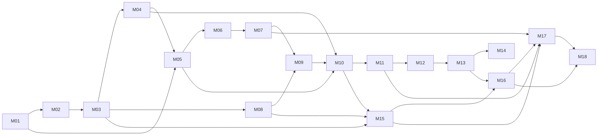

# Implementación de ThePredict 0.0.1

Documentos para pasar el [plan de la 0.0.1](../Plan-Jev-y-combate-tactico.md) a código. El plan explica **qué** se construye y **por qué**, con la evidencia verificada. Esta carpeta explica **cómo** se implementa, dividido en subpuntos que se pueden estimar, implementar y cerrar uno a uno.

## Cómo leer

1. [00-Arquitectura-y-reglas.md](00-Arquitectura-y-reglas.md): principios, paquetes, dependencias, hilos, identificadores y reglas de código y pruebas. Es normativo.
2. [01-Modelo-de-dominio.md](01-Modelo-de-dominio.md): los únicos tipos de `domain` y el estado mínimo de `engine`. Es normativo.
3. El documento del módulo en curso. Cada subpunto cita las reglas (`A`, `D`, `T`, `I`, `C`, `P`, `W`) y los tipos de 01 que usa.

## Módulos

| Módulo | Documento | Entrega | Depende de | Estado |
|---|---|---|---|---|
| M01 | [Verificación nativa en servidor](M01-Verificacion-nativa.md) | A | — | Local listo — servidor pendiente (sesiones 1–5 del paquete) |
| M02 | [Identificadores y contratos del dominio](M02-Identificadores-y-dominio.md) | A | M01 (parcial) | Local listo |
| M03 | [Configuración v2, binder y migración](M03-Configuracion-binder-migracion.md) | A | M02 | Local listo — servidor pendiente (sesiones 1, 2 y 6) |
| M04 | [Vocabulario de MythicMobs](M04-Vocabulario-MythicMobs.md) | B | M02, M03 | Local listo — servidor pendiente (sesiones 2 y 3) |
| M05 | [Propiedad de la IA de movimiento](M05-Propiedad-IA-movimiento.md) | B | M01, M03, M04 | Local listo — servidor pendiente (sesiones 4 y 6) |
| M06 | [Sesiones, encuentros y ciclo de vida](M06-Sesiones-encuentros-ciclo-de-vida.md) | B | M02, M05 | Local listo — servidor pendiente (sesiones 7 y 13) |
| M07 | [Contexto nativo y percepción](M07-Contexto-nativo-percepcion.md) | C | M06 | Local listo — servidor pendiente (sesiones 8 y 11) |
| M08 | [Cliente System One (Jev)](M08-Cliente-System-One.md) | C | M02, M03 | Local listo — cuenta real verificada (2026-09-29, salvo 403, 429 y 529); latencia desde el host pendiente (sesiones K1 y K3) |
| M09 | [Coordinador, presupuesto y velocidad](M09-Coordinador-presupuesto-velocidad.md) | C | M06, M07, M08 | Local listo — cuenta real verificada (2026-09-29, salvo 429 y 529); servidor pendiente (sesiones 11 y K4) |
| M10 | [Ejecución táctica y cadena de fallback](M10-Ejecucion-tactica-fallback.md) | D | M04, M05, M09 | Local listo — servidor y cuenta real pendientes (sesiones 5, 9 y K1–K2 del paquete); disponibilidad en tiempo real (desviación 29, 2026-09-30) |
| M11 | [Amenaza enriquecida](M11-Amenaza-enriquecida.md) | D | M06, M07, M10 | Local listo — servidor pendiente (sesión 10) |
| M12 | [Diagnóstico, instalación, ejemplo y retiro de OpenRouter](M12-Diagnostico-instalacion-retiro-OpenRouter.md) | E | M03–M11 | Local listo — servidor pendiente (sesiones 1, 6 y K1) |
| M13 | [Suite integral, carga, latencia y calidad](M13-Suite-carga-latencia-calidad.md) · [Guion de servidor 0.0.1](Guion-servidor-0.0.1.md) | E | M01–M12 | Local listo — banco con la cuenta real verificado (2026-09-29); servidor pendiente (sesiones 11–13 y K3–K5) |
| M14 | [Documentación, empaquetado y aceptación alojada](M14-Documentacion-empaquetado-aceptacion.md) · [Paquete de pruebas](paquete-pruebas/README.md) · [Informe de la 0.0.1](Informe-0.0.1.md) | E | M13 | Local listo — aceptación alojada pendiente (candidato pendiente de integración) |
| M15 | [Primitivas tipadas de skills](M15-Primitivas-tipadas-de-skills.md) | F | M03, M08, M10 | Local listo — servidor pendiente (sesión 15 del paquete; DT-33, DT-34 y DT-41) |
| M16 | [Efectividad de las respuestas de Jev](M16-Efectividad-de-las-respuestas-de-Jev.md) | F | M15, M08, M10, M13 | Local listo — re-banco hecho (2026-09-30: defaults `questionDetail: full` y `minimumConfidence: 0.45`, DT-31 Resuelta); servidor pendiente (sesión 16; DT-35) |
| M17 | [Participantes y objetivos como entidades](M17-Participantes-y-objetivos-como-entidades.md) | F | M15, M16 (orden); base M06, M07, M10, M11 | Local listo — servidor pendiente (sesión 17; DT-36..39) |
| M18 | [Duelo de mobs controlados](M18-Duelo-de-mobs-controlados.md) | F | M15, M16, M17 | Local listo — servidor pendiente (sesión 18; DT-40); duelo con clave pendiente de la aprobación del usuario |



El orden es estricto salvo una excepción: M01 crea versiones mínimas de `MobKey`, `TacticId`, `Movement`, `ControlLevel`, `IntentView` e `IntentBoard`, siguiendo 01, para sus pruebas en servidor; M02 las completa (regla W5).

**M15–M18 amplían la 0.0.1 (entrega F); no son una versión nueva.** Nacen de la revisión del usuario tras el banco pagado (DT-31) y del pedido de un duelo visual. El orden es M15 → M16 → M17 → M18: M16 necesita los propósitos de M15 para describir cada opción; M17 empieza grabando referencias doradas (M17.0) y va después de M16.8 porque ambos tocan `CombatOutcomeListener` y porque M16.4 ya renombra `players` a `participants` en el estado, así que M17 no cambia las solicitudes de encuentros solo con jugadores (puede avanzar en paralelo a M16.9–M16.11, que no tocan los adapters de servidor); M18 usa la política de entidades de M17 y la métrica de resultado de M16, y su duelo con clave mide el planteamiento ya calibrado. La generalización a entidades es un módulo propio (M17) antes del duelo (M18), por decisión del usuario: el sistema se ata a entidades y a distinciones nativas de Minecraft, no a un caso especial "mob contra mob". Cada documento incluye sus "Cambios propuestos a 00/01"; quien implementa el módulo los aplica antes de escribir código.

**Estado de la 0.0.1 (2026-09-29): candidato pendiente de integración.** De la entrega F, M15, M16, M17 y M18 están en `Local listo` (1644 pruebas verdes tras la disponibilidad en tiempo real de M10 del 2026-09-30; JAR nuevo con huella en el [CHANGELOG](../../CHANGELOG.md#artefacto); re-banco de pago de M16.10 hecho el 2026-09-30; simulador de duelo de M18.7 medido en local; sesiones 15, 16, 17 y 18 del paquete pendientes, y el duelo con clave pendiente de la aprobación del usuario); lo que sigue describe M01–M14. Todos esos módulos están en `Local listo`: 1230 pruebas verdes, Javadoc estricto y JAR reproducible (huella en el [CHANGELOG](../../CHANGELOG.md#artefacto)). El cliente de Jev está verificado con la cuenta real (M08, M09, M13). Ningún módulo está `Verificado en servidor`: todo lo que exige juego lo ejecuta el usuario con el [paquete de pruebas](paquete-pruebas/README.md), en orden de sesión, y el [checklist](paquete-pruebas/Checklist-DT-y-casillas.md) dice qué casilla y qué DT cierra cada paso. Resumen, DT abiertas y revisión pendiente del usuario: [Informe de la 0.0.1](Informe-0.0.1.md). Guías de usuario: [autor](../../Guias/Guia-del-autor.md) y [administrador](../../Guias/Guia-del-administrador.md).

## Entregas intermedias

| Entrega | Módulos | Criterio de salida |
|---|---|---|
| A | M01–M03 | Registro de decisiones de M01; dominio y `ArchitectureRulesTest` verdes; configuración v2 cargada y vinculada. |
| B | M04–M06 | Un mob vinculado se mueve según intenciones fijadas con el comando de depuración, sin Jev ni costo; sesiones aisladas. |
| C | M07–M09 | Encuentros con estado semántico enviados a Jev (o al servidor de contrato) y respuestas aplicadas en el hilo del servidor dentro de los límites. |
| D | M10–M11 | Combate completo con Jev y sin Jev; cuatro niveles de fallback; amenaza enriquecida. |
| E | M12–M14 | Diagnóstico, ejemplo, migración, medidas y aceptación alojada; 0.0.1 publicada. Hoy: todo lo local hecho; aceptación alojada pendiente del usuario. |
| F | M15–M18 (extensión de la 0.0.1) | Skills con propósito tipado; re-banco con etiquetas revisadas que cumple sus objetivos de conservación, acierto y calibración; participantes como entidades con defaults idénticos; duelo mob contra mob medido en el simulador y en el servidor. Detalle de las preguntas configurable (`decision.questionDetail`: `full` por defecto desde el re-banco de M16.10, con `minimumConfidence` 0,45). Capacidad con los tokens reales del re-banco: 5 mobs aislados en combate continuo por mundo con `full` o `compact` (tope de 300 solicitudes/min por mundo); en varios mundos, 5 con `full` (≈ 1 884 tokens por solicitud) y 10 con `compact` (≈ 953) por el tope de 600 000 tokens/min. El diseño de M16.2 estimaba 8 con `compact`. Coste a plena carga: ≈ 0,28 USD por mob y hora con `full` y ≈ 0,14 con `compact`; como mucho unos 20 subiendo los topes de tokens **y** de solicitudes, por el límite de 1 200 solicitudes/min de la cuenta; los mobs que comparten encuentro gastan menos solicitudes. Presupuesto de pago: M16 ≈ 0,055 USD en el diseño, ≈ 0,050 USD estimado por la herramienta y **≈ 0,0315 USD real** (720 llamadas; techo 0,10); sesión 16 ≈ 0,011 USD; M18 (30 rondas con clave) ≈ 0,19 USD con el default `full` y los tokens reales del re-banco, ≈ 0,32 USD con la cota W7 de 1,5 caracteres por token y ≈ 0,14 USD con `compact` (techo 0,60). |

## Estados de un módulo

`Pendiente` → `En curso` → `Local listo` (pruebas automáticas verdes) → `Verificado en servidor` (si aplica) → `Cerrado` (terminado según W4 de 00).

## Plantilla de módulo

```markdown
# Mxx. Nombre

> Estado · Entrega · Depende de · Desbloquea · Diseño (enlace al plan)

## Objetivo
## Alcance
### Incluye
### No incluye
## Base existente
| Archivo | Acción |
## Subpuntos
### Mxx.n Nombre
- **Propósito:** qué problema resuelve.
- **Diseño:** APIs exactas, algoritmo, límites y formatos.
- **Archivos:** qué se crea, modifica o elimina, con rutas.
- **Reglas:** IDs de 00 que aplican especialmente.
- **Pruebas:** automáticas y, si aplica, en servidor.
- **Aceptación:** lista comprobable.
## Riesgos y decisiones abiertas
## Terminado
```
