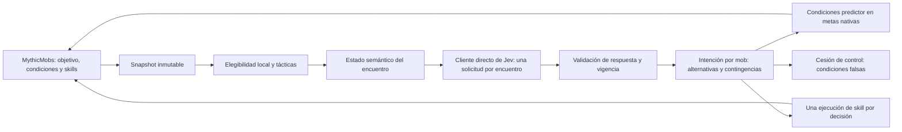

# ThePredict: integración directa con Jev y combate táctico

**Estado: planificación de la 0.0.1; implementación pendiente.** Todo lo descrito aquí pertenece a la versión 0.0.1: completa la base ya compilada y sustituye las decisiones anteriores sobre proveedor y control de movimiento. El código actual continúa usando OpenRouter. Los ejemplos de configuración nuevos son propuestas y todavía no se pueden instalar. El plan de ejecución está en la sección 11.

**Revisión 2 (2026-09-28).** Incorpora evidencia estática del JAR Premium suministrado (sección 2), el vocabulario de ThePredict dentro de MythicMobs (sección 3), el contrato publicado de Jev 1.13 con agrupación por encuentro, estado semántico y contingencias (sección 6) y el nuevo cálculo de demanda y costo (sección 7). La versión anterior está en `archive/Plan-Jev-y-combate-tactico-rev1-2026-09-28.md`.

**Revisión 3 (2026-09-28).** Añade la verificación del binario Paper 26.2 build 129 (servidor parcheado a partir del JAR oficial de Mojang, con nombres de Mojang) y de la documentación de Paper. Fija una regla de reinvención (sección 3): solo habrá lógica propia cuando haga más directa la decisión o su ejecución. En consecuencia, el plan retira la búsqueda propia de destinos de huida, la histéresis propia de movimiento y la detección propia de atascos, y define el contexto a partir de APIs y eventos nativos (sección 6).

**Revisión 4 (2026-09-29).** En modo Predictor, ThePredict toma la gestión de la IA de movimiento del mob y MythicMobs deja de gestionarla (sección 3). Añade la cadena de fallback de cuatro niveles (sección 8), la amenaza enriquecida y la táctica `FLANK` (sección 5), la validación de eficiencia, velocidad, concurrencia e identificadores (sección 7) y el plan por módulos de toda la integración de la 0.0.1 (sección 11). La revisión 3 está en `archive/Plan-Jev-y-combate-tactico-rev3-2026-09-29.md`.

## 1. Resultado que construiremos

Un autor configura un mob y sus skills en MythicMobs, añade un perfil `NORMAL` de ThePredict y activa `Predictor`. Jev elige una táctica entre alternativas válidas: acercarse para atacar, mantener distancia, retirarse para defenderse o esperar. El addon mantiene esa intención durante un plazo limitado y MythicMobs/Paper ejecutan el movimiento y las habilidades. Al apagar Predictor o perder el servicio, el mob recupera su comportamiento base.

La diferencia observable será la coordinación entre posición y habilidad: acercarse antes de golpear, conservar una distancia útil para disparar y abrir espacio al defenderse. La latencia remota seguirá existiendo; la continuidad vendrá de ejecutar localmente la intención vigente entre respuestas. Una conexión directa por sí sola no garantiza mejores decisiones ni menor latencia.

TypeSafe indica que la mayoría de consultas de Jev terminan en unos 100 ms; un análisis de terceros reporta 70–500 ms de extremo a extremo. A ese tiempo se suma la red entre el host y `api.typesafe.ai`, que solo se conocerá midiendo desde el servidor. Por eso el combate tendrá dos capas:

- **Capa reactiva, local, en cada tick:** metas nativas de MythicMobs gobernadas por la intención vigente, revalidación de alcance y condiciones, y cambio inmediato a una alternativa o contingencia ya recibida.
- **Capa deliberativa, Jev, por eventos y latido corto:** elige la táctica y prepara contingencias. Nunca bloquea el tick ni ejecuta nada por sí misma.

La sensación de "IA real" vendrá de esa combinación: juicio contextual de Jev sobre hechos semánticos y reacción local inmediata. Una respuesta más rápida sin esa capa local seguiría llegando tarde a un combate que cambia cada tick.

Decisiones de alcance:

- Jev oficial será el único proveedor soportado. El cliente implementará el protocolo System One (`GET /v1/models`, `POST /v1/systemone`) con URL base configurable; un servidor compatible, como Kev autoalojado, podrá probarse sin otro adapter ni selector de proveedores (sección 6). Se retirarán OpenRouter y el selector público de proveedores al completar la migración.
- **Propiedad de la IA:** en un mob con `Predictor: true`, ThePredict sustituye la gestión de metas de MythicMobs por un conjunto de metas generado desde el perfil. Lo instala con la API de IA de MythicMobs, reutilizando sus metas y las de vanilla, y añade solo las metas de Paper que no existen (sección 3). MythicMobs conserva spawn, skills, selección de objetivo y tabla de amenaza. Con Predictor apagado, MythicMobs gestiona el mob como siempre.
- ThePredict se integrará también como vocabulario de MythicMobs: condiciones, mecánicas, placeholders y señales registradas mediante la API para addons, para que el autor enlace skills y efectos con la táctica vigente.
- Las decisiones se agruparán por **encuentro**: mobs vinculados que comparten objetivo o zona de combate. Una solicitud contiene el estado del encuentro una sola vez y una pregunta por mob que necesita decidir.
- Un perfil por **tipo de mob de MythicMobs**, compartido entre mundos. Cada instancia tendrá estado independiente por UUID y generación de sesión.
- `Predictor: false`, o ausente, impedirá consultas y control táctico del addon. El perfil podrá permanecer instalado.
- Solo `NORMAL`. Sin aprendizaje durante combates, entrenamiento, RAG, memoria de jugadores entre sesiones ni modos `TRAINED` o `UNPREDICTABLE`. El historial corto del encuentro (sección 6) es parte del estado de cada solicitud: se descarta al cerrar el encuentro y no modifica pesos, perfiles ni decisiones futuras de otros combates.
- La ejecución apuntará a metaskills de MythicMobs. Invocar mobs, aplicar efectos o usar contenido adicional se delegará a esas skills.
- Primer soporte de movimiento: mobs terrestres con navegación compatible, demostrado inicialmente con un zombie. Voladores, dragones, navegación acuática y Folia quedan fuera de esta entrega. También quedan fuera del control de movimiento los mobs cuya IA vanilla usa `Brain` en lugar de metas (lista del binario 26.2 en la sección 2): las metas no gobiernan su desplazamiento, así que solo podrán usar tácticas sin movimiento.
- Regla de reinvención: ThePredict solo implementa lógica propia cuando hace más directa la decisión de la IA o su ejecución. Todo lo demás se delega a MythicMobs, Paper o Minecraft vanilla (sección 3).
- Se conserva el objetivo elegido por MythicMobs y su tabla de amenaza, enriquecida por ThePredict con hechos que MythicMobs no mide (sección 5). Jev seleccionará táctica; que Jev elija objetivo queda fuera de la 0.0.1, aunque la amenaza enriquecida ya usa el mismo camino nativo.
- Fallback escalonado: intención vigente → alternativas y contingencias recibidas → modo local sin Jev → IA base del mob (sección 8).
- Objetivo de compatibilidad: Paper 26.x posteriores; soporte declarado únicamente para combinaciones probadas. No se supondrá compatibilidad por comparar números de versión.

## 2. Base real y asuntos pendientes

La compilación actual usa Java 25, Paper API `26.2.build.129-stable` y `VersionsOfJars/MythicMobsPremium-5.13.1-SNAPSHOT.jar`. Los reportes locales existentes suman **67 pruebas sin fallos**; no equivalen a una integración de Jev o a una aceptación en el servidor alojado.

| Pieza actual | Decisión en la 0.0.1 |
|---|---|
| Carga estricta, archivos de primer inicio y binder de IDs | Conservar y extender con versión de esquema y recarga transaccional |
| `MythicSkillExecutor` | Conservar la ejecución mediante MythicMobs; verificar metadatos, condiciones y semántica del resultado en servidor |
| Snapshots inmutables y `NearestK` | Conservar; añadir hechos necesarios para movimiento y límites de lectura |
| `ServerThreadInbox` | Conservar el retorno al hilo del servidor; acotar cola y trabajo por tick |
| `RemoteRequestBudget`, `DecisionFreshness`, estado por UUID | Reforzar con sesiones, revisiones, plazo de intención y contabilidad del transporte |
| `MythicPredictionRunner` | Separar registro de sesiones, observación, planificación y aplicación de respuestas |
| Copia periódica de todos los mobs activos | Sustituir por registro de mobs vinculados y agenda de próximas evaluaciones; reconciliación ocasional acotada |
| `DecisionReuseCache` | Sustituir la repetición de decisiones por conservación de intención; una respuesta no será permiso para repetir un cast |
| `OpenRouterDecisionProvider` y fábrica de proveedores | Sustituir por cliente Jev y composición directa; retirar código y pruebas exclusivas de OpenRouter al cerrar la migración |
| Intervalos actuales de 10 s entre solicitudes y 5 s después de respuesta | Revisar con mediciones: no son adecuados para prometer cambios tácticos frecuentes |
| Documentación de recarga | Corregir discrepancia: la garantía de conservar configuración anterior necesita implementarse; el runner actual puede vaciar vínculos al fallar |

El plan anterior y sus resultados permanecen como referencia de la base existente. Una función nueva solo pasará a documentación de uso cuando esté implementada y comprobada.

### Evidencia estática del JAR suministrado

Lectura con `javap` de `VersionsOfJars/MythicMobsPremium-5.13.1-SNAPSHOT.jar` (handler `v26_2`). Demuestra que las clases, métodos y claves existen en esa build; no demuestra su comportamiento en juego. M1 conserva la verificación en servidor.

| Pregunta | Evidencia | Consecuencia |
|---|---|---|
| ¿Puede un addon registrar su propia meta en `AIGoalSelectors`? | `VolatileAIHandlerImpl` llena su mapa privado `AI_GOALS` con `AnnotationUtil.getAnnotatedClasses(MythicBukkit.inst(), "io.lumine.mythic.core.mobs.ai.goals", MythicAIGoal.class)` y con el paquete de metas de la versión. No hay método público de registro. | Descartada una meta propia dentro de `AIGoalSelectors`. No se usará reflexión sobre el mapa privado. |
| ¿Hay metas de movimiento gobernables por condiciones del mob? | `meleeAttackConditional`, `moveTowardsTargetConditional`, `moveWithinDistanceOfTargetConditional` (alias `moveWithinConditional`), `fleeConditional` y `arrowAttackConditional` aceptan `mobconditions` (`mc`) además de `targetconditions`. `doNothing` acepta `conditions`. | La ruta 1 de movimiento tiene soporte en esta build. |
| ¿Qué parámetros aceptan? | `moveTowardsTargetConditional`: `speed`, `minrange`, `maxrange`. `moveWithinDistanceOfTargetConditional`: `speed`, `minrange`, `range`, `maxrange`. `fleeConditional`: `distance`, `speed`, `safespeed`. `meleeAttackConditional`: `speed`, `followUnseen`. | Las bandas de distancia pueden expresarse en configuración nativa; su histéresis real se mide en M1. |
| ¿Llegan a tiempo las condiciones, mecánicas y targeters del addon en el primer arranque? | MythicMobs carga skills y mobs dentro de su `onEnable`, antes que ThePredict (`depend`). Pero `CustomCondition`, `CustomMechanic` y `CustomTargeter` resuelven el componente con `Schedulers.sync().runLater(..., 1)`: un tick después, cuando todos los plugins ya están habilitados. | Registrar en `onEnable` alcanza la carga inicial. Falta confirmarlo en primer arranque y en `/mm reload`. |
| ¿Existe un registro idiomático para addons? | `io.lumine.mythic.core.skills.CustomComponentRegistry(JavaPlugin, paquete)` busca clases con `@MythicCondition`, `@MythicMechanic`, `@MythicTargeter` y `@MythicPlaceholder` en el paquete del addon, las conecta a los eventos de carga e inyecta placeholders si el gestor ya está inicializado. | No se usa: instancia las clases por reflexión con constructores fijos y no permite inyectar dependencias sin estado estático (regla D8 de `Implementacion-0.0.1/00`). El registro se hace escuchando `MythicConditionLoadEvent`, `MythicMechanicLoadEvent` y `MythicTargeterLoadEvent`, API pública. |
| ¿Pueden registrarse placeholders? | `MythicPlaceholdersLoadEvent` se emite dentro de la carga de MythicMobs, antes de habilitar ThePredict. `PlaceholderManager.register(...)` y `recheckForPlaceholders()` son públicos. | Registrar al habilitar y en cada evento de recarga; comprobar en M1 si hace falta `recheckForPlaceholders()`. |
| ¿Puede validarse la configuración de metas del autor? | `MythicMob.getAIGoalSelectors()` y `getAITargetSelectors()` devuelven las líneas configuradas; `reapplyAIGoalSelectors(ActiveMob)` reinstala las metas. | El binder puede comprobar que cada movimiento usado tiene una meta gobernada y advertir ataques incondicionales. |
| ¿Hay navegación directa? | `navigateToLocation`, `clearPath` y `resetAI` están implementados en el handler `v26_2`, no solo como métodos predeterminados. | Ruta 2 disponible para destinos calculados. |
| ¿Hay puntos nativos para amenaza, señales y variables? | `ActiveMob.ThreatTable`: `threatGain`, `threatSet`, `Taunt`, `inCombat`. `ActiveMob.signalMob(entity, signal)` dispara `~onSignal:<signal>`. `ActiveMob.getVariables()` devuelve un `VariableRegistry` por instancia. | Telegrafía mediante señales en esta entrega; selección futura de objetivo mediante amenaza, sin reemplazar el sistema de MythicMobs. |
| ¿Pueden los perfiles usar condiciones nativas? | `getSkillManager().getConditions(List<String>)` convierte líneas de condición de MythicMobs en `SkillCondition`; `evaluateCaster`, `evaluateEntity` y `evaluateToEntity` las evalúan. | Los contextos del perfil pueden escribirse con condiciones de MythicMobs en lugar de un vocabulario propio. |
| ¿Qué opciones de navegación ofrece el mob? | `MobType` lee `Options.AsyncPathfinding`, `AINavigator`, `AIPathfindingMalus`, `Options.FollowRange` y `Options.MovementSpeed`. `fleeConditional` usa `AsyncAvoidEntityGoal`. | Las rutas de los mobs vinculados pueden calcularse fuera del hilo principal con una opción nativa, si M1 confirma su compatibilidad con las metas condicionales. |
| ¿Existe una meta nativa de retorno a la arena? | `goToSpawnLocation` (alias `goToSpawn`) acepta `maxrange`, `minrange`, `speed` y `droptarget`; también existe `moveTowardsRestriction`. | El límite de arena se configura en MythicMobs; ThePredict no limita posiciones por su cuenta. |
| ¿Puede un addon instalar metas de MythicMobs en un mob? | `MythicBukkit.inst().getVolatileCodeHandler().getAIHandler()` devuelve `VolatileAIHandler` (paquete `api`), con `addPathfinderGoals(LivingEntity, List<String>)`, `addTargetGoals`, `clearPathfinderGoals` y `resetAI`. `addPathfinderGoals` interpreta las mismas líneas que `AIGoalSelectors`, incluida `clear`. | ThePredict puede generar e instalar el conjunto de metas de un mob vinculado sin clases NMS. |
| ¿Cuándo instala MythicMobs sus propias metas? | `MobType.applyMobVolatileOptions` las instala en `registerActiveMob` (spawn) y `ActiveMob` vuelve a llamarlo al cargar un mob desde un chunk (`ChunkListeners` → `loadMythicMob`), sin `MythicMobSpawnEvent`. `reapplyAIGoalSelectors` las reinstala. | Las metas no se guardan con la entidad: ThePredict debe reinstalar las suyas después del spawn y de cada carga, y comprobar que siguen instaladas. |
| ¿En qué hilo se evalúan condiciones y mecánicas? | Las mecánicas declaran `ThreadSafetyLevel` (`EITHER` por defecto, `SYNC_ONLY`, `ASYNC_ONLY`); las condiciones no declaran nada. `fleeConditional` usa `AsyncAvoidEntityGoal`, que envía a `AsyncEntityScan` un predicado construido con las condiciones. | Las condiciones de ThePredict pueden ejecutarse fuera del hilo principal: deben leer solo datos inmutables y no llamar a Bukkit. |
| ¿Qué banderas usa `doNothing`? | Declara `GoalType.MOVE_LOOK`; `CustomAIAdapter` lo traduce a `Goal.Flag.MOVE` y `LOOK`. | Un `HOLD` con `doNothing` bloquea también la mirada: el mob quedaría congelado sin mirar al objetivo. |
| ¿Qué ofrece la tabla de amenaza nativa? | Opciones `Modules.ThreatTable`, `Options.UseThreatTable`, `Options.MaxThreatDistance`, `ThreatTable.UseDamageTaken`, `ThreatTable.DecayUnreachable`, `ThreatTable.DropUnreachableSeconds`; mecánicas `threat` y `threatclear`; API `threatGain`, `threatLoss`, `threatSet`, `Taunt`. | La amenaza enriquecida se escribe en esta tabla; no se crea otra. |
| ¿Son exactos los IDs de MythicMobs? | `MobExecutor.getMythicMob(String)` consulta el mapa `mmList` con la clave exacta. Los nombres de condiciones y mecánicas se comparan en mayúsculas. | IDs de mobs y skills distinguen mayúsculas; nombres de vocabulario, no. |

### Evidencia del binario Paper 26.2 y de Minecraft vanilla

Paperclip (`VersionsOfJars/paper-26.2-129.jar`) se ejecutó con `-Dpaperclip.patchonly=true`: descargó el servidor oficial de Mojang para 26.2, verificó su hash y aplicó los parches de Paper sin arrancar el servidor. El JAR resultante usa nombres de Mojang, los mismos que referencia MythicMobs. Se leyó con `javap` junto con `paper-api-26.2.build.129-stable` (clases y fuentes) y la documentación oficial ([Mob Goal API](https://docs.papermc.io/paper/dev/mob-goals/), [Entity Pathfinder API](https://docs.papermc.io/paper/dev/entity-pathfinder/), [Data components](https://docs.papermc.io/paper/dev/data-component-api/)).

| Tema | Evidencia | Consecuencia |
|---|---|---|
| Ritmo de la IA vanilla | `Mob.serverAiStep`: `Sensing.tick`, selector de objetivos, selector de metas, navegación y controles de movimiento y mirada, en ese orden. Con `(tickCount + id) % 2 != 0` solo avanzan las metas en curso; la selección de metas nuevas ocurre cada 2 ticks, escalonada por ID. | Un cambio de intención llega a las metas nativas en ≤2 ticks. Revisar condiciones de control más rápido no aporta. |
| Ataque cuerpo a cuerpo | `MeleeAttackGoal`: `attackInterval = 20`; `canUse` se evalúa como máximo cada 20 ticks; recalcula la ruta cada 4–10 ticks, +5 a más de 16 bloques, +10 a más de 32 y +15 tras un fallo; usa la caché de línea de visión de `Sensing`. `meleeAttackConditional` extiende esta clase. | Cadencia y persecución naturales sin código propio. |
| Huida | `AvoidEntityGoal` elige destinos con `DefaultRandomPos.getPosAway(mob, 16, 7, ...)`; MythicMobs reproduce esa meta en `AsyncAvoidEntityGoal`. | No se calcularán destinos de retirada propios. |
| Atascos | `PathNavigation`: comprobación cada 100 ticks con factor 0.25 de avance, tiempo límite por nodo, `isStuck()` y recálculo con espera mínima de 20 ticks. | ThePredict observa el resultado; no implementa otra detección. |
| Ataque a distancia natural | `bowAttackConditional` extiende `RangedBowAttackGoal`, que alterna el sentido del giro alrededor del objetivo (`strafingClockwise`) y retrocede (`strafingBackwards`); requiere `Monster & RangedAttackMob`. `crossbowAttackConditional` envuelve `RangedCrossbowAttackGoal`, que carga, espera y dispara sin ese giro, y requiere además `CrossbowAttackMob`. | `KEEP_DISTANCE` con disparo vanilla es natural en esqueletos; en saqueadores, el disparo es vanilla y la distancia la da la banda nativa. |
| Mobs con `Brain` | Sobrescriben `makeBrain`: Allay, Armadillo, Axolotl, Camel, Frog, Tadpole, Goat, CopperGolem, HappyGhast, Nautilus, ZombieNautilus, Sniffer, Zoglin, Breeze, Creaking, Hoglin, Piglin, PiglinBrute, Warden y Villager. | Fuera del control de movimiento de esta entrega. |
| Escudo | `LivingEntity.getItemBlockingWith()` exige un ítem con `BLOCKS_ATTACKS` en uso durante al menos `blockDelayTicks`. | `HumanEntity#isBlocking()` ya incluye esa espera. Escudo en uso sin bloqueo efectivo = ventana de ataque. |
| Estado de combate | `CombatTracker` vanilla: `RESET_DAMAGE_STATUS_TIME = 100`, `RESET_COMBAT_STATUS_TIME = 300` ticks. Paper expone `LivingEntity#getCombatTracker()`: `isInCombat`, `isTakingDamage`, `getCombatDuration`, `getLastDamageTime`, `getCombatEntries`. | El ciclo de vida del encuentro y su historial salen de datos nativos. |
| Metas en ejecución | `MobGoals#getRunningGoals(mob, GoalType.MOVE)` devuelve también metas NMS; `MobGoalHelper` les asigna una clave derivada de su clase. | Permite comprobar que la meta gobernada realmente se ejecuta. |
| Rutas | `Pathfinder#findPath(...)` calcula de forma síncrona y devuelve `PathResult` con `canReachFinalPoint()`; `getCurrentPath()` expone la ruta que ya calculó la meta en curso. | La alcanzabilidad se lee de la ruta existente; solo se calcula otra de forma acotada. |
| Contexto del jugador | `Player#getCurrentInput()` y `PlayerInputEvent`, `getActiveItem()`, `getActiveItemUsedTime()`, `isHandRaised()`, `HumanEntity#isBlocking()`, `getAttackCooldown()`, `getCooldown(ItemStack/Key)`, `LivingEntity#hasLineOfSight`, `getNoDamageTicks()`. | Hechos semánticos de la sección 6 sin cálculos propios. |
| Clasificación de ítems y daño | Componentes `BLOCKS_ATTACKS`, `WEAPON`, `CONSUMABLE`, `DEATH_PROTECTION`, `CHARGED_PROJECTILES`, `USE_COOLDOWN`, `KINETIC_WEAPON`, `PIERCING_WEAPON`, `ATTACK_RANGE`; etiquetas `DamageTypeTagKeys` como `IS_PROJECTILE`, `BYPASSES_SHIELD`, `IS_EXPLOSION`, `MACE_SMASH`. | Clasificación estable entre versiones, sin listas de `Material`. |
| Alcance y detección | Atributos `ENTITY_INTERACTION_RANGE` (alcance del jugador), `FOLLOW_RANGE`, `ATTACK_SPEED`, `ARMOR`, `ARMOR_TOUGHNESS`, `SCALE`. | Radio de percepción y bandas de distancia derivadas de atributos nativos. |
| Congelar la IA | Con `aware = false`, `Mob.serverAiStep` solo ejecuta `FloatGoal` y el control de salto, y retorna: no avanzan metas, navegación ni controles de movimiento y mirada. | `Mob#setAware(false)` no sirve para `HOLD` ni para "apagar la IA y conducir el mob": sin navegación no hay movimiento. |
| Metas propias de Paper | `PaperCustomGoal` extiende la `Goal` vanilla y no sobrescribe `requiresUpdateEveryTick`: se elige cada 2 ticks y su `tick()` corre en los ticks completos, cada 2 ticks. `MobGoals` no expone prioridades; `removeAllGoals(mob)` también borra las metas de objetivo. | Una meta propia no es más rápida que una nativa. Solo se usa para capacidades ausentes, y nunca para borrar y reconstruir la IA en cada cambio de control. |
| Ángulo del escudo | `BlocksAttacks.DamageReduction.horizontalBlockingAngle` vale 90° por defecto y `resolve` solo reduce daño que llega dentro de ese ángulo respecto a la mirada del que bloquea; Paper lo expone en `DamageReduction#horizontalBlockingAngle()`. | Atacar desde un lado o por detrás anula el escudo: base de la táctica `FLANK`. |

## 3. Reutilización de MythicMobs y Paper

| Necesidad | Responsable | Aporte necesario del addon |
|---|---|---|
| Definiciones, skills, efectos, proyectiles, invocaciones | MythicMobs | Vincular IDs y aportar etiquetas semánticas |
| Condiciones, targeters y cooldowns de skills | MythicMobs | Invocar la evaluación correcta y revalidar antes del cast |
| Selección de objetivo y amenaza | MythicMobs | Capturar el objetivo elegido, invalidar decisiones cuando cambia y enriquecer la amenaza (sección 5) |
| Metas de acercamiento, huida y seguimiento | Metas condicionales de MythicMobs con `mobconditions` | Generar e instalar el conjunto de metas y publicar la intención vigente mediante condiciones `predictor*` |
| Rutas, colisiones y movimiento de la entidad | Navegador nativo de MythicMobs/Paper | Ninguna ruta propia en la ruta nativa; observar progreso con `Pathfinder` y `MobGoals` y ceder control |
| Elección táctica contextual | Jev | Preparar hechos y candidatos, validar respuesta y vigencia |
| Aislamiento, presupuestos, recuperación y diagnóstico | ThePredict | Estado por instancia, coordinación asíncrona y UI administrativa |

La documentación de MythicMobs describe metas condicionales. Por ejemplo, `meleeAttackConditional` admite condiciones del mob y del objetivo, pero también produce ataques cuerpo a cuerpo: no debe combinarse automáticamente con una skill de daño del addon. La presencia documentada de una opción no garantiza que todas las metas ni el JAR local la admitan. [Referencia oficial](https://wiki.mythiccraft.io/mythicmobs/Mobs/ai/goals/meleeAttackConditional).

El punto de extensión preferido será una condición del addon que consulte la intención de una instancia. MythicMobs documenta el registro de condiciones, mechanics y targeters personalizados; también advierte que el evento de spawn ocurre antes del registro completo del mob. El alta se completará cuando su referencia activa esté disponible. [API de MythicMobs](https://wiki.mythiccraft.io/mythicmobs/API).

### Propiedad de la IA de movimiento

En un mob vinculado (`Predictor: true`, perfil válido y especie con metas, no `Brain`), ThePredict sustituye la gestión de metas de MythicMobs. No reescribe comportamientos: genera la lista de metas desde el perfil y la instala con `VolatileAIHandler.addPathfinderGoals`, la misma vía que usa MythicMobs para `AIGoalSelectors`. Así reutiliza las metas de MythicMobs y de vanilla, y añade con `MobGoals` solo tres metas de Paper que no existen de forma nativa. MythicMobs conserva spawn, skills, `AITargetSelectors`, tabla de amenaza y opciones del mob.

**Conjunto generado para el ejemplo; sintaxis y significado de rangos se validan en M1. Los valores siguen la tabla de M05.1: velocidad de aproximación (`approachSpeed`, 1,15 por defecto) salvo en la huida, `minrange` = `meleeReachBlocks` (2,5) y `maxrange` = `FOLLOW_RANGE` del mob (32 en el ejemplo). MythicMobs escapa cada línea con `unparseBlock` antes de instalarla (M05):**

```text
 0  clear
 1  float
 2  goToSpawnLocation{maxrange=24;speed=1.15}                                         # si el perfil define arena
 3  fleeConditional{distance=10;speed=1.2;mc=[ - predictormove{m=RETREAT} true ]}
 4  fleeConditional{distance=5;speed=1.15;mc=[ - predictormove{m=KEEP_DISTANCE} true ]}
 5  moveWithinConditional{range=9;speed=1.15;mc=[ - predictormove{m=KEEP_DISTANCE} true ]}
 6  moveTowardsTargetConditional{speed=1.15;minrange=2.5;maxrange=32;mc=[ - predictormove{m=APPROACH} true ]}
 7  [Paper] thepredict:flank    solo MOVE; si el perfil usa FLANK
 8  [Paper] thepredict:hold     solo MOVE; activa mientras ThePredict controla y ninguna meta táctica se mueve
10+ IA base: `BaseAI` del perfil, o `AIGoalSelectors` del mob sin `clear`, desplazadas;
    si no hay ninguna, `meleeAttack` y `randomStroll`
    lookAtTarget                al final si la IA base no incluye una meta de mirada
    [Paper] thepredict:owner    marcador; nunca se activa
```

Las metas tácticas y `thepredict:hold` usan la bandera `MOVE` y tienen prioridad sobre la IA base. El selector vanilla solo cede una bandera a una meta de mayor prioridad, así que mientras ThePredict controla, ninguna meta base de movimiento o ataque puede empezar: la IA clásica queda apagada sin desinstalarla. La bandera `LOOK` queda libre, y `lookAtTarget` mantiene al mob mirando al objetivo durante `HOLD`, la huida o el flanqueo. Por eso `HOLD` no usa `doNothing`, que bloquea también `LOOK`. Cuando ThePredict deja de controlar, las metas tácticas y `hold` no se activan y la IA base continúa en el siguiente ciclo de metas: es el nivel 4 del fallback (sección 8).

Ciclo de vida:

- **Instalación:** un tick después de `MythicMobSpawnEvent` y de la carga de entidades de un chunk (`EntitiesLoadEvent`), cuando MythicMobs ya registró el `ActiveMob` y aplicó sus propias metas. Se limita el número de instalaciones por tick para absorber cargas masivas; mientras espera, el mob usa la IA de MythicMobs.
- **Autocomprobación:** antes de cada decisión, `MobControl.ensureInstalled`, que lee el marcador `thepredict:owner` con `MobGoals#getGoal` y no hace nada si corresponde a la revisión y generación actuales. Si falta, una skill, una recarga o una carga reinstaló otras metas, y ThePredict reinstala su conjunto. Un marcador de rechazo (especie sin metas de MythicMobs o conjunto incompleto) se respeta hasta que cambie la generación o la revisión (M05).
- **Cambio de táctica:** solo cambia la vista de intención que leen las condiciones; nunca borra ni reconstruye metas.
- **Desvinculación** (Predictor apagado, perfil inválido o apagado del addon): las condiciones responden falso de inmediato y, en el siguiente punto seguro, `reapplyAIGoalSelectors` devuelve al mob su IA de MythicMobs. Si el mob no tenía `AIGoalSelectors`, conserva la IA base incluida en el conjunto generado.

Se conservarán el binario Premium, el motor de skills y el navegador. No habrá fork, parche, NMS ni reflexión. Las variables auxiliares usarán un espacio propio; no se apropiarán de la `stance` del autor. El autor ya no escribe metas gobernadas a mano: define en el perfil distancias, arena y, si quiere, su IA base (sección 9). El binder avisará de skills con triggers normales que puedan sumar daño mientras ThePredict controla.

Orden de rutas por capacidad: metas de MythicMobs instaladas por ThePredict → servicios de navegación de MythicMobs (`navigateToLocation`, `clearPath`) → meta de Paper solo para una capacidad ausente. Hoy solo `hold`, `flank` y `owner` están en la última ruta. Paper permite solicitar rutas mediante `Pathfinder`; no construiremos un algoritmo de búsqueda de caminos propio. [Mob Goal API](https://docs.papermc.io/paper/dev/mob-goals/), [Entity Pathfinder API](https://docs.papermc.io/paper/dev/entity-pathfinder/).

### Vocabulario de ThePredict dentro de MythicMobs

Expandir MythicMobs significa que el autor use ThePredict con la sintaxis que ya conoce: condiciones en skills, mecánicas con triggers nativos, placeholders y señales. El conjunto de metas generado usa este mismo vocabulario; el autor lo emplea para enlazar sus skills y efectos con la táctica vigente. ThePredict no reescribe archivos del autor.

| Elemento | Nombre propuesto | Uso del autor | Garantía |
|---|---|---|---|
| Condición | `predictorcontrol` | Silenciar skills clásicas con triggers normales mientras ThePredict controla, negándola en sus condiciones | Falsa sin intención vigente, con Predictor apagado, servicio suspendido o sesión cerrada |
| Condición | `predictormove{m=RETREAT}` | Gobernar metas de movimiento; la usa el conjunto generado | Igual; solo acepta movimientos declarados |
| Condición | `predictortactic{t=retreat_and_defend}` | Variantes de skills, efectos o diálogos según la táctica | Igual; solo acepta tácticas del perfil |
| Mecánica | `predictordecide` | Pedir reevaluación desde triggers nativos: `- predictordecide @self ~onDamaged`, `~onSignal:PHASE2` | Solo marca contexto pendiente del encuentro; respeta presupuesto y nunca espera la respuesta |
| Placeholders | `<caster.predictor.tactic>`, `<caster.predictor.confidence>`, `<caster.predictor.state>` | Hologramas, bossbar y mensajes de depuración | Solo lectura, calculados en el hilo del servidor |
| Señal | `PREDICTOR_<TACTIC>` mediante `signalMob` | Telegrafiar el inicio de una táctica: `- sound{...} @self ~onSignal:PREDICTOR_RETREAT_AND_DEFEND` | Una vez por intención nueva; nunca por renovación de la misma |
| Mecánica posterior | `predictorprofile{p=guardian_enraged}` | Cambiar el perfil de una instancia por fase o variante | Fuera de la 0.0.1; la sesión guarda su perfil desde M6 para admitirla sin rediseño |

Todas las condiciones son deliberadamente seguras ante fallos: si ThePredict se detiene, pierde el servicio o la intención vence, responden falso y el mob vuelve a sus metas base en el siguiente ciclo de metas. Esa es la cesión de control; no depende de retirar metas en tiempo de ejecución. Como MythicMobs puede evaluarlas fuera del hilo principal (sección 2), leen solo una vista inmutable de la intención y no llaman a Bukkit (sección 7).

`predictordecide` convierte parte del sondeo en decisiones por evento: el autor ya sabe qué momentos importan en su boss (recibir daño, cambiar de fase, invocar aliados) y los expresa con triggers de MythicMobs. El latido periódico del encuentro sigue cubriendo los cambios que no generan eventos.

Los nombres usan el prefijo `predictor` para no confundirse con elementos nativos como `@PredictedTargetLocation` o `@targetPredictedLoc`. M12 añadirá estos nombres al vocabulario local de MythicScript 2077 (`vocab/*.json` y `tools/regen.py`) para que el editor no los marque como inventados.

### Regla de reinvención y responsabilidades nativas

Una pieza propia solo se justifica si hace más directa la decisión de la IA o su ejecución. Si no, gana la integración nativa más rápida y eficiente, aunque sea menos flexible. Orden de preferencia: MythicMobs (configurable por el autor) → API pública de Paper → comportamiento vanilla observado. No se usarán clases NMS ni reflexión.

| Necesidad | Solución nativa | Lógica propia |
|---|---|---|
| Tomar la IA del mob | `VolatileAIHandler.addPathfinderGoals` de MythicMobs; prioridades y banderas del selector vanilla | Solo generar la lista de metas desde el perfil |
| Moverse según la táctica | Metas condicionales de MythicMobs sobre metas vanilla | No |
| Esperar mirando al objetivo (`HOLD`) | `doNothing` bloquea `MOVE` y `LOOK`; no hay meta nativa solo de `MOVE` | Sí: meta de Paper `thepredict:hold` con `MOVE`, sin lógica de movimiento |
| Flanquear un escudo | No existe; el escudo solo cubre 90° | Sí: meta de Paper `thepredict:flank` con `Pathfinder.moveTo` (sección 5) |
| Elegir hacia dónde huir | `fleeConditional` → `AsyncAvoidEntityGoal` / `DefaultRandomPos` | No; se retira la búsqueda propia de destinos |
| Mantener una banda de distancia | `fleeConditional{distance=d1}` + `moveWithinConditional{range=d2}` | Solo validar `0 < d1 < d2` al vincular |
| Detectar atascos | `PathNavigation` vanilla | No; solo observar `Pathfinder` y `MobGoals` |
| Saber si el objetivo es alcanzable | Ruta en curso (`getCurrentPath().canReachFinalPoint()`), `findPath` acotado | No |
| Percibir jugadores | `FOLLOW_RANGE`, objetivo de MythicMobs, `hasLineOfSight` | No |
| Historial del combate | `CombatTracker` y eventos de Paper | Solo el resumen semántico |
| Clasificar ítems y daño | Componentes de datos y etiquetas de tipos de daño | No; sin listas de `Material` |
| Contextos del perfil | Condiciones de MythicMobs parseadas con `getSkillManager().getConditions(...)` | No; los contextos actuales quedan como atajos compatibles |
| Cooldown de skills | `Cooldown` nativo de la skill, ya consultado con `onCooldown` | `CD` del perfil solo por compatibilidad |
| Ataque vanilla declarado | `LivingEntity#attack(target)` y `swingMainHand()` | No |
| Telegrafía | Señales de MythicMobs; `Mob#setAggressive` si la especie lo muestra | No |
| Arena | `goToSpawnLocation{maxrange=...}` o regiones del servidor | No |
| Traducir el combate a texto para Jev | No existe | Sí: codificador semántico (sección 6) |
| Agrupar mobs y anticipar situaciones | No existe | Sí: encuentros y contingencias (sección 6) |
| Estabilidad de la intención | No existe | Sí: umbral de confianza e histéresis táctica |
| Revalidar justo antes del cast | Condiciones y cooldown de MythicMobs | Sí, mínima: invulnerabilidad del objetivo y escudo efectivo (sección 5) |

Las filas marcadas "Sí" son el núcleo de ThePredict: acortan el camino entre lo que ocurre en el combate y la decisión de Jev, o entre la decisión y su ejecución.

## 4. Arquitectura y contrato del dominio



El núcleo tendrá conceptos de combate y reglas puras, sin Bukkit, MythicMobs o HTTP. Los adapters resolverán las entidades y APIs externas. Mantendremos un port pequeño para solicitar decisiones y poder probar fallos; una interfaz Java no añade un salto de red. La ruta externa será servidor → API oficial de Jev.

| Concepto | Contrato |
|---|---|
| `TacticalProfile` | Definición inmutable compartida por tipo de mob: objetivo, tácticas, choices, contextos, movimiento, amenaza, IA base y tiempos |
| `Tactic` | ID semántico en inglés, movimiento y choice opcional; solo instrucciones declaradas por el autor |
| `MobSession` (`engine`) | `MobKey` (UUID y generación), perfil asignado, estado, encuentro e intención actual; mutable solo en el hilo del servidor |
| `Encounter` (`engine`) | Sesiones que comparten objetivo o zona de combate; unidad de solicitud, de latido y de presupuesto; se cierra cuando ninguna sesión ni jugador participante sigue en combate según `CombatTracker#isInCombat()` (300 ticks vanilla) o la tabla de amenaza de MythicMobs |
| `CombatFacts` | Hechos inmutables del encuentro en bandas y señales, con tick y tiempo monotónico de captura; sin referencias vivas a entidades |
| `DecisionRequest` | Hechos del encuentro y una pregunta por sesión con sus opciones exactas y contingencias |
| `DecisionResult` | Distribución completa por pregunta, confianza, modelo efectivo y tokens de entrada, o un fallo tipado |
| `TacticalIntent` | Táctica aceptada, alternativas ordenadas por probabilidad, contingencias, nivel de control, vigencia y consumo de su skill |
| `IntentView` | Vista inmutable de la intención que leen condiciones y placeholders desde cualquier hilo |
| `ExecutionOutcome` | Aceptado por MythicMobs, aplazado, omitido, rechazado o caducado; aceptar un cast no implica daño efectivo |

Las firmas exactas, las invariantes y el resto de tipos están en [Implementacion-0.0.1/01-Modelo-de-dominio.md](Implementacion-0.0.1/01-Modelo-de-dominio.md), que es normativo.

Estos conceptos no obligan a crear una interfaz y una fábrica para cada clase. Usar records y composición donde simplifiquen el contrato; separar funciones por responsabilidad real.

### Comportamientos, elecciones y combinaciones

- `Behaviors` describe contextos observados, como salud baja o objetivo fuera de alcance. No será un segundo cerebro con una llamada independiente a Jev. Se escribirán con condiciones nativas de MythicMobs, evaluadas mediante su API; los cuatro contextos actuales (`Idle`, `AttackingPhase`, `LowHealthPhase`, `TrackingEnemy`) quedan como atajos compatibles.
- `Choices` seguirá identificando skills y sus etiquetas. El cooldown recomendado es el `Cooldown` nativo de la skill, que el executor ya consulta con `onCooldown`. El `CD` del perfil se conserva solo por compatibilidad como restricción adicional por instancia; nunca sustituye al nativo.
- `Tactics` combinará un movimiento con una choice opcional. Evita preguntar por movimiento y ataque separadamente y obtener respuestas incompatibles.
- `Combinators` restringirá qué tácticas están disponibles en cada contexto. Una prioridad explícita resolverá contextos simultáneos; los empates seguirán un orden documentado.
- `DirectChoice` resolverá localmente una alternativa obligatoria. Una única alternativa válida tampoco necesita inferencia. Se aplicarán las mismas condiciones de seguridad y de control activo.
- Una skill en cooldown puede excluir la táctica que exige lanzarla, pero no debe impedir acercarse o mantener posición: habrá candidatos de movimiento sin skill.

Los valores numéricos exactos se calcularán en Java. Las etiquetas enviadas a Jev conservarán significado, por ejemplo `POISON`, `RANGED_ATTACK` o `HEALS_CASTER`, con vocabulario documentado. No suponemos un diccionario numérico preentrenado específico del proyecto. TypeSafe recomienda formular criterios precisos y realizar operaciones aritméticas en código; la sección 6 define cómo se codifican los hechos. [Guía de limitaciones de Jev](https://docs.typesafe.ai/model-jaggedness/jev-1.13).

## 5. Control de movimiento y habilidades

| Movimiento inicial | Resultado local esperado | Meta nativa candidata en el JAR (validar en M1) |
|---|---|---|
| `APPROACH` | Acercarse al objetivo usando navegación nativa y detenerse en el alcance configurado | `moveTowardsTargetConditional` con `minrange`/`maxrange` |
| `KEEP_DISTANCE` | Acercarse si está lejos y separarse si está demasiado cerca; conservar una banda con histéresis | `moveWithinDistanceOfTargetConditional` para la banda exterior y `fleeConditional` con `distance` para la interior |
| `RETREAT` | Buscar un destino transitable que aumente separación dentro del área permitida | `fleeConditional` con `distance` y `speed` propios |
| `HOLD` | Detener el desplazamiento controlado durante un plazo; seguir mirando al objetivo y flotando | `thepredict:hold` (Paper, solo `MOVE`) con `lookAtTarget` y `float` nativas |
| `FLANK` | Rodear a un objetivo que bloquea con escudo hasta quedar fuera de su ángulo de bloqueo y atacar desde ahí | `thepredict:flank` (Paper, solo `MOVE`) con `Pathfinder.moveTo` |

Si una fila no se comporta como se espera en M1, solo esa capacidad pasa a la ruta 2 o 3; las demás siguen en configuración nativa.

La histéresis del movimiento la da la configuración nativa: `fleeConditional{distance=d1}` solo actúa con el objetivo más cerca que `d1`, y `moveWithinConditional{range=d2}` solo más lejos que `d2`; entre ambas distancias el mob no se desplaza. El binder validará `0 < d1 < d2`. Velocidad y frecuencia de recálculo son parámetros de cada meta nativa. El límite de arena lo impone `goToSpawnLocation{maxrange=...}` con prioridad superior a las metas tácticas. No se usarán teletransportes para simular navegación. ThePredict solo aplica histéresis al cambio de táctica (sección 6).

Para retirarse se usa `fleeConditional`: MythicMobs construye `AsyncAvoidEntityGoal`, versión asíncrona de `AvoidEntityGoal`, que elige destinos transitables alejados del objetivo con `DefaultRandomPos` (hasta 16 bloques en horizontal y 7 en vertical). La detección de atascos es la de `PathNavigation`. ThePredict solo observa: si en dos decisiones seguidas no hay una meta de movimiento en curso (`MobGoals#getRunningGoals(mob, GoalType.MOVE)`) o la distancia al objetivo no cambia en la dirección esperada, abandona la intención con una causa explícita. No insiste ni consulta cada tick.

Antes de un cast de daño se aplican dos comprobaciones locales, sin Jev, que reproducen reglas vanilla:

- **Invulnerabilidad del objetivo:** vanilla ignora un golpe que no supera al anterior mientras `invulnerableTime > invulnerableDuration / 2`. Si `getNoDamageTicks() > getMaximumNoDamageTicks() / 2`, la skill espera como máximo esos ticks dentro de la vigencia de la intención.
- **Escudo efectivo:** si `isBlocking()` es verdadero y la skill no declara que ignora escudos (etiqueta propuesta `IGNORES_SHIELD`), se usa la siguiente alternativa válida de la respuesta. Un escudo levantado que todavía no bloquea es una ventana de ataque, no un motivo para esperar.

La fuente de ataques se definirá por perfil. El ejemplo usará skills para sus ataques principales y metas de movimiento que no añadan daño implícito. Si se admite ataque vanilla, deberá declararse y probarse como una elección distinta. Skills pasivas o visuales podrán seguir ejecutándose según su configuración.

Las metas base de ataque no pueden arrancar mientras ThePredict controla (sección 3), pero las skills de ataque con triggers normales (`~onAttack`, `~onTimer`) siguen activas. Para no sumar su daño al de la táctica elegida, el autor las condiciona con `predictorcontrol` negada y el binder avisa de las que no lo hacen. El addon no reescribe los archivos del autor.

Cada decisión puede iniciar **como máximo una vez** su skill asociada. Mantener el movimiento no reinicia esa skill. Se comprobarán objetivo, alcance, línea de visión cuando corresponda, condiciones y cooldown inmediatamente antes del cast.

Los delays, proyectiles y efectos ya iniciados pertenecen al motor de MythicMobs. No prometer cancelación universal. El ejemplo fijará una política de interrupción y duración compatible con sus skills; una nueva táctica no duplicará ni reiniciará una secuencia en curso. `HOLD` será una decisión válida; fallback será la devolución del control a las metas base.

### Flanqueo

El escudo vanilla solo reduce daño que llega dentro de `horizontalBlockingAngle` (90° por defecto) respecto a su mirada. `FLANK` aprovecha esa regla con la mínima lógica propia:

- Dos destinos candidatos a cada lado del objetivo, a la distancia de ataque de la skill, fuera del ángulo leído del componente `BLOCKS_ATTACKS` del ítem que bloquea.
- Ruta con `Pathfinder.findPath`, recalculada solo si el objetivo se desplazó más de un bloque o giró más de 30°, y como máximo cada 10 ticks.
- La skill asociada se lanza cuando el ángulo entre la mirada del objetivo y la dirección hacia el mob supera el ángulo de bloqueo; la comprobación es local, sin Jev.
- Sin ruta a ninguno de los lados o sin progreso en dos decisiones, la intención termina con causa explícita.

Solo es elegible si el objetivo está bloqueando o levantando un escudo; Jev la recibe como una táctica más, con su descripción semántica.

### Objetivo y amenaza enriquecida

La tabla de amenaza de MythicMobs sigue eligiendo el objetivo (sección 2). ThePredict la enriquece con `threatGain` a partir de hechos semánticos que MythicMobs no mide, con pesos declarados por perfil:

| Hecho | Fuente nativa | Efecto por defecto |
|---|---|---|
| Un jugador cura o potencia a otros participantes | `PotionSplashEvent` y `AreaEffectCloudApplyEvent`, que exponen lanzador o fuente y entidades afectadas | Suma amenaza al que asiste |
| Un jugador bloquea golpes del mob | `EntityDamageByEntityEvent` del mob con `isBlocking()` verdadero en el jugador | Suma poca amenaza; no fuerza el cambio de objetivo |
| Un jugador ataca a distancia sin ser objetivo | `EntityDamageByEntityEvent` con un proyectil disparado por ese jugador como causante; `ProjectileHitEvent` solo registra fallos | Suma amenaza proporcional al daño final |
| El objetivo actual es inalcanzable a pie | Ruta en curso sin alcanzar el punto final | Resta amenaza gradualmente; complementa `ThreatTable.DecayUnreachable` |

Las opciones nativas (`UseDamageTaken`, `DecayUnreachable`, `DropUnreachableSeconds`, `MaxThreatDistance`) no se duplican. Los pesos se aplican por evento, sin sondeo; un límite por ventana evita que un solo evento repetido domine la tabla. La amenaza enriquecida funciona con o sin Jev, así que mejora también el fallback. La elección de objetivo por Jev queda fuera de la 0.0.1; cuando llegue, usará `Taunt`, el mismo camino nativo.

## 6. Cliente directo de Jev (protocolo System One)

Contrato verificado en la documentación oficial: autenticación Bearer, `GET /v1/models` y `POST /v1/systemone`, con `model`, `state` y preguntas tipadas. Se usará una pregunta `choice` por mob cuyos criterios sean sus tácticas elegibles. La respuesta incluye elección, confianza, probabilidades, modelo y uso. [OpenAPI oficial](https://api.typesafe.ai/openapi.json).

Las preguntas de una misma solicitud se evalúan independientemente sobre el estado compartido. Por ello, pedir movimiento y skill como preguntas dependientes no asegura coherencia; el contrato de ThePredict elegirá una táctica conjunta. [Introducción de TypeSafe](https://docs.typesafe.ai/introduction).

### Datos publicados que condicionan el diseño

| Aspecto | Jev 1.13 (`jev-1.13.0`), documentación revisada el 2026-09-28 |
|---|---|
| Latencia | "La mayoría de consultas terminan en unos 100 ms"; no incluye la red del host |
| Precio | USD 0.042 por millón de tokens de entrada; salida gratuita |
| Límites | 1,200 solicitudes/min y 250,000 tokens/s por cuenta; TypeSafe advierte que pueden cambiar sin aviso |
| Contexto | 64k tokens por solicitud; 32k para `state` más la pregunta más larga |
| Choice | Hasta 255 opciones; `probabilities` suman aproximadamente 1; `confidence` se deriva de la distribución |
| Idioma | Entrenamiento principal en inglés; otros idiomas tienen menor precisión |
| Errores | 401, 422, 429 (con `retry-after` cuando exista) y 529 Overloaded |
| Modelos | `/v1/models` lista alias (`jev-latest`, `jev-preview`); un ID versionado como `jev-1.13.0` es válido aunque no aparezca en la lista |

Fuentes: [Models](https://docs.typesafe.ai/models), [API reference](https://docs.typesafe.ai/api), [Jev 1.13 jaggedness](https://docs.typesafe.ai/model-jaggedness/jev-1.13).

### Responsabilidades del adapter

1. Crear un cliente HTTP reutilizable por proceso con plazos, TLS y tamaños de cuerpos limitados; no un cliente por mob. La URL base será configurable y por defecto `https://api.typesafe.ai`.
2. Comprobar credenciales y modelo con `GET /v1/models`. Un ID versionado ausente de la lista no es un error: se mostrará como "credencial válida; modelo sin verificar hasta la primera inferencia". Esta comprobación no demuestra inferencia correcta ni calidad de combate.
3. Serializar únicamente hechos y criterios relevantes mediante el codificador semántico descrito abajo. Omitir nombres de jugadores, nombres y lore de ítems y datos ajenos al combate; usar referencias locales cuando se necesite distinguir participantes.
4. Solicitar una elección entre IDs permitidos; incluir la táctica `hold` o una abstención explícita cuando el dominio la admita. No aceptar coordenadas, commands, scripts o IDs de skills inventados por el servicio.
5. Validar nombre y tipo de cada respuesta, elección permitida, números finitos y rangos. Comprobar que las probabilidades suman 1 con tolerancia documentada; tratar campos nuevos compatibles sin romper el parser.
6. Registrar modelo efectivo, tiempos y `usage.input_tokens`. La confianza es información del modelo, no una garantía; cualquier umbral deberá calibrarse con escenarios y tener una acción de abstención definida.
7. Clasificar autenticación, modelo ausente, validación de solicitud (422), 429, 529, error del servicio, red, timeout y respuesta inválida. 429 y 529 activan una pausa creciente y respetan `retry-after`; no invalidan la credencial. No imprimir claves, cabeceras de autorización o cuerpos completos.
8. No reintentar automáticamente una inferencia cuyo resultado se desconoce. Cancelar localmente no garantiza cancelación del procesamiento o del cargo remoto; no asumir idempotencia del proveedor. La siguiente decisión del encuentro sustituye a la perdida.

La configuración inicial fijará un ID versionado, no un alias: TypeSafe advierte que un alias puede cambiar de modelo sin cambios del cliente, y los umbrales de confianza e histéresis se calibran por versión. La entrega documentará el modelo exacto probado. Si el `model` de una respuesta difiere del esperado, se registrará y se invalidarán decisiones pendientes; un cambio de modelo exige repetir la evaluación de calidad. Si el administrador configura un alias, el primer ID versionado recibido pasa a ser el esperado (M10).

### Estado semántico, no numérico

La guía de limitaciones de Jev 1.13 documenta lectura literal, debilidad con números, conteos e indirección, y pérdida de precisión con estado irrelevante. El codificador del adapter convertirá hechos leídos de APIs nativas en frases cortas en inglés, sobre los participantes que el mob percibe (jugadores y, si la política de participantes lo permite, otras entidades vivas con su especie; M17). No calcula nada que Paper, MythicMobs o vanilla ya expongan:

| Hecho | Fuente nativa (Paper 26.2 y MythicMobs) | Forma enviada a Jev |
|---|---|---|
| Distancia frente a alcances | Posiciones; atributo `ENTITY_INTERACTION_RANGE` del objetivo; alcance de las skills del perfil | `target is inside melee reach`, `I am outside the target's reach`, `target is beyond every attack range` |
| Tendencia del objetivo | Variación de posición entre observaciones; `Player#getCurrentInput()` y `PlayerInputEvent`. En jugadores, `getVelocity()` no refleja su desplazamiento al caminar | `target is closing in`, `target is backing away`, `target is strafing` |
| Alcanzable a pie | `getCurrentPath().canReachFinalPoint()` de la meta en curso; `findPath` solo de forma acotada | `target cannot be reached on foot` |
| Escudo | `getActiveItem()` con `BLOCKS_ATTACKS`, `isBlocking()`, `PlayerShieldDisableEvent`, `getCooldown(...)` del escudo | `target is raising a shield but not blocking yet`, `target is blocking`, `target's shield is disabled` |
| Ataque del objetivo | `HumanEntity#getAttackCooldown()` | `target's attack is recharging` |
| Arco y ballesta | `getActiveItem()`, `getActiveItemUsedTime()`, `PlayerReadyArrowEvent`, componente `CHARGED_PROJECTILES`, `EntityLoadCrossbowEvent` | `target is drawing a bow`, `target has a fully drawn bow`, `target has a loaded crossbow` |
| Consumo y supervivencia | `getActiveItem()` con `CONSUMABLE`; `DEATH_PROTECTION` en una mano; `EntityResurrectEvent` | `target is drinking or eating`, `target holds a totem of undying` |
| Movilidad | `getCooldown(...)` de ítems con `USE_COOLDOWN`, `isGliding()`, `isRiptiding()`, `PlayerTeleportEvent` con causa `ENDER_PEARL` | `target cannot throw ender pearls for a while`, `target is gliding` |
| Armas especiales | `KINETIC_WEAPON`, `PIERCING_WEAPON`, `ATTACK_RANGE`; `EntityAttemptSmashAttackEvent`, `EntityLungeEvent`; `getFallDistance()` | `target wields a long-reach spear`, `target is diving for a mace smash` |
| Salud y defensa | Salud, `getAbsorptionAmount()`, atributos `ARMOR` y `ARMOR_TOUGHNESS` en bandas del perfil | `my health is critical`, `target is heavily armored` |
| Efectos | `getActivePotionEffects()` | `target is poisoned`, `I have regeneration` |
| Visión y terreno | `hasLineOfSight`, `isInvisible()`, `isInWater()`, `isInLava()`, `isClimbing()` | `no line of sight to target`, `I am standing in water` |
| Historial del encuentro | `CombatTracker#getCombatEntries()` clasificadas con `DamageTypeTagKeys`; `EntityDamageByEntityEvent`, `ProjectileHitEvent` | `I took two arrow hits recently`, `my last two melee attacks were blocked` |
| Duración del combate | `CombatTracker#isInCombat()` y `getCombatDuration()` | `the fight has lasted about one minute` |
| Estado de skills | Condiciones y `Cooldown` de MythicMobs | Solo tácticas elegibles; sin números |

Coordenadas relativas crudas y porcentajes exactos dejarán de enviarse salvo que M13 demuestre que mejoran decisiones. El historial se limita a los eventos del encuentro actual y a un número fijo de entradas. `Objective` y las descripciones de tácticas se escribirán en inglés; el binder advertirá si detecta otro idioma. Los textos del autor son configuración de confianza; los textos de jugadores nunca entran en `state`, porque Jev puede ser desviado por contenido adversarial.

### Percepción natural

Un mob vanilla no conoce lo que no percibe. El estado incluirá solo los participantes que admite la política de participantes (por defecto, jugadores en supervivencia o aventura; [M17](Implementacion-0.0.1/M17-Participantes-y-objetivos-como-entidades.md)) dentro del `FOLLOW_RANGE` del mob, el mismo atributo que ya fija `Options.FollowRange`, y los detalles visuales de un participante (ítem en mano, escudo, efectos visibles) solo si hay línea de visión y no está invisible. Jev decide así con la información que el mob podría tener: el comportamiento resulta creíble y justo, y el estado es más pequeño. `decision.searchRadiusBlocks` deja de ser necesario como valor propio; queda solo como tope global de seguridad.

### Señales por evento, no por sondeo

Paper publica eventos para los cambios que más alteran un combate. ThePredict escuchará solo estos, filtrados con una búsqueda O(1) de jugadores y mobs de encuentros activos. Cada evento marca contexto pendiente del encuentro o activa una contingencia; nunca envía una solicitud por sí mismo.

- **Objetivo:** `PlayerReadyArrowEvent`, `PlayerStopUsingItemEvent`, `EntityLoadCrossbowEvent`, `PlayerShieldDisableEvent`, `PlayerItemConsumeEvent`, `EntityResurrectEvent`, `EntityEquipmentChangedEvent`, `PlayerItemGroupCooldownEvent`, `PlayerTeleportEvent` (causa `ENDER_PEARL`), `PrePlayerAttackEntityEvent`, `EntityAttemptSmashAttackEvent`, `EntityLungeEvent` y `PlayerInputEvent`.
- **Mob y resultado:** `EntityDamageByEntityEvent`, `ProjectileHitEvent`, `EntityPathfindEvent` y los triggers de MythicMobs que el autor enlace con `predictordecide`.

No se escuchará `EntityMoveEvent`, que se dispara con cada movimiento de entidades vivas, ni `PlayerAttackEntityCooldownResetEvent`, cuyo Javadoc lo marca obsoleto porque ya no representa bien el enfriamiento de ataque.

### Una solicitud por encuentro

Una solicitud contiene el estado del encuentro una sola vez y una pregunta `choice` por sesión que necesita decidir (`tactic_<referencia local>`). TypeSafe ingiere el estado una vez y evalúa las preguntas en paralelo; en su cookbook de preguntas paralelas, 13 preguntas en una llamada costaron 12.2 veces menos y tardaron 10 veces menos que 13 llamadas separadas. [Parallel questions](https://docs.typesafe.ai/cookbooks/parallel_questions).

Las preguntas son independientes entre sí: la coordinación entre mobs, por ejemplo evitar que todos se retiren a la vez, se resolverá en código al aceptar las respuestas. No se mezclarán encuentros sin relación en una solicitud, porque el estado irrelevante reduce precisión.

### Contingencias especulativas

La misma solicitud puede incluir, para cada mob, 1–2 preguntas sobre situaciones previstas: "which tactic if the target enters melee reach", "which tactic if my health becomes critical". La capa reactiva aplicará la contingencia en el tick en que ocurra esa situación, sin esperar otra respuesta, y la marcará consumida. Una contingencia caduca con la intención que la acompaña o al llegar la siguiente decisión. Cada contingencia añade tokens; M13 medirá cuántas se usan y retirará las que no cambian decisiones. [Speculative fan-out](https://docs.typesafe.ai/patterns/fan-out).

### Probabilidades, confianza e histéresis

- Conservar la distribución completa. Si la táctica principal deja de ser válida (cooldown, alcance, condición), usar la siguiente táctica válida de la misma respuesta en lugar de consultar otra vez.
- Por debajo de `minimumConfidence`, conservar la intención vigente o, si no existe, ceder a las metas base; nunca adivinar. [Confidence](https://docs.typesafe.ai/confidence).
- Cambiar de táctica solo si la nueva supera a la vigente por `tacticSwitchMargin` en probabilidad y la vigente cumplió su duración mínima. Esto evita oscilar entre avanzar y retroceder.
- Umbrales y márgenes se calibran por versión de modelo con el banco de escenarios de M13.

### Jev y Kev

Kev es una familia open-source (Apache-2.0) que reproduce la API System One sobre Qwen3.5/3.8 y se ejecuta en GPU propia. Su README reporta 13–47 ms por solicitud en H100, L40S y B200 según tamaño y caché, y 721 ms en Apple M5 sin caché; en su benchmark de fuentes nuevas obtiene 0.817–0.848 frente a 0.857 de Jev. [Repositorio de Kev](https://github.com/jaredpalmer/kev).

La integración en código es la misma porque el protocolo es el mismo; Jev no ofrece un acceso "más directo". Su ventaja para este proyecto es operativa: no requiere GPU, generaliza mejor fuera de dominio y entrega probabilidades calibradas con RLCD. Kev solo reduciría la latencia si corre con GPU cerca del servidor de Minecraft. Decisión: Jev por defecto y única opción soportada; `baseUrl` configurable para pruebas; Kev fuera del soporte declarado hasta superar la matriz de la sección 12.

## 7. Hilos, aislamiento, costes y vigencia

### Hilos y propiedad del estado

Lectura del mundo, consulta de condiciones, metas y casts ocurrirán en el hilo permitido por Paper. HTTP y transformación de datos inmutables podrán ejecutarse fuera. El callback remoto solo depositará un resultado; nunca resolverá entidades ni ejecutará skills. Esta separación sigue las restricciones de acceso al mundo de Paper. [Scheduling](https://docs.papermc.io/paper/dev/scheduler/).

No habrá un hilo, executor ni bucle infinito por mob. Un coordinador administrará las sesiones y su agenda, con presupuestos de observación, aplicación de resultados y navegación. Las metas nativas continuarán ejecutándose en su ciclo normal.

Cada encuentro tendrá como máximo una solicitud en vuelo y cada instancia como máximo una pregunta pendiente. Los cambios durante la espera, incluidas las llamadas a `predictordecide`, se condensarán en una marca de contexto pendiente del encuentro, sin encolar una solicitud por evento. Antes de un nuevo envío se capturará el estado actual. Una caída del executor o fallo al programar el retorno no autoriza a tocar el mundo desde el callback: el supervisor del hilo del servidor caducará el control; el apagado soltará las metas en el ciclo de vida del plugin.

Los perfiles son compartidos; cooldowns adicionales, preguntas pendientes, casts consumidos y vigencia son por sesión. Los presupuestos de solicitudes se aplican por encuentro, mundo y servidor. El registro inicial encontrará mobs ya existentes; los eventos posteriores mantendrán el índice, con reconciliación limitada para cubrir eventos perdidos.

### Ritmos iniciales para medir

| Trabajo | Punto de partida experimental |
|---|---|
| Mantener movimiento vigente | Ciclo de meta nativo; sin consulta remota por tick |
| Capturar contexto | Completo solo al preparar una decisión. Entre decisiones: eventos de Paper y comprobaciones baratas (objetivo, distancia, salud) cada 2 ticks, el mismo ritmo de la selección de metas vanilla |
| Solicitar otra ruta | No aplica en la ruta nativa: cada meta recalcula su ruta (4–10 ticks en `MeleeAttackGoal`) |
| Reconsiderar táctica | Eventos relevantes (`predictordecide`, cambio de objetivo, daño significativo, fin de skill, contingencia consumida) más latido por encuentro cada 10–20 ticks, limitado por presupuesto |
| Aplicar contingencia o siguiente alternativa | En el tick en que se cumple la situación o se invalida la táctica; sin consulta remota |
| Comprobar respuesta y caducidad | En el siguiente turno disponible del coordinador, con trabajo máximo acotado |

Estos valores no son defaults comprometidos. M13 los ajustará con p50/p95/p99 de latencia y coste del servidor. `timeoutMillis` limita HTTP; la edad máxima aceptable de una snapshot y la duración de una intención serán plazos independientes. Se usarán ticks para mecánicas y tiempo monotónico para límites reales, evitando que una caída de TPS prolongue una decisión remota indefinidamente.

Para `E` encuentros activos y `f` decisiones por segundo por encuentro, la demanda es `R = E × f`, independiente del número de mobs por encuentro; los tokens por solicitud sí crecen con las preguntas. Debe cumplir los límites por mundo y servidor y quedar por debajo del límite de la cuenta de Jev (1,200 solicitudes/min, compartido por todo el servidor y variable). La concurrencia media necesaria se aproxima por `C = R × L`, con `L` como latencia media en segundos; los picos requieren margen y límites duros. Por ejemplo, 10 mobs consultando por separado cada 2 segundos demandan 300 solicitudes/minuto; agrupados en un encuentro que decide cada segundo, 60. Los límites de 0.0.1 (10 por mundo y minuto) no sostienen ninguno de los dos casos y se sustituirán por presupuestos derivados del límite de la cuenta.

Costo estimado: con unos 1,000 tokens de entrada por solicitud (estado del encuentro, preguntas y contingencias), cada decisión cuesta aproximadamente USD 0.000042. Un encuentro que decide cada segundo consume unos 3.6 millones de tokens por hora, aproximadamente USD 0.15 por hora de combate. El tamaño real se medirá con `usage.input_tokens`; `/thepredict status` mostrará tokens por minuto y costo estimado.

Cuando no haya presupuesto se conservará una intención todavía válida o se cederá a la IA base al caducar. No se generará una cola de snapshots antiguas. Mantener una intención reduce consultas; no se compartirá una decisión entre mobs ni se repetirá un cast por acertar una clave de caché.

La contabilidad distinguirá solicitud lógica y transporte en curso. Cancelar una future no liberará ficticiamente capacidad para abrir conexiones sin límite. Una solicitud que pudo salir seguirá contando en la ventana de consumo aunque llegue tarde. Una recarga no reiniciará estos contadores para evadir límites.

### Aceptación de una respuesta

Cada pregunta de una respuesta de encuentro se acepta o descarta por separado. Aplicar únicamente si coinciden sesión, UUID, mundo, generación de configuración, revisión del catálogo de MythicMobs, modelo y número de secuencia; el mob sigue vivo, Predictor activo y el objetivo sigue siendo válido. Después revalidar la táctica frente a hechos actuales. Un cambio material de objetivo, fase o geometría puede invalidar la respuesta aunque no haya vencido el timeout.

Marcar la ejecución consumida en la misma operación del hilo del servidor que intenta el cast. Si MythicMobs lo rechaza, registrar el rechazo; no reintentar la misma respuesta. Una futura evaluación podrá producir otra decisión.

### Validación de eficiencia, velocidad, concurrencia e identificadores

Análisis sobre el código actual y los binarios verificados. Los tiempos dependen del host y se medirán en M13.

**Velocidad**

| Tramo | Código actual (OpenRouter) | Diseño 0.0.1 |
|---|---|---|
| Revisión de mobs y vaciado de respuestas | `runTaskTimer(..., 1L, 10L)`: una respuesta puede esperar 10 ticks (500 ms) antes de aplicarse | Inbox vaciada cada tick (≤50 ms); agenda con trabajo acotado por tick |
| Frecuencia de decisión | ≥10 s entre envíos por mob y ≥5 s después de cada respuesta | Latido por encuentro cada 10–20 ticks más eventos, limitado por presupuesto |
| Inferencia | Timeout de 3 s con un LLM generativo | ~100 ms de modelo según TypeSafe más la red del host; timeout de 800 ms |
| Aplicación | Cast inmediato si sigue válido | Vista de intención publicada en el mismo tick; las metas reaccionan en ≤2 ticks; cast inmediato tras revalidar |
| Reacción local | No existe | Contingencias y siguiente alternativa en ≤2 ticks, sin red |

Objetivo medible: de un evento a un cambio de movimiento en unos 0,25–0,45 s por la ruta de Jev, y en ≤100 ms por una contingencia. M13 lo comprueba con p50/p95/p99.

**Eficiencia**

- Condiciones `predictor*`: unas tres evaluaciones por mob y tick, porque las metas inactivas se revisan cada 2 ticks. Cada una es una lectura de mapa concurrente y una comparación; con 100 mobs sigue siendo despreciable.
- Entre decisiones: comprobaciones O(1) cada 2 ticks (objetivo, distancia al cuadrado, salud) y eventos filtrados en O(1).
- Captura completa solo al decidir: `getNearbyPlayers` sobre el índice espacial del mundo, hasta 16 participantes, y trazados de línea de visión solo cuando hacen falta; como máximo una vez por segundo y encuentro.
- `findPath` solo para `FLANK` y para alcanzabilidad sin ruta en curso, con límite por tick.
- Serialización y parseo JSON fuera del hilo principal; el hilo principal entrega un snapshot inmutable.
- Instalación de metas una vez por spawn o carga, con límite por tick para cargas masivas.
- Memoria O(sesiones + encuentros); inbox acotada por las solicitudes en vuelo; historial de encuentro con tamaño fijo.

**Concurrencia**

| Hilo | Puede | No puede |
|---|---|---|
| Servidor (Paper) | Mutar sesiones, encuentros, presupuesto e intenciones; usar Bukkit y MythicMobs; instalar metas; lanzar skills; emitir señales; sumar amenaza | Esperar una respuesta HTTP |
| HTTP (executor del `HttpClient` de JDK y temporizador de `orTimeout`) | Serializar, enviar, parsear y depositar un resultado inmutable en la inbox | Tocar entidades o estado mutable |
| Hilos de MythicMobs (skills asíncronas, `AsyncEntityScan`) | Leer la vista inmutable de intención (condiciones, placeholders); encolar contexto pendiente con `predictordecide` | Usar Bukkit o estado mutable de ThePredict |

- La vista de intención es un registro inmutable que el hilo del servidor publica en un `ConcurrentHashMap<UUID, IntentView>`. Incluye generación, estado, movimiento, táctica, confianza y vencimiento en tiempo monotónico, así que una condición decide sin depender del hilo principal.
- `predictordecide` declara `ThreadSafetyLevel.EITHER` y solo encola; el coordinador consume la cola en el hilo del servidor.
- Cada respuesta se identifica por la referencia de su solicitud, como ya hace `MobDecisionStates.finish`, más sesión, generación y secuencia.
- Los eventos asíncronos de MythicMobs pasan al hilo del servidor, como ya hace `runOnServerThread`.
- Correcciones al código actual: vaciar la inbox cada tick; mover la serialización fuera del hilo principal; sustituir el bloqueo hasta `/thepredict check` por pausa creciente ante 429 y 529; retirar `DecisionReuseCache`.

**Identificadores**

| Identificador | Regla |
|---|---|
| Sesión | UUID de la entidad (el mismo de `ActiveMob`) más `generation`, que aumenta en spawn, carga, cambio de mundo, recarga y cambio de Predictor. Nunca el ID entero de entidad, que se reutiliza |
| Encuentro | `long` monotónico por arranque del servidor; no se persiste |
| Solicitud y pregunta | Secuencia por encuentro; claves de pregunta opacas (`q0`, `q1`…), que TypeSafe no pasa al modelo, asociadas localmente a sesión, generación y secuencia |
| Táctica | Su ID sí llega al modelo como nombre de opción: inglés semántico en `snake_case`, único por perfil, con el patrón `[a-z][a-z0-9_]{2,39}` |
| Participantes | Alias estables por encuentro (`player_1`…) asignados al entrar; nunca nombre ni UUID en `state` |
| IDs de MythicMobs | Exactos y con mayúsculas; el binder sugiere el ID correcto si solo difiere en mayúsculas |
| Vocabulario | Condiciones y mecánicas con prefijo `predictor`; MythicMobs compara sus nombres en mayúsculas |
| Señales | `PREDICTOR_<ID de táctica en mayúsculas>`; M1 confirma cómo compara `~onSignal` |
| Metas de Paper | `GoalKey.of(Mob.class, new NamespacedKey(plugin, …))`: `hold`, `flank` y `owner` en el espacio `thepredict` |
| Modelo y catálogo | ID versionado de Jev; revisión de catálogo en cada recarga de perfiles o de MythicMobs |

## 8. Estados, fallos y recuperación

Separar el estado global del servicio del estado de cada mob. Un perfil incorrecto no inutilizará otros perfiles válidos salvo conflicto global que impida cargar el catálogo con consistencia.

| Estado de instancia | Control | Transición principal |
|---|---|---|
| `DISABLED` | MythicMobs | Predictor apagado; cero inferencias; ThePredict no instala metas |
| `FALLBACK` | IA base del conjunto generado (nivel 4) | Sin intención válida, error interno, configuración pendiente o sesión no válida |
| `LOCAL` | Intención local del addon (nivel 3) | Jev en pausa, sin presupuesto o con confianza baja repetida; decide el planner local |
| `REQUESTING` | Intención anterior válida, modo local o IA base | Solicitud pendiente; sin bloquear el tick |
| `ACTIVE` | Intención aceptada de Jev (niveles 1 y 2) | Ejecutar movimiento y consumir la skill una vez |
| `SUSPENDED` | MythicMobs | Instancia temporalmente no utilizable, por ejemplo chunk descargado |
| `CLOSED` | Ninguna tarea del addon | Muerte, desaparición o cierre definitivo de sesión |

### Cadena de fallback

Cada nivel es más simple que el anterior y ninguno espera a la red:

1. **Intención vigente de Jev** hasta su vencimiento.
2. **Alternativas y contingencias de la última respuesta**: la siguiente táctica válida por probabilidad o la contingencia cuya situación se cumple, sin nueva consulta.
3. **Modo local (`LOCAL`)**: el planner que ya existe elige por contextos, `Priority` y `DirectChoice`, con vigencia corta y costo cero. La amenaza enriquecida sigue activa. Se usa mientras Jev está en pausa por 429, 529, timeout o red, sin presupuesto, o con confianza baja repetida. Al llegar una respuesta válida se vuelve al nivel 1.
4. **IA base (`FALLBACK`)**: las condiciones responden falso y `thepredict:hold` no se activa, así que corren las metas base del conjunto generado. Siempre disponible: también si ThePredict lanza una excepción, se desactiva o la sesión deja de ser válida.

El modo local no es un segundo cerebro: reutiliza el planner, las prioridades y los contextos del perfil, y no añade reglas nuevas.

Una respuesta válida y un perfil listo permiten pasar de fallback a control. Un fallo remoto confirmado cede control; agotar presupuesto permite conservar la intención únicamente hasta su vencimiento. Una respuesta inválida se descarta, se informa y no produce una acción nueva. Morir, cambiar de mundo, recargar el catálogo o apagar Predictor invalida la generación y toda respuesta anterior.

Fallback debe probarse como un cambio real de control: detener navegación propia, desactivar metas propias y permitir que las metas y ataques base retomen su ejecución. No bastará con dejar de llamar a skills. Con la ruta de metas condicionales, ceder control significa que `predictorcontrol`, `predictormove` y `predictortactic` respondan falso para esa instancia; la prueba debe observar que la meta gobernada termina y que la meta base empieza. Se soltará el control en el siguiente ciclo del servidor disponible; no se promete continuidad durante una parada completa del hilo principal.

Autenticación y modelo inválidos bloquean inferencias hasta corregir configuración o solicitar comprobación. Para fallos transitorios se aplicará una pausa creciente con variación y límite máximo; la recuperación usará primero una comprobación de metadatos y como máximo una inferencia nueva de prueba cuando exista combate, Predictor siga activo y haya presupuesto. No reenvía la solicitud fallida. Respetar `Retry-After` cuando proceda.

En recarga solo del addon, preparar y validar un catálogo nuevo antes de intercambiarlo. Si falla, conservar el último catálogo válido. En recarga de MythicMobs, sus objetos anteriores pueden quedar obsoletos: suspender control, invalidar referencias y volver a vincular; si falla, permanecer en fallback. La documentación no prometerá conservar objetos antiguos de MythicMobs.

## 9. Configuración, ejemplo y migración

Se conservarán la carpeta `AI`, el interruptor `Predictor`, los IDs de MythicMobs y `PredictValues`. El nuevo esquema se versionará; no interpretaremos cualquier bloque histórico `jev:` como compatible solo por tener ese nombre.

**Borrador parcial de `config.yml`, todavía no ejecutable:**

```yaml
schemaVersion: 2
jev:
  baseUrl: 'https://api.typesafe.ai'
  model: 'jev-1.13.0'
  apiKeyEnvironment: TYPESAFE_API_KEY
  apiKey: ''
  timeoutMillis: 800
decision:
  maxRequestsPerMinute: 600
  maxInFlightRequests: 8
  encounterHeartbeatTicks: 20
  contingenciesPerMob: 1
  minimumConfidence: 0.45
  tacticSwitchMargin: 0.15
profileDefaults:
  observationIntervalTicks: 2
  minimumDecisionIntervalTicks: 20
  maximumIntentDurationTicks: 40
```

El esquema completo, con todas las claves, tipos, rangos y defaults, lo fija M03. Conservará límites globales y por mundo de concurrencia y consumo, además de presupuestos locales. Los límites efectivos no podrán ampliarse desde un perfil. Los valores temporales anteriores son puntos de medición; se validará su relación para evitar un presupuesto que haga imposible renovar la intención.

`model` llega fijado al ID versionado probado. `TYPESAFE_API_KEY` coincide con la variable de los SDK oficiales. `maxRequestsPerMinute` usa inicialmente la mitad del límite publicado, porque TypeSafe lo ajusta sin aviso. `timeoutMillis` baja a 800: una respuesta que tarda más de un segundo suele describir un combate que ya cambió. `minimumConfidence` y `tacticSwitchMargin` son puntos de partida; M13 los calibra por versión de modelo. `observationIntervalTicks: 2` cubre solo comprobaciones baratas y coincide con la selección de metas vanilla; la captura completa ocurre al preparar cada decisión.

**Borrador parcial del perfil; muestra la relación entre tácticas y skills:**

```yaml
schemaVersion: 2
guardian_ai:
  MythicID: ThePredictGuardian
  TypeOfMythicID: MOB
  Type: NORMAL
  Objective: Survive while defeating the current target
  Choices:
    melee:
      MythicID: ThePredictGuardianMelee
      TypeOfMythicID: SKILL
      CD: 40
    ranged:
      MythicID: ThePredictGuardianRanged
      TypeOfMythicID: SKILL
      CD: 60
    defense:
      MythicID: ThePredictGuardianDefense
      TypeOfMythicID: SKILL
      CD: 100
  Tactics:
    approach:
      Movement: APPROACH
    press_and_strike:
      Movement: APPROACH
      Choice: melee
    keep_distance:
      Movement: KEEP_DISTANCE
    keep_distance_and_shoot:
      Movement: KEEP_DISTANCE
      Choice: ranged
      Description: Stay outside melee reach and shoot while the target approaches
    retreat_and_defend:
      Movement: RETREAT
      Choice: defense
    flank_and_strike:
      Movement: FLANK
      Choice: melee
    hold:
      Movement: HOLD
  Movement:
    Band: { Inner: 5, Outer: 9 }
    Retreat: { Distance: 10, Speed: 1.2 }
    Arena: { Radius: 24 }
  Threat:
    AssistsOthers: 1.5
    RangedHarass: 1.0
    BlockedHits: 0.25
  BaseAI:
  - 1 meleeAttack
  - 2 randomStroll
```

El mob de MythicMobs solo necesita `Predictor: true` y sus opciones nativas (`FollowRange`, `AsyncPathfinding` si M1 la valida); no escribe metas gobernadas. `Movement` alimenta el conjunto generado (sección 3), `Threat` define los pesos de la amenaza enriquecida (sección 5) y `BaseAI`, opcional y con sintaxis de `AIGoalSelectors`, fija la IA base. Si falta `BaseAI`, se usan los `AIGoalSelectors` del mob o el conjunto base genérico.

El criterio enviado a Jev para cada táctica se generará desde `Movement` y los `PredictValues` de su skill; `Description`, opcional y en inglés, lo precisa cuando el autor necesita matizar cuándo aplica. M3 cerrará el esquema completo de distancias, condiciones de comportamiento, prioridades y combinaciones, con ejemplos parseables y pruebas. Las condiciones nativas usarán su sintaxis validada; no inventaremos un lenguaje de expresiones paralelo. `CD` heredado se documentará en ticks; los nuevos campos explicitarán unidades. Campos desconocidos, duplicados, referencias inexistentes y rangos inconsistentes producirán mensajes con archivo y ruta.

La precedencia será defaults internos seguros → configuración global → perfil por tipo. No habrá overrides de perfil por mundo en esta entrega; el mundo aporta presupuesto e identidad. El ejemplo general será una plantilla reutilizable para crear perfiles, sin aplicarse implícitamente a todos los mobs.

El paquete de ejemplo incluirá mob, skills y perfil compatibles; las metas las genera ThePredict. La skill a distancia tendrá alcance y línea de visión comprobables; la defensa evitará curarse con salud completa. Los ataques tendrán preparación visible cuando corresponda. El mismo contenido funcionará con Predictor apagado.

Primera instalación: crear solo archivos ausentes, clave vacía, modelo probado preconfigurado, ejemplos inactivos y estado `SETUP_PENDING`. No lanzar inferencias de prueba automáticas. Una carpeta `AI` vacía no será un fallo de conexión.

Migración: detectar esquema antiguo, conservar originales y generar una propuesta junto con un informe. No convertir una clave OpenRouter en clave Jev ni activar consultas por migrar. Los perfiles solo de skills podrán convertirse a tácticas sin movimiento, manteniendo sus restricciones; las combinaciones ambiguas exigirán corrección explícita. Antes de reemplazar un archivo se guardará copia. Al cerrar M12 se eliminarán instrucciones activas contradictorias sobre OpenRouter; el historial quedará en archivo.

## 10. Refactor y reglas de implementación

| Área | Cambio concreto |
|---|---|
| Dominio de decisión | Extender selección de skills a tácticas, intención y resultado de ejecución |
| Runner actual | Extraer registro/agenda y aceptación de decisiones; mantener un coordinador pequeño |
| Adapter MythicMobs | Reutilizar binder y executor; generar e instalar el conjunto de metas con `VolatileAIHandler`; registrar el vocabulario `predictor*` con los eventos de carga de MythicMobs; emitir señales de táctica; escribir la amenaza enriquecida con `threatGain` |
| Adapter Paper | Mantener snapshots e inbox; leer contexto con API y eventos de Paper (sección 6); usar `MobGoals` y `Pathfinder` para observar ejecución y progreso, y metas propias solo donde lo justifique M1 |
| Adapter remoto | Cliente System One con URL base configurable, codificador semántico, preguntas por encuentro y contingencias; borrar OpenRouter al validar sustitución |
| Configuración | Esquema versionado, carga transaccional y migración explícita |
| Diagnóstico | Estado global, por encuentro y por mob; contadores acotados, tokens por minuto, costo estimado, confianza y razones de fallback; placeholders para el autor |

Las reglas de código, arquitectura, hilos, identificadores y pruebas están en [Implementacion-0.0.1/00-Arquitectura-y-reglas.md](Implementacion-0.0.1/00-Arquitectura-y-reglas.md), y el modelo de dominio mínimo en [Implementacion-0.0.1/01-Modelo-de-dominio.md](Implementacion-0.0.1/01-Modelo-de-dominio.md). Ambos son normativos y sustituyen las reglas que antes figuraban aquí.

## 11. Plan por módulos de la 0.0.1

Todos los módulos pertenecen a la 0.0.1 y cubren la integración completa: base existente, Jev, propiedad de la IA, contexto nativo, fallback y publicación. Cada módulo tiene un documento de implementación con subpuntos en [Implementacion-0.0.1](Implementacion-0.0.1/README.md); este resumen fija el alcance y el documento del módulo, el cómo. Cada módulo entrega código, pruebas y documentación de su contrato. Su cierre local no sustituye la comprobación en servidor cuando se indica. **Base** señala código actual que se reutiliza, amplía o retira.

### M1. Verificación nativa en servidor

- **Documento de implementación:** [M01-Verificacion-nativa.md](Implementacion-0.0.1/M01-Verificacion-nativa.md)

- **Objetivo:** convertir la evidencia estática de la sección 2 en evidencia de juego antes de construir encima.
- **Entregables:**
  - Versiones y huellas de Java, Paper y MythicMobs; capacidades Premium necesarias.
  - Resolución de condiciones, mecánicas y placeholders en el primer arranque y en `/mm reload`; registro por eventos de carga.
  - `VolatileAIHandler.addPathfinderGoals` con `clear` y líneas generadas, tras spawn y tras carga de chunk; efecto de `reapplyAIGoalSelectors` con y sin `AIGoalSelectors` en el mob.
  - `fleeConditional`, `moveWithinConditional`, `moveTowardsTargetConditional`, `goToSpawnLocation` y `lookAtTarget` gobernadas por condiciones de prueba: significado de `minrange`, `range` y `maxrange`, y forma de limitar la huida al objetivo.
  - Metas de Paper `hold` y `flank` junto a las de MythicMobs: prioridades, banderas y cesión a la IA base.
  - `Options.AsyncPathfinding` con metas condicionales; hilo en que MythicMobs evalúa las condiciones.
  - Clave de las metas de MythicMobs en `getRunningGoals`, comparación de `~onSignal` y nombres de placeholders.
  - Comando de depuración que fija una intención local sin API, usado en todas estas pruebas.
- **Salida:** registro de decisiones técnicas con su evidencia. Lo no confirmado queda marcado y su módulo usa la alternativa documentada.
- **Dependencias:** ninguna.

### M2. Identificadores y contratos del dominio

- **Documento de implementación:** [M02-Identificadores-y-dominio.md](Implementacion-0.0.1/M02-Identificadores-y-dominio.md)

- **Objetivo:** fijar identidad y reglas puras antes de conectar APIs.
- **Entregables:** los tipos de [01](Implementacion-0.0.1/01-Modelo-de-dominio.md) (identidad, perfil, hechos, decisión e intención); las reglas puras `Eligibility`, `LocalPlanner`, `IntentPolicy`, `ContingencyPolicy` y `FallbackPolicy`; `ArchitectureRulesTest`.
- **Base:** `PredictValue` pasa a `domain`. `PredictionPlanner`, `DecisionPlan` y `DecisionFreshness` se sustituyen por los tipos nuevos, pero siguen compilando hasta M9 (regla W5); `DecisionReuseCache` se retira en M9.
- **Validación:** identificadores de la sección 7; `IntentView` inmutable y segura entre hilos.
- **Pruebas:** contextos simultáneos, empates, cooldown, movimiento sin skill, cambio de objetivo, consumo único, histéresis en fronteras, contingencia consumida una vez, confianza baja, transición entre niveles de fallback y validez de IDs.
- **Salida:** dominio puro y probado, sin Bukkit, MythicMobs ni HTTP.
- **Dependencias:** conclusiones parciales de M1.

### M3. Configuración v2, binder y migración

- **Documento de implementación:** [M03-Configuracion-binder-migracion.md](Implementacion-0.0.1/M03-Configuracion-binder-migracion.md)

- **Objetivo:** esquema completo y vínculo estricto con MythicMobs.
- **Entregables:**
  - `config.yml` v2 (`jev`, `decision`, `profileDefaults`) y perfil v2 (`Tactics`, `Movement`, `Threat`, `BaseAI` y contextos con condiciones de MythicMobs parseadas por `getSkillManager().getConditions(...)`).
  - Validación: IDs exactos con sugerencia si solo difieren en mayúsculas, patrón de IDs de táctica, `0 < Inner < Outer`, especies con `Brain` sin movimientos, textos en inglés, skills con triggers normales y `Cooldown` nativo.
  - Recarga transaccional que conserva el último catálogo válido; migración desde v1 con informe y copia de seguridad.
- **Base:** `PluginConfigurationLoader`, `ProfileLoader`, `ProfileSchema`, `FirstRunFiles` y `MythicProfileBinder` se extienden.
- **Pruebas:** YAML roto, campos desconocidos, referencias rotas, prioridades contradictorias, defaults, dos perfiles independientes y migración repetida.
- **Salida:** catálogo inmutable y versionado.
- **Dependencias:** M2.

### M4. Vocabulario de MythicMobs

- **Documento de implementación:** [M04-Vocabulario-MythicMobs.md](Implementacion-0.0.1/M04-Vocabulario-MythicMobs.md)

- **Objetivo:** que ThePredict se use con la sintaxis de MythicMobs.
- **Entregables:** condiciones `predictorcontrol`, `predictormove` y `predictortactic` que leen `IntentView`; mecánica `predictordecide` con `ThreadSafetyLevel.EITHER` que solo encola; placeholders `<caster.predictor.*>`; señales `PREDICTOR_<TACTIC>`; registro con los eventos de carga de MythicMobs (`VocabularyRegistrar`).
- **Validación:** condiciones O(1), sin Bukkit, seguras fuera del hilo principal y falsas ante cualquier estado inválido.
- **Pruebas:** evaluación concurrente mientras cambian las vistas, vencimiento por tiempo monotónico, plugin deshabilitado y nombres en distintas mayúsculas.
- **Salida:** vocabulario utilizable en skills y en el conjunto generado.
- **Dependencias:** M2 y M3.

### M5. Propiedad de la IA de movimiento

- **Documento de implementación:** [M05-Propiedad-IA-movimiento.md](Implementacion-0.0.1/M05-Propiedad-IA-movimiento.md)

- **Objetivo:** que ThePredict gestione las metas del mob vinculado en lugar de MythicMobs (sección 3).
- **Entregables:** generador del conjunto de metas desde el perfil; instalación con `VolatileAIHandler` más las metas de Paper `hold`, `flank` y `owner`; reinstalación tras spawn, carga de chunk y autocomprobación; límite de instalaciones por tick; desvinculación con `reapplyAIGoalSelectors`; observación con `MobGoals#getRunningGoals` y `Pathfinder`.
- **Validación:** una instalación por spawn o carga; ninguna reconstrucción al cambiar de táctica; todo en el hilo del servidor; claves `thepredict:*`.
- **Pruebas en servidor:** cada movimiento, banda sin oscilación, arena, `HOLD` mirando al objetivo, flanqueo, IA base al perder el control, carga y descarga de chunks, recarga de MythicMobs y 30 mobs cargando a la vez.
- **Salida:** mob que se mueve según intenciones locales, sin Jev ni costo.
- **Dependencias:** M1, M3 y M4.

### M6. Sesiones, encuentros y ciclo de vida

- **Documento de implementación:** [M06-Sesiones-encuentros-ciclo-de-vida.md](Implementacion-0.0.1/M06-Sesiones-encuentros-ciclo-de-vida.md)

- **Objetivo:** identidad y aislamiento de cada instancia y agrupación por combate.
- **Entregables:** registro por UUID y generación; spawn, carga, muerte, despawn, descarga, cambio de mundo, recarga y apagado; agrupación en encuentros por objetivo y combate; cierre por `CombatTracker` y tabla de amenaza; perfil por sesión.
- **Base:** `MobDecisionStates`, `RotatingMobCursor` y los listeners de `ThePredictPlugin` se reorganizan; la copia periódica de todos los mobs activos se sustituye por registro y agenda.
- **Validación:** ninguna clave por ID entero de entidad; limpieza completa; O(1) por evento.
- **Pruebas:** dos instancias del mismo tipo, dos mundos, reaparición, callback tardío, alta durante spawn y mob que cambia de encuentro.
- **Salida:** aislamiento y liberación de recursos comprobados.
- **Dependencias:** M2 y M5.

### M7. Contexto nativo y percepción

- **Documento de implementación:** [M07-Contexto-nativo-percepcion.md](Implementacion-0.0.1/M07-Contexto-nativo-percepcion.md)

- **Objetivo:** hechos semánticos leídos de APIs nativas (sección 6).
- **Entregables:** captura al decidir con las fuentes de la tabla semántica; percepción por `FOLLOW_RANGE` y línea de visión; suscripción a eventos filtrada en O(1); comprobaciones baratas cada 2 ticks; historial desde `CombatTracker`; codificador en inglés.
- **Base:** `PaperCombatSnapshotReader`, `NearestK` y `CombatSnapshot` se amplían.
- **Validación:** costo por captura medido; ningún texto de jugadores; sin `EntityMoveEvent`.
- **Pruebas:** cada hecho con su fuente (escudo levantado frente a bloqueando, arco tensado, tótem, perla en cooldown, objetivo inalcanzable, invisible), varios jugadores y fronteras de bandas.
- **Salida:** estado semántico reproducible sin Jev.
- **Dependencias:** M6.

### M8. Cliente System One (Jev)

- **Documento de implementación:** [M08-Cliente-System-One.md](Implementacion-0.0.1/M08-Cliente-System-One.md)

- **Objetivo:** adapter directo y estricto del protocolo (sección 6).
- **Entregables:** un cliente HTTP con URL base configurable, modelo versionado y comprobación con `/v1/models`; solicitud por encuentro con preguntas y contingencias; parser estricto; clasificación de 401, 422, 429, 529, 5xx, red y timeout; contabilidad de `usage.input_tokens`; servidor HTTP de contrato para pruebas.
- **Base:** la estructura de `OpenRouterDecisionProvider`, `ProviderFailure` y `ProviderHealth`; el adapter de OpenRouter se retira en M12.
- **Validación:** serialización fuera del hilo principal; sin reintentos automáticos; secretos ocultos; claves de pregunta opacas.
- **Pruebas:** ciclo HTTP completo, respuestas tardías, conexión cortada, opciones ajenas, tipos incorrectos, probabilidades inválidas y modelo efectivo distinto.
- **Salida:** cliente verificable localmente; la conexión real queda como puerta externa.
- **Dependencias:** M2 y M3.

### M9. Coordinador, presupuesto y velocidad

- **Documento de implementación:** [M09-Coordinador-presupuesto-velocidad.md](Implementacion-0.0.1/M09-Coordinador-presupuesto-velocidad.md)

- **Objetivo:** llevar decisiones de Jev al hilo del servidor sin bloquearlo y dentro de límites.
- **Entregables:** coordinador por tick con trabajo acotado; inbox vaciada cada tick y acotada; una solicitud en vuelo por encuentro; latido y eventos; presupuestos derivados del límite de la cuenta; pausa creciente con `retry-after`; métricas de latencia por tramo.
- **Base:** `ServerThreadInbox`, `RemoteRequestBudget` y `ProviderHealthMonitor` se adaptan; `MythicPredictionRunner` se divide por responsabilidad.
- **Validación:** latencias de la sección 7; memoria y colas acotadas; nunca dos solicitudes en vuelo para un encuentro.
- **Pruebas:** ráfagas de eventos, respuesta duplicada, cola llena, cancelación que no termina HTTP, saturación, encuentros simultáneos, ausencia de starvation y reloj controlable.
- **Salida:** servicio remoto integrado con límites medibles.
- **Dependencias:** M6, M7 y M8.

### M10. Ejecución táctica y cadena de fallback

- **Documento de implementación:** [M10-Ejecucion-tactica-fallback.md](Implementacion-0.0.1/M10-Ejecucion-tactica-fallback.md)

- **Objetivo:** combate completo con Jev y sin Jev.
- **Entregables:** aplicación de decisiones (vista de intención, señal y cast único); revalidación de invulnerabilidad y escudo; alternativas y contingencias; umbral de confianza e histéresis; niveles 1–4 del fallback con modo local; coordinación entre mobs del encuentro; `FLANK` de extremo a extremo.
- **Base:** `MythicSkillExecutor` se conserva.
- **Validación:** casts y señales en el hilo del servidor; ninguna acción desde callbacks; cambio de nivel sin reinstalar metas.
- **Pruebas:** daño doble, cast rechazado, muerte durante la espera, objetivo cambiado, respuesta vieja, pérdida de Jev en pleno combate, recuperación y oscilación.
- **Salida:** combate completo y fallback sin mob congelado.
- **Dependencias:** M4, M5 y M9.

### M11. Amenaza enriquecida

- **Documento de implementación:** [M11-Amenaza-enriquecida.md](Implementacion-0.0.1/M11-Amenaza-enriquecida.md)

- **Objetivo:** mejor selección de objetivo sin reemplazar la tabla nativa (sección 5).
- **Entregables:** pesos por perfil; `threatGain` desde los eventos de la sección 5; límite por ventana; hecho semántico de amenaza para Jev.
- **Validación:** O(1) por evento; sin sondeo; sin duplicar opciones nativas.
- **Pruebas:** jugador que cura, arquero que acosa, bloqueos repetidos, objetivo inalcanzable y varios jugadores, comparados con la tabla sin enriquecer.
- **Salida:** selección de objetivo más contextual con o sin Jev.
- **Dependencias:** M6, M7 y M10.

### M12. Diagnóstico, instalación, ejemplo y retiro de OpenRouter

- **Documento de implementación:** [M12-Diagnostico-instalacion-retiro-OpenRouter.md](Implementacion-0.0.1/M12-Diagnostico-instalacion-retiro-OpenRouter.md)

- **Objetivo:** que un administrador configure y diagnostique sin leer Java.
- **Entregables:** `/thepredict status` y `check` ampliados (sesiones, encuentros, nivel de fallback, metas instaladas, tokens por minuto, costo estimado, confianza y latencias); inspección por mob; primer inicio sin falsas alarmas; boss de ejemplo completo; migración; vocabulario en MythicScript 2077; retiro de OpenRouter, del selector y de la documentación activa anterior.
- **Pruebas:** instalación limpia, segundo inicio, configuración rota, credenciales ausentes, recarga fallida y migración repetida.
- **Salida:** instalación y diagnóstico documentados y comprobados.
- **Dependencias:** M3 a M11.

### M13. Suite integral, carga, latencia y calidad

- **Documento de implementación:** [M13-Suite-carga-latencia-calidad.md](Implementacion-0.0.1/M13-Suite-carga-latencia-calidad.md)

- **Objetivo:** justificar los defaults y los límites publicados con medidas.
- **Entregables:** matriz de la sección 12; escalones de 1, 10 y 30 mobs en varios mundos; latencia host → TypeSafe y de extremo a extremo (p50/p95/p99); A/B frente a la IA de MythicMobs con el mismo boss; banco de escenarios para calibrar confianza, histéresis y contingencias; medición de naturalidad.
- **Salida:** informe reproducible con resultados, defaults ajustados y fallos pendientes; no se cierra solo con tests unitarios.
- **Dependencias:** M1 a M12.

### M14. Documentación, empaquetado y aceptación alojada

- **Documento de implementación:** [M14-Documentacion-empaquetado-aceptacion.md](Implementacion-0.0.1/M14-Documentacion-empaquetado-aceptacion.md)

- **Objetivo:** publicar la 0.0.1 con evidencia real.
- **Entregables:** guías de autor y administrador, Javadoc, matriz de versiones, changelog de migración, build limpio, verificación del JAR y huella, guion de prueba del host y evidencia real de Jev, navegación, fallback y concurrencia.
- **Salida:** 0.0.1 aceptada en el servidor alojado. Sin host o credenciales reales, se rotula como candidata pendiente de integración, aunque compile.
- **Dependencias:** M13.

Orden de ejecución: M1 → M2 → M3 → M4 → M5 → M6 → M7 → M8 → M9 → M10 → M11 → M12 → M13 → M14. M1 condiciona sobre todo M4 y M5. Si el host no está disponible, M2, M3, M7 y M8 pueden avanzar con pruebas locales, manteniendo abierta esa puerta.

Entregas intermedias:

- **A (M1–M3):** integración verificada, dominio y configuración.
- **B (M4–M6):** mob controlado por intenciones locales, sin Jev ni costo.
- **C (M7–M9):** contexto nativo y Jev integrados con límites.
- **D (M10–M11):** combate completo con fallback escalonado y amenaza enriquecida.
- **E (M12–M14):** publicación de la 0.0.1.

No añadir funciones nuevas para compensar fallos de una etapa: corregir su contrato y repetir la prueba relevante.

## 12. Matriz de pruebas y evidencia

| Nivel | Escenarios mínimos | Evidencia de aceptación |
|---|---|---|
| Dominio | Secuencias acercarse → atacar → retirarse; salud y distancia en fronteras; contexto contradictorio | Decisiones elegibles, histéresis estable, un cast por intención (por época de la choice: una renovación de Jev se rearma cada vida de intención local, como una replanificación local; DT-28) |
| Configuración | Instalación vacía, YAML roto, IDs repetidos, reload inválido, esquema antiguo | Mensajes con ubicación; sin sobrescritura ni activación accidental |
| HTTP | Éxito, fallos autenticación/modelo, 429, 529, 5xx, JSON roto, timeout, respuesta tardía y modelo efectivo distinto del configurado | Un solo intento contabilizado; diagnóstico y recuperación según política |
| Concurrencia | Muchos mobs, mundos distintos, callbacks reordenados, cancelación y cambios de perfil | Sin contaminación de estado; límites e inbox respetados |
| Integración Mythic | Condiciones Premium, targeters, cooldown, delays, triggers, custom fields y reload | Resultado observado dentro del servidor con JAR exacto |
| Vocabulario Mythic | Condiciones `predictor*` en metas y skills, `predictordecide` desde triggers, placeholders y señales; primer arranque y `/mm reload` | Resolución sin errores; condición falsa devuelve el control a la meta base en el siguiente ciclo |
| Encuentros | Varios mobs contra el mismo jugador, dos combates simultáneos, mob que cambia de encuentro | Una solicitud en vuelo por encuentro; ninguna respuesta aplicada a otra sesión; costo por encuentro medido |
| Contexto nativo | Escudo levantado frente a escudo bloqueando, arco cargado, ballesta cargada, tótem en mano, perla en cooldown, objetivo inalcanzable sobre bloques, jugador invisible o sin línea de visión | Hechos correctos según la API de Paper; detalles ocultos sin visión; eventos marcan contexto sin enviar solicitudes extra |
| Propiedad de la IA | Spawn, carga y descarga de chunk, recarga de MythicMobs, skill que reinstala metas, Predictor apagado, apagado del addon, 30 mobs cargando a la vez | Conjunto generado siempre instalado o reinstalado; ninguna meta base corre mientras ThePredict controla; IA de MythicMobs restaurada al desvincular; picos de tick acotados |
| Fallback escalonado | Jev con 429, 529, timeout y red caída; confianza baja repetida; excepción interna; sesión inválida | Cada nivel entra sin esperar a la red; modo local con costo cero; IA base en el siguiente ciclo de metas; vuelta al nivel 1 con la primera respuesta válida |
| Movimiento | Pasillo, pared, esquina, desnivel, ruta imposible, agua, objetivo que huye | Navegación nativa, rutas limitadas, detección de atasco y cesión de control |
| Lifecycle | Spawn, muerte, unload, respawn, disable durante HTTP y pérdida de MythicMobs | Sin tareas o metas huérfanas, referencias viejas ni cast tras cierre |
| Fallos en combate | Desconectar API, agotar cuota, vencer intención, fallo al despachar retorno | IA base recupera control; sin acceso async al mundo |
| Carga sostenida | Escalones de 1, 10 y 30 mobs activos, repartidos entre mundos, si el host lo permite | Curvas de tiempo por tick, memoria y consultas; límite soportado documentado |
| Calidad táctica | Cuerpo a cuerpo, distancia, salud baja, target perdido, objetivo con escudo o arco y varios jugadores | Táctica adecuada a criterios declarados; ausencia de oscilación y gasto inútil; contingencias usadas antes de consultar otra vez |

Los tests de concurrencia usarán reloj y scheduler controlables, secuencias de eventos y transporte HTTP real de prueba; no dependerán de sleeps frágiles. Los tests nativos requieren Paper/MythicMobs: mocks no demuestran que una meta navegue o una condición se evalúe en el momento correcto.

Medir por separado p50/p95/p99 de captura, filtrado, HTTP, espera de aplicación y navegación solicitada. Registrar solicitudes enviadas/evitadas, respuestas descartadas por motivo, tiempo en fallback, cambios de táctica y casts iniciados/rechazados. Limitar etiquetas de métricas y retención para no acumular una serie por UUID para siempre.

Protocolo A/B: repetir los mismos escenarios con Predictor apagado y activo, preservando salud, daño, cooldowns y capacidades del boss. El brazo sin Predictor usa una variante del boss con las mismas skills disparadas por triggers de MythicMobs; si no, la comparación enfrenta un boss sin ataques a uno con ellos. Observar tiempo en alcance útil, ataques inválidos evitados, cambios de posición, supervivencia y coste. Un aumento de daño por duplicación no cuenta como mejora. Jev deberá mejorar decisiones frente a la base concreta medida; no se afirmará superioridad frente a cualquier IA manual bien configurada.

Puede usarse un modo de diagnóstico que consulte sin aplicar decisiones para comparar respuestas; **también consume API** y debe activarse explícitamente. La aceptación de calidad inicial será un conjunto de escenarios etiquetados con alternativas aceptables y fallos críticos, no una promesa de que el modelo siempre elige una única acción óptima.

Antes de cerrar M13 se fijará y publicará el presupuesto local medido para la capacidad soportada del host: tiempo añadido por tick, máximo de mobs y tasa de consulta. Son condiciones obligatorias: cero accesos al mundo desde callbacks, cero casts duplicados por respuesta, colas y memoria acotadas, ningún envío con Predictor apagado y fallback comprobado en todos los escenarios de fallo.

## 13. Decisiones pendientes de evidencia, no de preferencias

| Incógnita | Cómo se resuelve | Consecuencia si falla |
|---|---|---|
| Condiciones del caster en cada meta del JAR suministrado | Bytecode: cinco metas condicionales aceptan `mobconditions` (sección 2). Falta M1: comportamiento en juego por meta | Puente mínimo Paper para la capacidad faltante |
| Registro de extensiones antes/después de carga de packs | Bytecode: resolución diferida un tick. Falta M1: primer inicio y reload real | Cambiar orden de registro/rebind; no exigir un reinicio a ciegas |
| Restauración fiel del boss existente | M1/M5, metas y ataques base | Explicar adaptación requerida en su perfil; rechazar control incompatible |
| Funcionamiento de API de navegación en Paper 26.2 | M1/M5, rutas reales | Usar API Paper comprobada o declarar especie no soportada |
| Modelo y latencia Jev desde el host | M8/M13, cuenta y red reales; límites publicados variables | Ajustar latido, contingencias, vigencia y capacidad; no aumentar consultas sin límite. Kev autoalojado solo con GPU cercana y matriz superada |
| Cancelación de skills ya iniciadas | M10, cada tipo de ejemplo | Respetar finalización y documentar límite; no fingir cancelación |
| Utilidad del estado semántico y de las contingencias | M13, A/B y banco de escenarios | Retirar hechos o preguntas que no cambian decisiones |
| Umbrales de confianza e histéresis | M13, por versión de modelo | Conservar la intención vigente o ceder a metas base; nunca adivinar |
| Clave que Paper asigna a las metas de MythicMobs en `getRunningGoals` | M1, inspección en servidor | Comparar por `GoalType.MOVE` en curso en lugar de por clave |
| `Options.AsyncPathfinding` con metas condicionales y `goToSpawnLocation` | M1, combate real | Navegación síncrona para mobs vinculados |
| Tendencia del jugador a partir de posición e input | M7/M13, jugadores reales con latencia | Usar solo la variación de posición entre observaciones |
| Reinstalación de metas tras carga, recarga o skills que cambian la IA | M1/M5, marcador `thepredict:owner` en servidor | Reinstalar en la siguiente decisión; documentar la skill que interfiere |
| Hilo en que MythicMobs evalúa las condiciones | M1, trazas de hilo en pruebas | Las condiciones ya son seguras entre hilos; solo se ajusta la documentación |
| `reapplyAIGoalSelectors` en mobs sin `AIGoalSelectors` | M1, spawn y desvinculación | Conservar la IA base del conjunto generado como estado final |
| Comparación de `~onSignal` y nombres de placeholders | M1 | Ajustar formato de señales y nombres antes de documentarlos |

Solo se necesitará intervención del administrador para aportar/configurar la credencial de Jev, permitir una prueba con consumo si aún no está autorizada y ejecutar o facilitar la verificación del servidor alojado. Las claves se configuran en el host; no se piden en el chat. Las decisiones de implementación ordinarias se resolverán siguiendo este plan.

La 0.0.1 estará completa cuando el mismo boss pueda funcionar con Predictor apagado bajo la IA de MythicMobs; pasar a la IA gestionada por ThePredict al activarlo; consultar Jev; combinar movimiento y habilidades con aislamiento entre instancias; degradar por los cuatro niveles de fallback; y hacerlo dentro de límites medidos. El build y la suite local serán parte de esa evidencia, junto con la prueba real del servidor.
